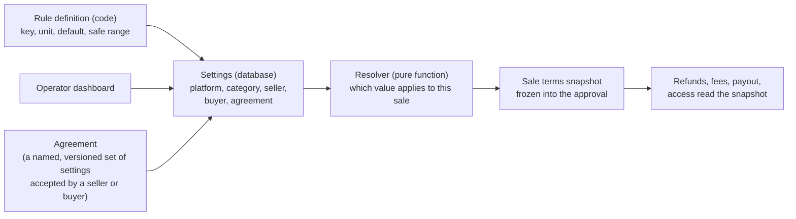

# Configurable business rules: design proposal (4 Nov 2026)

Status: APPROVED DESIGN (D-096, 5 Nov 2026), no code yet. Owner answers are in section 11. Reads with
`docs/business-rules/business-rules-reference.md` (rule ids `BR-*`). Offline only: nothing here calls PayPal, and no
rule described here can switch the PayPal outbound locks.

## 1. The problem in one paragraph

Today every business rule is a constant, a database CHECK or a seed row, and each one holds a single value for the
whole platform. Changing "refunds within one week" to "within three weeks" means a code change and a deploy, and it
silently changes the rule for every past sale that reads the same constant. There is also no way to say "this
publisher has a 14-day refund agreement", "buyers in the education category get 30 days" or "this enterprise buyer
pays a 5 percent fee". The owners want those changes made by an operator from the dashboard, case by case or
category by category, with a record of who changed what and why.

## 2. Mental model

Four ideas carry the design.

1. **A rule is a setting with a default and a safe range.** The default and the hard limits live in code, reviewed
   like any code. The current value lives in the database and an operator can change it inside the safe range.
2. **An agreement is a named set of exceptions.** "Quayside Press, 14-day refunds, 8 percent fee, from 1 Dec" is one
   agreement version that a seller (or buyer) accepts. A category template is the same thing without a party.
3. **Every sale freezes the rules it used.** At approval, the resolved values and where each came from are written
   into the approval snapshot and covered by the content hash, the same way `rule_version` and the price are today.
   Refunds, fees and payout timing read the snapshot, never the live setting. A later change affects new sales only.
4. **Some rules never become settings.** Safety rails stay in code and constraints (section 4).

## 3. Which rules become settings

Tier A: an operator with the authenticator code can change it alone. Tier B (money): needs a second operator or the
owner to approve the change before it takes effect. "Scopes" lists where an override may be set.

| Key                                | Reference                 | Unit                             | Default        | Safe range                                          | Scopes                                       | When buyer and seller settings differ         | Tier | Slice |
| ---------------------------------- | ------------------------- | -------------------------------- | -------------- | --------------------------------------------------- | -------------------------------------------- | --------------------------------------------- | ---- | ----- |
| `refund.request_window`            | BR-REF-13                 | days after access starts         | 7 (D-096)      | 0..30                                               | platform, category, seller, buyer, agreement | the longer one (buyer protection)             | A    | BR-1  |
| `refund.who_decides`               | BR-REF-1                  | enum operator, auto_below_amount | operator       | fixed list                                          | platform, seller                             | seller's setting                              | B    | later |
| `refund.auto_approve_max`          | new                       | minor units                      | 0 (off)        | 0..500                                              | platform, seller                             | the lower one                                 | B    | later |
| `refund.partial_allowed`           | BR-REF-11                 | bool                             | true           |                                                     | platform, seller                             | seller's setting                              | A    | later |
| `refund.paypal_fee_bearer`         | BR-REF-16                 | enum seller, platform, by_cause  | seller         | fixed list                                          | platform, seller, agreement                  | agreement's setting                           | B    | later |
| `fee.platform_rate_bps`            | BR-FEE-1, D-089           | basis points of publisher price  | 1000 (D-089)   | 0..3000                                             | platform, category, seller, buyer, agreement | the most specific agreement; otherwise seller | B    | later |
| `fee.charged_to`                   | D-089                     | enum buyer_on_top, seller_inside | buyer_on_top   | fixed list                                          | platform, agreement                          | agreement's setting                           | B    | later |
| `payout.delay_after_refund_window` | BR-FEE-3, A7              | hours                            | 0              | 0..720                                              | platform, seller, agreement                  | seller's setting                              | B    | later |
| `payout.min_amount`                | BR-SIM-1 (sim only today) | minor units per currency         | 0              | 0..10 000                                           | platform, seller                             | seller's setting                              | B    | later |
| `access.window`                    | BR-ACC-1                  | days                             | 5              | 1..30; raised to `refund.request_window` if shorter | platform, category, seller, offer            | seller's setting                              | A    | BR-1  |
| `price.max_minor`                  | BR-PRC-2                  | minor units                      | 2000           | 1..2000 (until the outbound cap is raised)          | platform, category, seller                   | the lower one                                 | A    | later |
| `basket.max_items`                 | BR-APR-4                  | count                            | 5              | 1..5                                                | platform                                     | platform only                                 | A    | later |
| `mandate.max_days`                 | BR-MAN-2                  | days                             | 90             | 1..90                                               | platform, buyer                              | the lower one                                 | A    | BR-1  |
| `mandate.max_money`                | new                       | minor units                      | none           | 0..100 000                                          | platform, buyer                              | the lower one                                 | B    | later |
| `dispute.access_during`            | BR-DSP-6                  | enum keep, freeze                | keep           | fixed list                                          | platform                                     | platform only                                 | A    | later |
| `case.sla_hours.<kind>`            | BR-OPS-7                  | hours                            | today's values | 1..168                                              | platform                                     | platform only                                 | A    | later |

Two rules link to each other and the resolver enforces it: the access window is raised to at least the refund window
(a buyer must still have the content while a refund is possible), and payout can never be due before the
refund window of that sale has closed (D-089).

## 4. What stays fixed (not settings)

Approval and quote life of 15 minutes (BR-APR-1, -2), single use of approvals, MFA for operator changes, the
outbound PayPal locks and the owner-only approval rows (BR-OPS-5), live mode refused (BR-OPS-6), append-only ledger
and audit, refunds never above the sale (BR-REF-8), one currency per order (BR-PRC-8), idempotency rules, session and
password rules, the webhook event matrix. These protect money or security; changing them stays a reviewed code
change with a decision row.

## 5. Data model (sandbox repository only)

Four new tables in one migration (next free number at merge time), all append-only with the existing trigger style.

- `rule_settings`: `id`, `rule_key` (must exist in the code registry), `scope_kind` (`platform`, `category`,
  `seller`, `buyer`, `agreement`), `scope_id`, `value` (jsonb, validated against the registry), `effective_from`,
  `effective_until` (nullable), `set_by`, `reason` (3 to 200), `decision_ref` (optional D-nnn), `approved_by`
  (required for tier B), `created_at`. A change is a new row; nothing is updated in place.
- `agreements`: `id`, `kind` (`seller`, `buyer`, `category_template`), `party_id` or `category`, `title`.
- `agreement_versions`: `agreement_id`, `version`, `effective_from`, `effective_until`, `terms_text_hash`, the
  settings it carries (rows in `rule_settings` with `scope_kind = 'agreement'`).
- `agreement_acceptances`: who accepted which version, when, how (click, countersigned, seeded demo). This replaces
  and extends today's `publisher_agreements` (BR-PUB-10).

Categories: articles carry `topics` only. Add one `category` per offer, chosen from an operator-managed list, so a
category rule has something to key on. Until then category scope is off.

Code registry: `packages/contracts/src/rules.ts` exports one `RULES_REGISTRY` with each key's type, unit, default,
safe range, allowed scopes, merge strategy and tier. A test fails if a key is missing from the reference document or
if the reference lists a configurable key the registry lacks, so the document cannot drift.

## 6. How a value is chosen (resolver)

`resolveRules(context, settings, now)` is a pure function in a domain package (no clock, no database, injected
`now`), like the veto today. Context: buyer, seller, offer, category, currency, channel (web or agent).

1. Take the platform default from the registry.
2. Apply, in order, the active rows for category, then the seller's agreement, then the buyer's agreement, then a
   party-specific agreement that names both. "Active" means `effective_from <= now < effective_until`.
3. Where the buyer side and the seller side both set a key, apply that key's merge strategy (section 3 column).
4. Clamp check: a value outside the safe range is refused at write time, so the resolver never sees one; the
   resolver still asserts it and fails closed (refuses the quote with `rules_invalid`).
5. Apply the links (raise the access window to the refund window if shorter).
6. Return each value with its source (`platform`, `category:edu`, `agreement:quayside@v2`), and a `terms_digest`.

Worked example. Platform refund window 5 days; category "research" sets 10; Quayside's agreement v2 sets 14; buyer
Acme's agreement sets 30 (above the safe range would be refused at write time, so it is 30 at most). Acme buys a
Quayside research article: seller side 14, buyer side 30, merge "the longer one" gives 30. The link rule then raises
this sale's access window from 5 to 30 days, so the buyer keeps the content while a refund is possible. The
operator screen shows that knock-on effect before the agreement is saved.

## 7. Where the snapshot is used

- **Approval** (`domain/approval`): the resolved values and `terms_digest` go into the approval snapshot and the
  content hash. A rule change after approval therefore makes the approval fail with a hash mismatch, which is
  today's behaviour for a price change (BR-APR-6).
- **Refunds** (`domain/payments/src/refunds.ts`): eligibility reads `refund.request_window` from the sale's snapshot.
  An operator can still refund outside the window with a reason (an override is logged), because a human decision
  must stay possible.
- **Fees** (`domain/ledger`): the fee line uses the snapshot rate. This needs the BR-FEE-1 CHECK replaced by a check
  that the fee equals the snapshot rate applied to the price (D-096 confirms D-089).
- **Payout** (D-089 lanes): due at the later of access end and refund window end, plus the snapshot delay. This
  computes and records a due date only. No payout is sent to PayPal from this repository (no Payouts API, D-004);
  payouts and the micro-ledger stay simulation-only (owner decision, 4 Nov).
- **Screens**: the approval page and the receipt show "Refunds: within N days, decided by ..." and the fee, from the
  snapshot. The seller console shows "Your agreement" read only. The agent API returns the same terms in the offer
  and quote responses, so an agent can tell its user before asking for a cap.

## 8. Operator dashboard

One new area, "Business rules", in the operator console. Every write needs the authenticator code and a reason.

| Screen            | What it does                                                                                                                                                               |
| ----------------- | -------------------------------------------------------------------------------------------------------------------------------------------------------------------------- |
| Platform defaults | Table of every registry key: current value, safe range, last change, who, why. Edit opens a form with the new value, the effective date (now or scheduled) and the reason. |
| Impact preview    | Before saving: how many sellers, buyers and open sales the change touches, and a reminder that past sales keep their terms.                                                |
| Categories        | List categories and their template; edit a category's overrides.                                                                                                           |
| Agreements        | Search a seller or buyer, see the agreement versions, create a new version from a template, schedule it, record acceptance.                                                |
| Pending approvals | Tier B changes waiting for a second operator or the owner; approve or reject with the code. The person who proposed cannot approve.                                        |
| History           | Every change, filterable by rule, scope, person, date. Export as CSV.                                                                                                      |
| Explain a sale    | Enter an order id and see each rule value that applied and where it came from (the snapshot).                                                                              |

The simulation keeps its `/sim/pools` and `/sim/market` controls; they are not part of this.

## 9. Build plan (sandbox, offline, Sonnet builds, Opus specs and verifies)

Scale S = 1, M = 2, L = 4 (money paths count as L).

| Lane  | What                                                                                                                 | Size      |
| ----- | -------------------------------------------------------------------------------------------------------------------- | --------- |
| BR-0  | This PR: reference document and design                                                                               | done      |
| BR-1  | Registry plus pure resolver plus property tests (defaults equal today's values, so behaviour does not change)        | M 2       |
| BR-2  | Migration: settings, agreements, versions, acceptances; append-only triggers; seed platform rows with today's values | L 4       |
| BR-3  | Snapshot into approval and hash; read-back in refunds, access clock                                                  | L 4       |
| BR-4  | Refund window enforced from the snapshot, with operator override and reason; optional buyer refund request           | L 4       |
| BR-5  | Fee rate from the snapshot; replace the zero-fee CHECK (D-096; joins the D-089 fee lane)                             | L 4       |
| BR-6  | Operator screens: defaults, history, explain a sale                                                                  | M 2       |
| BR-7  | Operator screens: agreements, categories, pending approvals (two-person)                                             | M 2       |
| BR-8  | Buyer and seller display of terms; agent API terms field                                                             | S 1       |
| BR-9  | Category field on offers and an operator-managed list                                                                | M 2       |
| BR-10 | Drift test between registry and reference document                                                                   | S 1       |
| Total |                                                                                                                      | 26 points |

Smallest useful slice for the 12 Nov deadline: BR-1, BR-2, BR-3, BR-4, BR-6, BR-10 (17 points, about two sessions
of build plus review). It gives "change the refund window from the dashboard, safely, for new sales only" and a
screen that explains any sale's terms. Agreements, categories and fees follow.

## 10. Risks

- **Too many knobs.** Each setting is a case the tests must cover. Start with the five keys the owners actually want
  to vary (refund window, fee rate, access window, payout delay, mandate maximum).
- **Hash change.** Adding the terms digest to the approval hash changes every approval fixture and golden file. Plan
  one lane for it; do not mix with other work.
- **Fee CHECK.** BR-FEE-1 is a deliberate safety constraint today. Removing it is a money change and needs D-089 to be
  confirmed and the fee lane reviewed as L.
- **Legal text.** The legal copy states fixed terms ("No commission", 5 days). It must read from the snapshot or say
  "your terms are shown at checkout"; counsel before a real launch.
- **Agreements are contracts.** The tool records what was agreed; it does not make the terms lawful. Counsel before
  launch.

## 11. Owner decisions (D-096, 5 Nov 2026)

1. Default refund window 7 days, safe range 0 to 30. Access window raised to at least the refund window.
2. D-089 fee confirmed (10 percent on top, buyer pays).
3. Merge: buyer-protection rules take the more generous value; money rules take the most specific agreement.
4. Two-person approval for anything that moves money: fee, payout, refund decider, auto-approve.
5. New sales only; a buyer-favourable change may be applied to open sales by a tier B change.
6. Build the 17-point slice first, then agreements, categories and fees.
