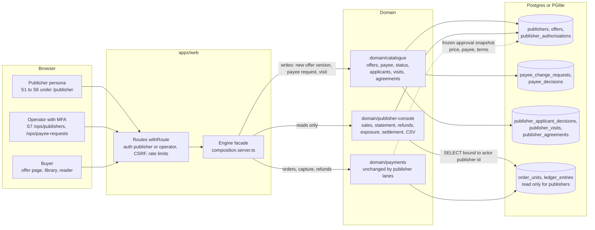

# Architecture and design addendum (21 Oct to 31 Oct 2026)

This file records the architecture and design changes made after the design snapshot of 21 Oct. It does not edit that snapshot.
`docs/design/README.md` says `architecture.md`, `mvp-plan.md` and `nfr.md` are read-only copies and that later changes go
through specs and the decision log, not by editing those files. This addendum follows that rule: the three snapshot files are
unchanged, and every change below points to the spec, decision row or code that makes it.

Written on 31 Oct 2026 (lane DOCS-C2, docs only) against `origin/main` at `7869114`. No PayPal call was made, no env file was read
and no credential was held. The requirement status of every item is in `docs/REQUIREMENTS-REGISTER.md`. Simulation, fixture and
dry run results prove the modelled cases only, not PayPal compatibility.

## 1. What changed, in one list

1. A publisher side: three publisher personas, nine pages (seven under `/publisher`, `/ops/publishers` and
   `/ops/payee-requests`), five new tables over migrations 0012 to 0015 (section 2).
2. Two payment shape changes for MVP-D: publishers may share one payee by an explicit flag (0010) and one PayPal order per
   publisher (0011) (section 2).
3. New engine surfaces in `apps/web/composition.server.ts` (section 3).
4. A skin system and a reader view (section 4).
5. A controlled exception for one AI host, decision D-067 (section 5).
6. An offline judge service and optional secrets in the Google Cloud kit (section 6).
7. Settlement modes derived from stored data, a privacy script, a seeded agreement record (sections 7 to 9).
8. Hosting moved to Google Cloud Run with Cloud SQL Postgres (D-049), with a Postgres adapter (PG-1, PG-2, D-050).

## 2. Publisher side data model

All six migrations are forward only and live in `packages/db/migrations/common/`. None changes the ledger rows, the money
operations or the five PayPal locks.

| Migration                         | Lane   | One line                                                                                                                                    |
| --------------------------------- | ------ | ------------------------------------------------------------------------------------------------------------------------------------------- |
| `0010_publisher_payee_shared.sql` | DP-1   | Adds `publishers.payee_shared`; drops the plain UNIQUE on `paypal_merchant_id` and keeps a unique index over unflagged rows, plus a guard trigger (D-041) |
| `0011_provider_order_state.sql`   | DP-2a  | One PayPal order per publisher: `provider_orders` gains position, `po_ref`, `publisher_id`, `state`, `first_approved_at`; operations gain `provider_order_ref` |
| `0012_publisher_side.sql`         | PUB-A1 | `publishers.status` (applied, active, suspended), append-only `payee_change_requests` and `payee_decisions`, `publisher_authorisations.attestation_version`, `articles.created_by` and the `articles_content_frozen` trigger |
| `0013_publisher_applicants.sql`   | PUB-E2 | Append-only `publisher_applicant_decisions`, at most one per publisher; a rejection is a row and the publisher stays `applied` |
| `0014_publisher_visits.sql`       | PUB-E1 | `publisher_visits`, one row per publisher holding the "since your last visit" cursor; written with the injected clock, no default          |
| `0015_publisher_agreements.sql`   | AGREE-1 | Append-only `publisher_agreements`, one per publisher and terms version; written only by the boot seed (method `seeded_demo`)              |

Supabase policies for the new tables are a listed follow-up in each migration header and are not written (Supabase is unused,
D-049; traceability row P-5M5).

New domain code:

- `domain/catalogue`: offer writes (`listOwnOffers`, `getOwnOffer`, `createOffer`, `reviseOffer`, `withdrawOffer`,
  `checkPrice`), payee requests and decisions (`payee.ts`), publisher status (`status.ts`), applicants (`applicants.ts`),
  visits (`visits.ts`), agreements (`agreements.ts`), demo prices as audited revisions (`demo-prices.ts`).
- `domain/publisher-console`, a new pure read-model package: `salesFor`, `statementFor`, `refundsFor`, `publisherExposure`,
  since-last-visit counts, CSV and totals, and the settlement modes. Every query binds the actor's publisher id and nothing else
  (`publisher-console.adversarial.test.ts`).

The dashed line is the approval snapshot. A buyer's approval freezes the offer version, price and payee for its window, so a
later revise or withdraw writes a new offer version and does not change an approval already given (PUB-B, A-08). Section 10
names the gap this leaves.

## 3. New engine surfaces (`apps/web/composition.server.ts`)

Pages and routes reach the engine only through the `Engine` interface in this file (D-016, CLAUDE.md S2). Members added since
21 Oct, by area:

| Area                 | Members                                                                                                     | Lanes                     |
| -------------------- | ----------------------------------------------------------------------------------------------------------- | ------------------------- |
| Publisher reads      | `publisherHome`, `publisherAgreement`, `publisherSales`, `publisherStatement`, `publisherRefunds`, `publisherSince`, `publisherExport` | PUB-A1, PUB-C, PUB-E1, AGREE-1 |
| Publisher writes     | `offers.list`, `offers.get`, `offers.offerable`, `offers.create`, `offers.revise`, `offers.withdraw`; `payee.view`, `payee.request` | PUB-B, PUB-E1, PUB-A2 |
| Operator             | `payee.openRequests`, `payee.decide`; `opsPublishers.list`, `opsPublishers.setStatus`; `opsApplicants.list`, `add`, `decide`; `opsAgreements.list`; `evalsSummary` | PUB-A2, PUB-D, PUB-E2, AGREE-1, AI-B |
| Buyer                | `readerView`, `buyerReceipt`, `unpaidOrderRef`, `checkoutSteps`, `packWindowMinutes`; `payments` facade with cancel and resume | READER-A, L1, GATEFIX2, DP-5, ORDER-A |
| Sign in and AI       | `signOut` (new). `aiEnabled`, `parseNeed` and `discover` existed on 22 Oct; they now use the model chosen by config | FIX-FLOW, AI-A            |

Each publisher read returns `null` for an actor that is not a publisher. The publisher id always comes from the session, never
from the request.

## 4. Skin system and reader view

- Skins (SKIN-A, SKIN-B1, SKIN-B, DV-38 to DV-43). `<html data-skin="market">` or `"harbour"` is rendered on the server from
  the `um_skin` cookie, so the first paint is right and nothing flashes. Any value other than exactly `harbour` renders Bright
  Market, the default (`apps/web/src/lib/skin.ts`). The cookie holds only the skin name: `Path=/`, 180 days, `SameSite=Lax`,
  `Secure`, `HttpOnly`. The Appearance control in the footer sets it through one route. Each skin is one fixed palette in
  `globals.css`; there is no automatic dark mode (assumption 5). No inline style attribute remains, so the strict CSP (no
  `style-src` exception) holds. Motion: counts may animate, amounts never; the approval step stays still; reduced motion is
  honoured.
- Reader view (READER-A, DV-44). `/library/[entitlement]/read` shows a bought article as text inside the app with the time-left
  meter. It uses the same access evidence, rate limits and window rules as the content route (`reader.state.test.ts`,
  `reader.adversarial.test.ts`).

## 5. AI adapter and its five safeguards

Decision D-067 amends architecture section 1 ("no Claude API ever"), zone Z4 and rule S2 for one host only. The spec
(`docs/specs/ai-a-model-adapter.md`) does not number its controls; this addendum groups them as five safeguards:

1. Off by default. `UMS_AI_ADAPTER=scripted` is the default; the Claude adapter is used only when the value is `claude` and a
   key is set. Boot refuses `claude` without a key, and the deploy kit skips the adapter when no key is stored (R-DEP-2).
2. One fixed egress. `packages/transport/src/model-https.ts` holds one host constant, one path (`/v1/messages`), POST only, no
   redirects, a 64 KB request cap, a 256 KB response cap and a 20 s deadline. Any other host, path or method is refused before a
   socket opens. It does not import the PayPal wire, the sandbox transport or the approval minter.
3. Spend caps. The worst-case cost is charged before each call; the call is refused at USD 2.00 since 00:00 UTC or USD 20.00 in
   total, and input over 8000 estimated tokens is not sent (`claude.caps.state.test.ts`). The price constants come from a cached
   reference dated 6 Oct and the owner re-checks them (assumption 8).
4. Fallback. Any error, refusal, non-200, timeout, cap or unparseable output makes the scripted model answer instead, so the
   buyer sees no difference in safety.
5. Narrow purpose and clean output. Only `brief_parse` and `pack_compose`; no tools are sent; the model sees no PayPal data;
   every output passes `sanitiseModelOutput`, which strips links, addresses, prices and control characters from reasons (AI-H);
   the served model is recorded per brief; discovery has a per IP limit.

No real AI call has been made. The key is human only (R-AI-8).

## 6. Offline judge service, optional secrets and judge passcode

- Optional secrets (INFRA-A). `infra/gcp/deploy.sh` maps `UMS_PUBLISHER_PASSCODE_HASH`, `UMS_JUDGE_PASSCODE_HASH`,
  `UMS_OFFER_MAX_MINOR`, `UMS_AI_ADAPTER` and `UMS_ANTHROPIC_API_KEY` only when each has an enabled version in Secret Manager.
  An absent one leaves its feature off and never fails the deploy. `service.yaml` is unchanged, so `UMS_PAYPAL_CONNECT` is `off`
  after every deploy.
- Offline judge service (INFRA-A, HARD-OFFLINE). A second Cloud Run service, `unitmarket-offline`, is described by
  `infra/gcp/service-offline.yaml` and deployed by `deploy-offline.sh`. Its fixed values: `UMS_MODE=offline`,
  `UMS_PAYPAL_CONNECT=off`, `UMS_DB=pglite-memory`, `UMS_AI_ADAPTER=scripted`, `UMS_TRUSTED_PROXIES=1`. It has no PayPal secret
  and no database; the Dry run label comes from the stored environment, not from a string. It maps five own secrets
  (`UMS_OFFLINE_SESSION_SECRET`, `UMS_OFFLINE_APPROVAL_SECRET`, `UMS_OFFLINE_LINK_SECRET`, `UMS_OFFLINE_DEMO_PASSCODE_HASH`,
  `UMS_OFFLINE_JUDGE_PASSCODE_HASH`). The judge hash reaches the app as `UMS_JUDGE_PASSCODE_HASH`; the demo hash there is a
  separate passcode only the owners keep. Prepared, never deployed by an agent.
- Judge passcode (JUDGE-A). When `UMS_JUDGE_PASSCODE_HASH` is set it verifies for Buyer A and Buyer B only, never the operator
  or a publisher. Boot refuses (`equal_secrets`) when it equals the demo or the publisher hash.

## 7. Settlement modes

`domain/publisher-console/src/settlement.ts` (lane SETTLE-A, no spec file) derives one of five modes from stored data, never
from a guess: `dryrun`, `owner_account`, `direct`, `not_set`, `mixed`. The statement groups its blocks by currency and stored
environment and derives the mode per block from the payee stored on each unit (`order_units.payee_merchant_id`), not from the
publisher's current payee. A block with more than one distinct payee is `mixed`, never `direct` (`statement.state.test.ts`). S1,
S5, S6 and S7 all print the sentence from this one module. Today every sandbox sale reads `owner_account`: "In this sandbox demo
every payment is received in the UnitMarket team's one test account. Nothing is paid out to the publisher." (D-041). The
`direct` mode exists in code; no sale has used it, because paying Quayside directly is not built (R-PUB-3, R-PUB-4).

## 8. Privacy script

`scripts/privacy.mjs` (HARD-PRIVACY, PRIV-3 and PRIV-4) runs `export <buyer_id>` (one JSON document of that buyer's rows) and
`delete <buyer_id> --operator <id> --reason <text>`, which pseudonymises the buyer after the buyer id is typed back. Ledger,
receipts and approvals keep their ids, so the money evidence stays. Both refuse before the database opens without a terminal, in
CI and in an AI session. It never connects to PayPal and reads no env file itself; the owner runs it with the
`env -u DATABASE_URL -u UMS_DB -u UMS_PAYPAL_CONNECT` prefix (D-059).

## 9. Agreement record

`publisher_agreements` (0015) holds one row per demo publisher and terms version: `terms_version`, `accepted_at`,
`accepted_by_label` (a demo label, no personal data), method `seeded_demo`. Only the boot seed writes it (`seedAgreements`);
there is no click-through and no write route. S1 shows it read only with a link to `/legal/publisher-terms`; S7 shows it per
publisher and flags "terms version changed, not re-accepted" when the stored version differs from the current one. The terms
text itself is a draft for owner approval (LEGAL-B).

## 10. Known gap: the approval window after a suspend or withdraw

Assumption 32 and the publisher questions memo (Q26). `requestApproval` re-reads the offer and the publisher for a new approval,
and suspension expires the publisher's open quotes. But `placeOrder` works only from the frozen snapshot, so an approval made
before a publisher is suspended or an offer is withdrawn can still be placed inside its 15 minute window. A KNOWN GAP test pins it
(`apps/web/src/ops-publishers.state.test.ts`, "an approval made before the suspension can still be placed"). Closing it is a
money path lane in `domain/approval` or `domain/payments` with an Opus review after the owners decide, because it changes the
A-08 promise that an approval keeps the price and terms the buyer saw. Not checked by this lane: whether the same applies to a
pack approval, whose window is `PACK_APPROVAL_WINDOW_MS = 3_600_000` (60 minutes) in `composition.server.ts`.

## 11. What the five PayPal locks still guarantee

None of the work above widened a lock. An outbound PayPal call still needs all five at the time of the call
(`docs/design/mvpb-unseal-and-mvpc-offline.md` section 2): L1 `UMS_MODE=sandbox`; L2 `UMS_PAYPAL_CONNECT=on`; L3 an active
`outbound_approvals` row whose scope, operations, amount cap and daily budget cover the call, inserted only by
`pnpm safety:approve` at a terminal; L4 the `paypal_outbound` kill switch on; L5 sandbox credentials present with no proxy,
trust-store or loader override. Under them sit the host constant, the egress guard, the scope operation list, the amount binding
and the no-live-host checks.

What they guarantee, and what they do not:

- The publisher lanes add no PayPal operation. `domain/payments`, `packages/paypal` and `packages/transport/src/sandbox.ts` were
  not changed by them (traceability row P-5D3).
- The AI egress is a separate file with its own host and cannot carry a PayPal operation (section 5). It is not behind the five
  locks; its own safeguards apply.
- The offline judge service cannot reach PayPal: it is offline mode with the connection off and no PayPal secret.
- A deploy leaves the connection off.
- Not guaranteed by the locks: which payee a create body names. The approval row has no payee field and the `mvp_c_refunds`
  scope allows a payee (traceability MT-5). Today only data and process stop a named payee: both selling publishers hold the
  owner's id with `payee_shared`, payee verification is refused outside a dry run (assumption 3), and no owner set-payee command
  is merged. An approval scope that names one payee is not built (R-PUB-4, DV-30).
