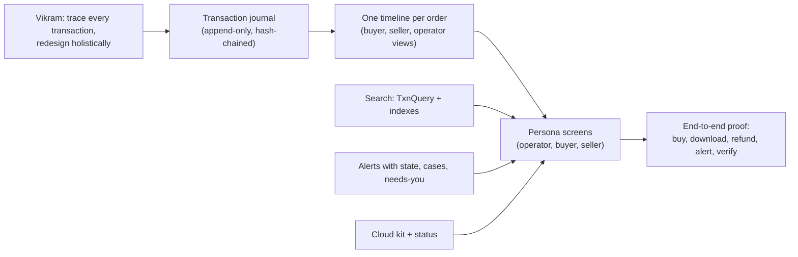
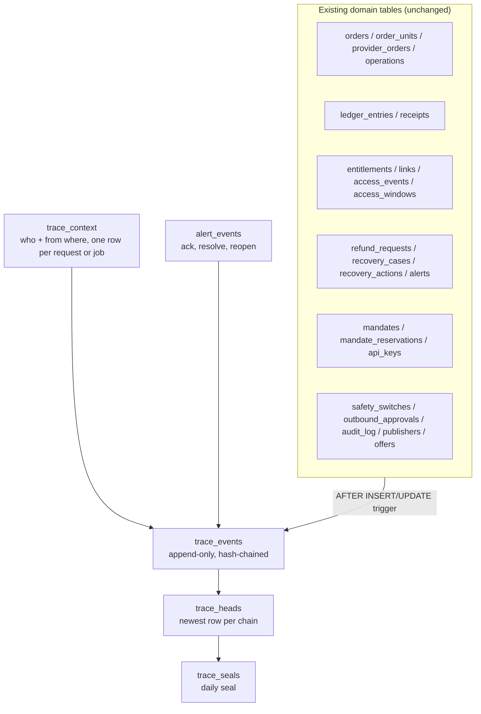
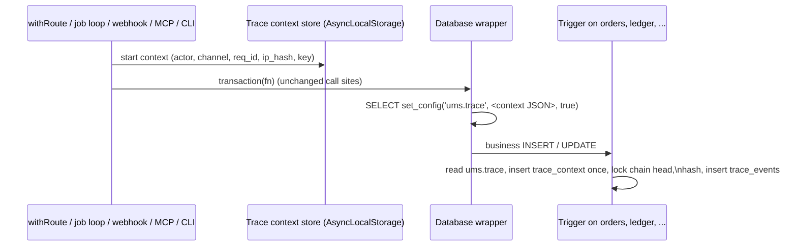
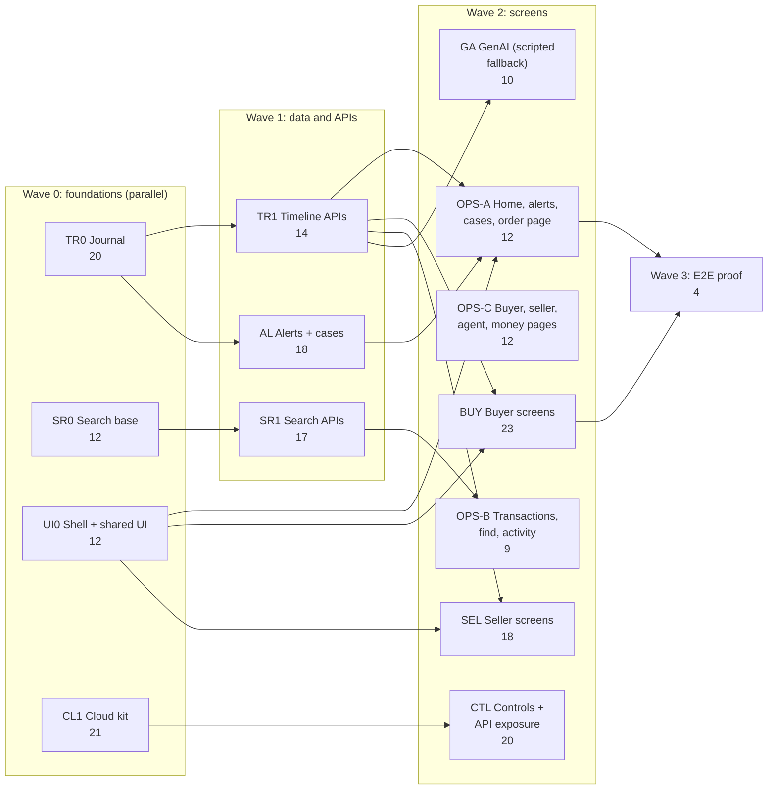
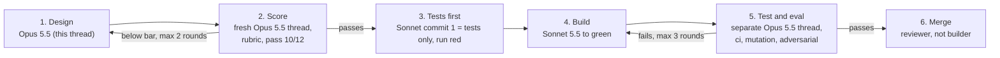

# Integrated plan: traceability, persona screens, search, alerts and cloud ops

Owner: Vikram. Written 4 Nov 2026, 23:30 UTC, by the lead architect thread (Opus 5.5). **Approved by Vikram 4 Nov 2026, 23:23 UTC: V1 to V9 as written.** Every lane in this plan runs offline (dry-run transport); the narrow sandbox lift of the PayPal rule does not change any lane. This is the one document to read for the next build. It replaces the separate build plans of five threads (persona dashboards, drill-down audit, transaction search and GenAI, cloud start and stop, and this thread's traceability design). Its status table (section 6) is updated as each lane merges.

Sources read: `unitmarket-sandbox` at `4b9af11` (migrations 0001 to 0021, `packages/obs/src/audit.ts`, `packages/security/src/route.ts`, `packages/db/src/export-sql.ts`, `domain/payments/src/alerts.ts`); `/mnt/project-files/operator-ux/recommendation.md` and its three HTML pages; `/mnt/project-files/ux-audit/ux-audit-report.md`; `/mnt/project-files/search-and-genai/transaction-search-and-genai.md`; `/mnt/project-files/cloud-ops/cloud-start-stop-plan.md`; `/mnt/project-files/api-design/mvp1-build-plan.md`.

## 1. The answer first

1. **Traceability gets one new building block: a transaction journal.** Every change to a money, delivery, agent-cap or control row is written, by the database itself, to one append-only, hash-chained table. Each journal row says what changed (old and new value), who did it, when, and from where. One query then gives the whole life of an order, from the quote to the last download and any refund.
2. **We do not rewrite the app as event-sourced.** The state tables stay the source of truth for decisions, and the journal records every change to them. That gives the audit benefits of event sourcing (full history, state at any past moment, who and where) without touching the 109 transaction sites and about 90 update statements that 9,246 tests already prove.
3. **Tamper evidence in three layers:** the existing append-only triggers stop accidental edits; a hash chain per order detects any edit, delete or reorder, even by someone who switches the triggers off; a daily seal fixes the state of every chain at midnight. `pnpm trace:verify` and an Operations tile check all three.
4. **All five threads' screens use the journal.** Every alert, list row, case, sale and receipt links to one timeline page. Buyers see their own orders, sellers see their sales without the buyer's identity, operators see everything, including where each action came from.
5. **Size: 16 lanes, 101 items, 223 points.** A "must" cut of **173 points** fits before 12 Nov at the MVP 1 pace (80 points in about 18 hours, so roughly 40 hours of pipelined work), leaving two days for the video. That is aggressive; section 10 gives the order in which to drop work if the pace slips. A "should" cut adds 50 points if the pace holds. 69 points move after the deadline, into the backlog.
6. **Nine decisions are needed from you before building starts** (section 9). The first one, approving the journal design, unblocks Wave 0.

## 2. Plain terms

| Word | Meaning here |
|---|---|
| **Transaction journal** (the "trace") | One append-only table, `trace_events`, with one row per change to a tracked row: an order moving to paid, a ledger line, a download, a refund state change, a cap being used, a switch turned off. |
| **Event sourcing** | A design where the event list is the only truth and every current state is rebuilt from it. We are **not** doing this; see 3.2. |
| **Trigger** | Code inside the database that runs on every insert or update of a table. The sandbox already uses triggers to make the ledger append-only. |
| **Hash chain** | Each journal row stores a SHA-256 fingerprint of itself plus the fingerprint of the row before it. Change one old row and every fingerprint after it stops matching. Git and certificate transparency logs work this way. |
| **Seal** | Once a day, one fingerprint over the newest row of every chain. It fixes "this is what the journal looked like at midnight". |
| **Trace context** | Who is acting and from where, captured once per web request, API call, agent call, job pass, webhook or command line run. |
| **Wave, lane, item, point** | As in MVP 1: waves run in order, lanes in a wave run in parallel, S = 1, M = 2, L = 4 (L for money or security). |

## 3. Traceability architecture

### 3.1 What the sandbox already has, and what is missing

The drill-down audit is right that about 20 tables already hold the steps of a purchase, and that the loss today is mostly in the screens. Reading the migrations shows four gaps a screen cannot fix:

| Already there | Gap | Example |
|---|---|---|
| Append-only tables with triggers: `ledger_entries`, `receipts`, `provider_calls`, `access_events`, `audit_log`, `recovery_actions`, `outbound_approvals`, `event_outbox`, `fx_rates`, publisher decision tables | **G1. State changes overwrite history.** `orders.status`, `order_units.status`, `refund_requests.state`, `operations.state`, `entitlements.money_state` and `access_state`, `mandates.spent_minor`, `mandate_reservations.state`, `recovery_cases.state`, `safety_switches.on` and 6 more are updated in place. The previous value and the time it changed are lost. | You can see an order is `paid`; you cannot see that it was `unresolved` for 12 minutes first. |
| `audit_log` records operator actions with actor kind and id | **G2. "Who" is missing on almost every row**, and "from where" on all of them. The route wrapper already computes a request id and a keyed hash of the client IP (`packages/security/src/route.ts:333,369`), then drops both. | A refund state change does not say whether the reconciler job, the operator or a PayPal webhook moved it. |
| `guardProblems` detects a switched-off trigger | **G3. No tamper evidence.** A database owner can disable a trigger, edit a ledger row and re-enable it; nothing would show. | Required for a financial app judged on trust. |
| `alerts` rows store order, unit and reason | **G4. Alerts have no state** (open, acknowledged, resolved) and no record of who handled them. | The audit's finding UX-01. |

### 3.2 Decision: a journal next to the state tables, not event sourcing

| Option | What it means | Verdict |
|---|---|---|
| A. Full event sourcing | Events are the only truth; orders, units, refunds and caps are rebuilt from events | **No.** It rewrites the proven money core (109 transaction sites, about 90 updates), moves guards that the database enforces today (ledger guard, approval guard, one open order per buyer) into projection code, and cannot land in 7 days. Its unique gain, rebuilding projections, is not something we need. |
| B. Per-table history tables | `order_status_history`, `refund_history` and 13 more | **No.** 15 new tables and triggers, a timeline that unions 15 reads, and no single chain to verify. |
| C. **One journal fed by triggers** (recommended) | State tables unchanged; one `trace_events` table gets a row for every tracked insert and update, written by a trigger | **Yes.** One capture point that no code path can skip, including future code. One timeline query. One chain to verify. Same pattern the sandbox already uses for its guards. |
| D. Journal written by app code | Each domain function appends its own trace row | **No.** About 90 call sites to edit, and any missed or future site leaves a silent gap. |

### 3.3 Table split

Business detail stays where it is today. The journal records that something happened and links to the row that holds the detail.

| Table | One row per | Key columns | Append-only | Retention (sandbox / production policy) |
|---|---|---|---|---|
| `trace_context` (new) | Web request, API call, agent (MCP) call, job pass, PayPal webhook, command line run | `id`, `channel` (web, api, mcp, job, webhook, cli, seed), `req_id`, `ip_hash` (keyed hash, never the raw address), `ua_family` (browser, curl, sdk, other), `session_ref` (hash), `api_key_id`, `job`, `started_at` | Yes | Until 15 Jan 2027 / 13 months, then pruned (it holds the "from where" data, which is personal data under GDPR rules) |
| `trace_events` (new) | Tracked insert or update | `chain_key`, `seq` (primary key together), `prev_hash`, `row_hash`, `occurred_at` (the app clock value written to the row), `ctx_id`, `actor_kind` (buyer, seller, operator, agent, system, paypal, unattributed), `actor_id`, `on_behalf_of` (the buyer an agent acts for), `mandate_id`, `mfa` (operator), `event_type` (for example `order.status`, `ledger.sale`, `access.download_completed`, `refund.state`, `mandate.reserved`, `switch.changed`), `source_table`, `source_id`, subject keys (`order_id`, `unit_id`, `entitlement_id`, `refund_request_id`, `case_id`, `publisher_id`, `buyer_id`), `body` (changed columns old and new, amounts, a SHA-256 of the source row) | Yes, and chained | Until 15 Jan 2027 / 7 years, matching financial records (UNVERIFIED legal figure: UK keeps 6 years, US 7; needs a legal check before production) |
| `trace_heads` (new) | Chain | `chain_key`, `seq`, `head_hash` | No: it is the newest-row pointer and the lock target. Its truth is recomputable from `trace_events`. | Same as the journal |
| `trace_seals` (new) | Day | `day` (unique), `at`, `heads` (every chain's head, ordered by `chain_key`), `root_hash`, `prev_root_hash`; written by `trace_seal(day, at)` defined in TR0 | Yes, and chained | Same as the journal |
| `alert_events` (new) | Alert state change | `alert_id`, `kind` (acknowledged, resolved, auto_resolved, reopened, note), `note`, `at` (actor comes from the context) | Yes, and journaled | Same as alerts |

Who, when, where, in one place:

- **Who:** `actor_kind`, `actor_id`; for agents also `on_behalf_of` (the buyer) and `mandate_id` (the cap); for operators the `mfa` flag; for PayPal webhooks `actor_kind = paypal` with the transmission id in the body.
- **When:** `occurred_at` is the time the app wrote on the row, from the injected clock (the sandbox forbids `now()` in SQL), plus `seq` for exact order within an order.
- **From where:** the context row: channel, request id, keyed IP hash, browser or tool family, session, API key or job name. Stored apart from the chain so it can be pruned after 13 months without breaking the chain. Who and when are inside the chain; from where is linked by `ctx_id`.

No names, emails or raw IP addresses are stored in the journal. Body values are ids, states, amounts and hashes only. A canary test enforces this, the same way the existing logger redaction is tested.

### 3.4 How the actor reaches the database

1. The five entry points (route wrapper, job loop, PayPal webhook receiver, MCP dispatcher, command line tools) open a trace context. They already know the actor, and the route wrapper already computes `req_id` and `ip_hash`.
2. A thin wrapper around `Database.transaction` (in `packages/db`, given a getter so it imports nothing new) sets one transaction-local setting at the start of each transaction. **None of the 109 transaction call sites change.**
3. The trigger reads that setting. If it is missing, the row is still journaled, with `actor_kind = unattributed`. A new invariant fails the end-to-end and journey tests if any unattributed row appears, so a forgotten entry point shows up in CI, not in production.

### 3.5 Chains, hashing and verification

- **One chain per order** (`ord:<order_id>`). Rows without an order chain on their own entity: `mdt:<mandate>`, `pub:<publisher>`, `buy:<buyer>`, `key:<api_key>`, and `plat` for switches, approvals and platform operator actions.
- **Hash:** `row_hash = sha256(prev_hash | chain_key | seq | occurred_at | actor | event_type | body)`, using the built-in `sha256()` of Postgres 11+ and PGlite. No extension, so migration rule PORT-1 holds.
- **Locking:** the trigger locks the chain's head row. Writes to one order are already serialised by row locks, so this adds no new contention across orders. A real-Postgres race test covers two writers on one chain and the agent purchase path that touches a cap chain and an order chain.
- **Source-row digests:** an insert into an append-only table (a ledger line, a receipt) stores the SHA-256 of that row in its journal body. Editing the ledger row with triggers off then breaks verification too.
- **Verifier:** `pnpm trace:verify` (and `GET /api/v1/ops/trace/verify`) recomputes every chain, every seal and every source digest, and reports the first broken row per chain. It joins the existing `checkInvariants` and `guardProblems` checks on the Operations invariants tile.
- **Seal:** the job loop writes one `trace_seals` row per UTC day and logs its root hash. Copying the root to a locked Google Cloud Storage bucket (retention lock), which makes the seal itself hard to rewrite, needs a cloud resource and your decision; it is in the "later" list.
- **Existing data:** a one-time backfill writes an `imported` row per existing order, refund, cap and switch, marked `actor_kind = unattributed`, so old orders still have a timeline.

### 3.6 Coverage: what each stage of a transaction records

| Stage | Source rows (detail) | Journal events | Who it usually is |
|---|---|---|---|
| Quote and approval | `approvals` (insert, `used_at`) | `approval.created`, `approval.used` | Buyer (web) or agent (mcp) |
| Order | `orders`, `provider_orders`, `order_units` | `order.created`, `order.status`, `unit.status`, `provider_order.state` | Buyer, agent, system |
| Agent cap use | `mandates`, `mandate_reservations` | `mandate.created`, `mandate.reserved`, `mandate.committed`, `mandate.released`, `mandate.exhausted`, `mandate.revoked` | Agent, buyer, system |
| Payment and capture | `operations`, `provider_calls`, `webhook_events` | `operation.state`, `provider.call` (outcome, PayPal debug id), `webhook.received`, `webhook.applied` | System (job), PayPal (webhook) |
| Money | `ledger_entries`, `receipts` | `ledger.sale`, `ledger.paypal_fee`, `ledger.refund`, `ledger.reversal`, `receipt.issued` | System |
| Delivery and download | `entitlements`, `access_windows`, `links`, `access_events` | `entitlement.state`, `window.state`, `link.issued`, `access.download_completed`, `access.reader_rendered`, `access.revoked` | Buyer, system |
| Refund | `refund_requests`, `ledger_entries` | `refund.requested`, `refund.state` | Operator (MFA), system |
| Reversal and cases (dispute stand-in) | `order_units`, `recovery_cases`, `recovery_actions` | `unit.status` to `reversed`, `case.opened`, `case.state`, `case.action` | PayPal, system, operator |
| Alerts | `alerts`, `alert_events` | `alert.raised`, `alert.acknowledged`, `alert.resolved`, `alert.auto_resolved` | System, operator |
| Operator and control actions | `safety_switches`, `outbound_approvals`, `audit_log`, publisher and payee decision tables, `api_keys` | `switch.changed`, `approval.outbound`, `operator.action`, `payee.decided`, `key.issued`, `key.revoked` | Operator, owner (CLI) |
| Disputes | none today (PayPal disputes are MVP 3) | `dispute.*` reserved; today the evidence pack (section 3.7) is the answer to a chargeback | |

Cloud start and stop happen in Google Cloud, outside the database. Google's own Admin Activity audit logs already record who changed Cloud Run or Cloud SQL (kept 400 days); the Services panel links to them.

### 3.7 What the journal gives each persona

- **Operator:** the order page timeline (every step, actor, channel, time, links to the ledger and provider call), an Activity log across all chains filtered by actor, channel, event type and date (this replaces the "audit log of control changes" item and the switch-history finding), and the verify tile.
- **Buyer:** their own order timeline in plain words: approved, paid, ready, downloaded, refunded, with the agent and cap when an agent bought.
- **Seller:** the sale timeline for their own units, without buyer identity: paid, delivered, downloaded or read, refunded, with "person" or "agent".
- **Evidence pack:** one click on a unit exports its timeline, source rows and chain proof as JSON plus a readable page. It answers "prove the buyer got the article" for a chargeback, and it is a strong judging moment.
- **GenAI "explain this problem order":** reads the same redacted timeline, so the search thread's separate timeline builder (G2a, 4 points) is no longer needed.

### 3.8 Costs and risks of the journal

| Risk | Handling |
|---|---|
| Write cost: 1 to 3 extra rows per change | Budget in the spec: offline order flow p95 grows under 5 ms on PGlite; full ci time grows under 10 percent. Measured in TR0. |
| Deadlock between an order chain and a cap chain | Fixed lock order (cap chain, then order chain); real-Postgres race test; the existing serialization retry covers a residual one. |
| A missed entry point leaves rows unattributed | Invariant fails the e2e and journey suites when any unattributed row appears after the seed. |
| Trigger logic in SQL is harder to test | Every tracked table has a state test that changes the row and asserts the journal row; a golden test lists the tracked tables and columns. |
| Hosted database already holds rows | Backfill writes `imported` rows; idempotent; tested on an exported copy. |
| Someone with database owner rights rewrites the whole chain consistently | The daily seal catches it from the next day; the GCS retention lock (later) closes it fully. Stated honestly in the demo. |

## 4. How the five threads fold together

Each thread's items were mapped to one owner lane. Shared blocks are built once.

| Shared block | Was counted in | Built once in |
|---|---|---|
| Console shell (tabs, section tabs, breadcrumb, environment pill from data, `/` slot) | Operator 1-5, buyer 1, seller 1 | UI0 |
| Per-order timeline | Operator 9, buyer 8, seller 5, UX-02, search G2a | TR1 (data and API) plus one shared component in UI0 |
| Filter bar and quick-find | Operator 5 and 10, buyer 3, seller 4, search T3.1, T3.5 | SR0 (contract), SR1 (APIs), OPS-B (component) |
| Error-to-fix table (12 alert kinds plus gate `blocked_by`) | Operator 8, UX-01 | AL |
| Alert state | Operator 7, UX-01 | AL (`alert_events`) |
| Case queue | Operator 7b, UX-03 | AL (API), OPS-A (screens) |
| Audit log of control changes, switch history | Operator 19, UX-21 | TR1 (Activity log, from the journal) |
| Services panel | Operator 18, cloud items 12-13 | CTL |
| Agent oversight and keys | Operator 13, UX-09, UX-19, buyer 5 and 7, API guide E5 and E6 | OPS-C (operator), BUY (buyer) |
| API exposure registry | API guide thread E1 to E4 (E7 partner owner kind deferred) | CTL |
| One display reference with copy; one status dictionary | UX-17, UX-18, search F4 | UI0 |

Reconciliations:

- **Migration 0023.** The search thread claimed 0023 for its indexes. Planned order is: 0023 trace journal (TR0), 0024 search indexes and `txn_rows` view (SR0), 0025 alert events (AL). As before, each lane takes the next free number on `main` at merge time; 0022 stays reserved for POB-I1.
- **`pg_trgm` is dropped from the deadline scope.** It is a Postgres extension, which breaks migration rule PORT-1 and needs extra loading code in PGlite. At thousands of rows a plain case-insensitive match answers in milliseconds. Typo-tolerant search moves to "later".
- **Search G2a (timeline builder) is removed;** GenAI explain uses the TR1 timeline.
- **Buyer self-serve refunds (UX-23)** stay in MVP 3 with disputes, as the audit recommended.
- **Simulation screens** (operator item 20, search T4.x, UX-15, 16, 27, 28, 32) form one optional lane after the sandbox, which is the judged entry.
- **PayPal gateway helper and the `ums-control` buttons** (cloud items 14-21) stay out of the deadline scope: the first wraps PayPal sitting steps under the project's hard rule, the second adds a cloud permission. Both need your separate go.

## 5. Waves and lanes

Cut marks: **M** = must, before 12 Nov. **S** = should, before 12 Nov if the pace holds. **L** = later, after the deadline. Sandbox unless marked SIM.

### Wave 0

**TR0. Transaction journal (20 points, M, Sonnet high).** Spec `int-tr0-journal.md`.

| Id | Item | Size | Pts | Cut |
|---|---|---|---|---|
| TR0.1 | Contracts: `TraceContext`, `TraceEvent`, event-type catalogue (golden list of tracked tables, columns and event types) | M | 2 | M |
| TR0.2 | Context capture: AsyncLocalStorage store; transaction wrapper that sets `ums.trace`; wired into `withRoute`, job loop, webhook receiver, MCP dispatch, CLI and seed | L | 4 | M |
| TR0.3 | Migration: `trace_context`, `trace_events`, `trace_heads`, `trace_seals`; capture function; triggers on the tracked tables; append-only guards | L | 4 | M |
| TR0.4 | Hash chain, source-row digests, verifier (SQL and TypeScript), `pnpm trace:verify`, joined to `checkInvariants` and `guardProblems`; unattributed-row invariant | L | 4 | M |
| TR0.5 | Adversarial and performance: tamper with triggers off is detected, delete and reorder detected, UPDATE and DELETE on the journal refused, no PII canary, two-writer race and cap-plus-order deadlock on real Postgres, p95 budget | L | 4 | M |
| TR0.6 | Backfill of existing rows as `imported` events, idempotent, tested on an exported copy | M | 2 | M |

**SR0. Search foundation (12 points, M, Sonnet high).** Spec `int-sr0-search-base.md`. From the search proposal T0.1, T0.2, T1.1 (without `pg_trgm`), T1.2, T1.3.

| Id | Item | Size | Pts | Cut |
|---|---|---|---|---|
| SR0.1 | `TxnQuery` schema, URL parse rules (invalid values dropped), golden tests | M | 2 | M |
| SR0.2 | Role rules: forced buyer or seller id, operator-only fields refused with 400, sellers never see buyer identity | L | 4 | M |
| SR0.3 | Migration: composite and partial indexes (no extension) | M | 2 | M |
| SR0.4 | `txn_rows` view, one row per order line, with refund, case, alert and agent columns | M | 2 | M |
| SR0.5 | Plan test: `EXPLAIN` on 100,000 seeded lines uses the indexes; p95 under 50 ms on Postgres | M | 2 | M |

**UI0. Console shell and shared UI (12 points, M, Sonnet medium).** Spec `int-ui0-shell.md`.

| Id | Item | Size | Pts | Cut |
|---|---|---|---|---|
| UI0.1 | Shared shell component: lasting tabs, section tabs, breadcrumb, environment pill from stored data, `/` search slot, phone bottom bar | M | 2 | M |
| UI0.2 | Operator tab routes (Home, Buyers, Sellers, Money, Agents and API, Controls); move the nine `/ops` blocks; redirects from old anchors and pages | M | 2 | M |
| UI0.3 | Buyer tab routes (Home, Find, Library, Spending, Agents) and seller tab routes (Home, Offers, Sales, Money, Account), moving today's pages | M | 2 | M |
| UI0.4 | One display reference with a copy control everywhere (UX-17) | S | 1 | M |
| UI0.5 | Status dictionary: word, meaning, who acts next, usual time, shared by all personas (UX-18, search F4) | M | 2 | M |
| UI0.6 | Shared timeline component (renders TR1 entries; works on fixtures until TR1 lands) | M | 2 | M |
| UI0.7 | One composition module per tab, so Wave 2 lanes do not all edit `composition.server.ts` | S | 1 | M |

**SIM-U2. Trades-to-money-movements headline (1 point, M, Sonnet medium, SIM).** Spec `int-sim-u2.md`. UPI recommendation 2, approved by Vikram 4 Nov (decision 52): one line on `/sim/market`, "10,000 trades became N money movements (T top-ups and P payout items)", from counts the harness already returns. Simulation repo only; runs in parallel with everything.

**CL1. Cloud kit, phase 1 (21 points, M, Sonnet high).** Spec `int-cl1-cloud-kit.md`. Cloud plan items 1 to 11: `stack.env` and shared library, `doctor`, `status --json`, `up`, `down` (PayPal flag off first, never deletes, L), `restart`, `deploy <tag>`, `logs`, `/api/v1/status` gains `revision` and `db`, offline tests with a fake `gcloud` and `check:hosting-gcp` rules (L), one-page runbook. Agents never run `gcloud` for real (D-049).

### Wave 1

**TR1. Timeline, activity log and evidence (14 points, M, Sonnet high).** Spec `int-tr1-timeline.md`. Needs TR0.

| Id | Item | Size | Pts | Cut |
|---|---|---|---|---|
| TR1.1 | `domain/trace`: timeline assembler for an order or unit; plain-word catalogue for every event type; golden fails on an unmapped type | M | 2 | M |
| TR1.2 | Role views and their attacks: buyer own orders only; seller own units only, no buyer identity and no context; operator everything; cross-tenant, cursor tamper and enumeration tests | L | 4 | M |
| TR1.3 | Endpoints: `GET /api/v1/orders/{ref}/timeline`, `GET /api/v1/seller/sales/{unit}/timeline`, `GET /api/v1/ops/orders/{ref}/timeline` | M | 2 | M |
| TR1.4 | Operator Activity log: `GET /api/ops/activity` (operator session; identity only with MFA) filtered by actor, channel, event type, chain, date; keyset paging | M | 2 | M |
| TR1.5 | Evidence pack for a unit: JSON with source rows and chain proof, plus a printable page (`/api/ops/units/[id]/evidence`, operator session with MFA) | M | 2 | M |
| TR1.6 | Daily seal in the job loop; `GET /api/v1/ops/trace/verify` | M | 2 | M |

**AL. Alerts you can act on, and cases (18 points, M, Sonnet high).** Spec `int-al-alerts.md`. Needs TR0 (alert events are journaled).

| Id | Item | Size | Pts | Cut |
|---|---|---|---|---|
| AL.1 | Alert read model and contract: order, unit, detail, money at risk, linked case, count without the silent `LIMIT 20` (UX-01) | M | 2 | M |
| AL.2 | Alert catalogue: for each of the 12 kinds and every gate `blocked_by` value, severity, title, cause sentence by reason, fix target (route and anchor), runbook line, auto-resolve rule; golden fails on an unmapped value | M | 2 | M |
| AL.3 | Migration and API: `alert_events`; acknowledge, resolve with a reason, reopen; resolve needs MFA | M | 2 | M |
| AL.4 | Auto-resolve pass in the job loop when the condition clears (order reaches paid or refunded, refund confirmed) | M | 2 | M |
| AL.5 | New signals as alert kinds: cap 90 percent used, webhook deliveries failing | M | 2 | M |
| AL.6 | Needs-you endpoint: open alerts by severity, applicants waiting, payee checks, caps near the limit, each with its fix link | M | 2 | M |
| AL.7 | Case queue and case detail API: state, SLA due, linked alerts, buyer message | M | 2 | M |
| AL.8 | Case actions: diagnose, restore, close, refund through the existing refund flow (MFA, idempotency key) | L | 4 | M |

**SR1. Search APIs (17 points, M, Sonnet high).** Spec `int-sr1-search-apis.md`. Needs SR0. Search proposal T2.1 to T2.6 and T5.1.

| Id | Item | Size | Pts | Cut |
|---|---|---|---|---|
| SR1.1 | Buyer `GET /api/v1/orders` takes `TxnQuery`; old calls unchanged | M | 2 | M |
| SR1.2 | Seller `GET /api/v1/seller/sales` takes `TxnQuery` with real keyset paging | M | 2 | M |
| SR1.3 | Operator `GET /api/v1/ops/transactions` (ops scope) with the four saved views | L | 4 | M |
| SR1.4 | Operator quick-find `GET /api/v1/ops/find`: exact references first, then email, then a plain case-insensitive match | M | 2 | M |
| SR1.5 | CSV of the current filter for all three roles, 5,000-row cap | M | 2 | M |
| SR1.6 | Library paging and filters | S | 1 | M |
| SR1.7 | Adversarial: cross-tenant leak, injection through `q`, tampered cursor, operator field from a buyer key | L | 4 | M |

### Wave 2

**OPS-A. Operator: Home, alerts, cases, order page (12 points, M, Sonnet medium).** Spec `int-ops-a.md`. Needs UI0, TR1, AL.

| Id | Item | Size | Pts | Cut |
|---|---|---|---|---|
| OPS-A.1 | Home: four health lights (app, database, PayPal gateway, job loop) | M | 2 | M |
| OPS-A.2 | Needs-you list and the alert bell with counts by severity | M | 2 | M |
| OPS-A.3 | Alerts list (filters open, severity, kind; show resolved) and alert detail with the fix button and ack or resolve | M | 2 | M |
| OPS-A.4 | Order page: summary, the timeline, the evidence pack button, the one fix action | M | 2 | M |
| OPS-A.5 | Case queue and case detail screens | M | 2 | M |
| OPS-A.6 | Invariant failures link to their rows (UX-08); operation-state tiles open filtered lists (UX-07) | S | 1 | M |
| OPS-A.7 | Read-only seller queues without the authenticator code; every action still needs it (UX-06, needs decision V6) | S | 1 | M |

**OPS-B. Operator: transactions, quick-find, activity log (9 points, M, Sonnet medium).** Spec `int-ops-b.md`. Needs UI0, SR1, TR1.

| Id | Item | Size | Pts | Cut |
|---|---|---|---|---|
| OPS-B.1 | Shared filter bar component: chips, presets, URL state, fields hidden per persona | M | 2 | M |
| OPS-B.2 | Transactions page on Money with the four saved views and CSV | M | 2 | M |
| OPS-B.3 | `/` quick-find box, results grouped by type | S | 1 | M |
| OPS-B.4 | Activity log page (who, what, when, from where), with the switch history view (UX-21) | M | 2 | M |
| OPS-B.5 | Trace verify tile on Controls › Invariants and a "verified" mark on every timeline | M | 2 | M |

**OPS-C. Operator: buyer, seller, agent and money pages (12 points, S, Sonnet high).** Spec `int-ops-c.md`. Operator items 11 to 15, UX-09, UX-19 (operator half), UX-20.

| Id | Item | Size | Pts | Cut |
|---|---|---|---|---|
| OPS-C.1 | Buyer page: orders, library, refunds, caps, keys | M | 2 | S |
| OPS-C.2 | Seller page: offers, sales, payee, agreement | M | 2 | S |
| OPS-C.3 | Agents and API: caps, reservations, agent purchases, keys, webhooks and deliveries, with operator revoke (MFA); no pause state (0021) | L | 4 | S |
| OPS-C.4 | Money tab: problems, reconciler, totals that open into a ledger list, exchange rates | M | 2 | S |
| OPS-C.5 | Money-flow strip on Home | M | 2 | S |

**CTL. Controls and API exposure (20 points: 16 M, 4 S, Sonnet high).** Spec `int-ctl-controls.md`. Needs CL1, UI0. Includes the API guide thread's exposure registry (its E1 to E4): you asked for an operator screen that chooses which API groups people outside the team can use; today that needs a code change and a deploy.

| Id | Item | Size | Pts | Cut |
|---|---|---|---|---|
| CTL.1 | PayPal gateway panel: five locks with plain reasons, existing Start and Stop, owner commands shown, never creates approvals or sets the connect flag | M | 2 | M |
| CTL.2 | Services panel: status from a pasted `cloud status --json` and `/api/v1/status`, the command to copy, Cloud Shell link, link to Google's audit log | L | 4 | M |
| CTL.3 | Feature switches on screen: off in one click, on with authenticator code and reason, journaled (needs decision V3) | L | 4 | S |
| CTL.4 | API exposure registry: one row per API group (catalogue, orders, library, mandates, webhooks, seller, ops, MCP, and each MCP tool), seeded on, journaled | M | 2 | M |
| CTL.5 | Enforcement in `withRoute` for bearer routes and in MCP `tools/list` and `tools/call`; a disabled group answers 403 `api_disabled`; 5 s cache like the switch reader | L | 4 | M |
| CTL.6 | Operator route `POST /api/ops/api-exposure`: off without a code, on with authenticator code and reason, CSRF | M | 2 | M |
| CTL.7 | Agents and API › Exposure screen: each group's state, last change (from the journal) and toggle | M | 2 | M |

**BUY. Buyer screens (23 points: 11 M, 12 S, Sonnet high).** Spec `int-buy.md`. Buyer items 1 to 10 merged with UX-04, 05, 10, 11, 12, 22.

| Id | Item | Size | Pts | Cut |
|---|---|---|---|---|
| BUY.1 | Agents: caps list; new cap in money and count with a confirm sentence; revoke (no pause state; session routes, D-093 amendment); agent purchases list (UX-05) | L | 4 | M |
| BUY.2 | Cap line on the agent hand-off page (UX-05) | S | 1 | M |
| BUY.3 | Order page: buyer timeline, case card with steps and due time, report a problem; frozen help page passes the order (UX-04, UX-12) | M | 2 | M |
| BUY.4 | Spending: purchases list with the filter bar and CSV (UX-10) | M | 2 | M |
| BUY.5 | Home: needs your OK, continue reading, agent spend meter, recent spending | M | 2 | M |
| BUY.6 | Receipts list; receipt fields and links back (UX-11) | M | 2 | S |
| BUY.7 | Approvals inbox (wraps the existing approve page) | M | 2 | S |
| BUY.8 | API keys: list, create once-shown, revoke (UX-19 buyer half) | L | 4 | S |
| BUY.9 | Return from payment shows "Open now"; pending items show expected time and order link (UX-22) | M | 2 | S |
| BUY.10 | One journey test per buyer journey B1 to B6, accessibility and copy goldens | M | 2 | S |

**SEL. Seller screens (18 points: 6 M, 12 S, Sonnet medium).** Spec `int-sel.md`. Seller items 2 to 9 merged with UX-13, 14, 24, 25, 26.

| Id | Item | Size | Pts | Cut |
|---|---|---|---|---|
| SEL.1 | Sale detail from the seller timeline: units, fee, refund with reason, net, person or agent (UX-13, UX-24) | M | 2 | M |
| SEL.2 | Sales split into All, Pending, Refunds with the filter bar (no buyer identity) | M | 2 | M |
| SEL.3 | Home after setup: this week, needs you, top offers, agent share tile (UX-26) | M | 2 | M |
| SEL.4 | Setup path on Home: application, terms, payout account, payee check, first offer | M | 2 | S |
| SEL.5 | Money tab: statement, CSV, payee status; modelled fee and net labelled from data (UX-25) | M | 2 | S |
| SEL.6 | Offers list with status filter; offer page with details, price history and sales | M | 2 | S |
| SEL.7 | Agent share and top offers queries | M | 2 | S |
| SEL.8 | Offer performance block per option (UX-14) | M | 2 | S |
| SEL.9 | One journey test per seller journey S1 to S5, accessibility and copy goldens | M | 2 | S |

**GA. GenAI with a scripted fallback (10 points, S, Sonnet high).** Spec `int-ga.md`. Search proposal G1a, G1b, G1c, G2b, G2c. Builds and tests on the scripted model; the live model needs decision V8.

| Id | Item | Size | Pts | Cut |
|---|---|---|---|---|
| GA.1 | Rule parser: words to `TxnQuery` | M | 2 | S |
| GA.2 | Model fallback for unparsed words, structured output, scripted default | M | 2 | S |
| GA.3 | Eval: 50 phrased queries with expected chips | M | 2 | S |
| GA.4 | "Explain this problem order" panel on the TR1 timeline: what happened, what is safe, the one button | M | 2 | S |
| GA.5 | Eval: 30 problem orders from the reconciler fixtures | M | 2 | S |

### Wave 3

**E2E. Integrated proof (4 points, M, Sonnet high).** Spec `int-e2e.md`.

| Id | Item | Size | Pts | Cut |
|---|---|---|---|---|
| E2E.1 | One story through the public routes: a person buys; an agent buys under a $5 cap; the buyer downloads; the operator refunds one unit; a forced `payment_unresolved` alert is raised, acknowledged and auto-resolved. Every step appears once in the timeline with the right actor and channel; no unattributed row; `trace:verify` passes; offline trace empty | M | 2 | M |
| E2E.2 | Tamper demo: with triggers off, edit one ledger amount; `trace:verify` names the chain and row; restore; verify passes. Scripted for the video | M | 2 | M |

### Later (after 12 Nov, each needs its own go)

| Lane | Items | Pts | Why later |
|---|---|---|---|
| SIM screens: operator shell in simulation, trades explorer (keep 50,000 trades), buyer and seller filters, trade and profile drawers, pool picker, fee breakdown, tile links | 9 | 14 | Simulation is not the judged entry |
| Cloud phase 2: `ums-control` service with real Stop and Restart buttons | 5 | 16 | New cloud permission; needs decision |
| PayPal gateway helper | 3 | 10 | Wraps PayPal sitting steps; under the hard rule |
| GenAI features 3 to 5 (cap from words, problem report, listing draft) and their evals | 6 | 12 | After features 1 and 2 prove themselves |
| Seal copied to a locked Cloud Storage bucket | 1 | 2 | New cloud resource |
| Retention pruning for `trace_context` (13 months) and monthly journal partitions | 1 | 2 | Nothing expires before 15 Jan 2027 |
| UPI 4: escrow-style hold until delivery (SIM; check the harness first) | 1 | 2 | Backlog by decision 52 |
| UPI 5: platform settlement guarantee reserve (SIM) | 1 | 2 | Backlog by decision 52 |
| `pg_trgm` typo-tolerant search | 1 | 2 | Extension, PORT-1 |
| Buyer self-serve refund (UX-23), notification inbox (UX-29), buy again (UX-31) | 3 | 7 | MVP 3 with disputes and compliance |

## 6. Status (updated as work lands)

| Lane | Wave | Items | Points | Must | Should | Builder | Status |
|---|---|---|---|---|---|---|---|
| TR0 Journal | 0 | 6 | 20 | 20 | | Sonnet 5.5 high | Spec passed 11/12 (round 2); building |
| SR0 Search base | 0 | 5 | 12 | 12 | | Sonnet 5.5 high | Spec passed 11/12; build stacks on TR0 |
| UI0 Shell | 0 | 7 | 12 | 12 | | Sonnet 5.5 medium | Spec passed 11/12; building |
| CL1 Cloud kit | 0 | 11 | 21 | 21 | | Sonnet 5.5 high | Spec passed 12/12 (round 3); ready to build |
| SIM-U2 Headline (SIM) | 0 | 1 | 1 | 1 | | Sonnet 5.5 medium | Spec passed 12/12; building |
| TR1 Timeline | 1 | 6 | 14 | 14 | | Sonnet 5.5 high | Spec passed 11/12; waits on TR0, UI0 |
| AL Alerts and cases | 1 | 8 | 18 | 18 | | Sonnet 5.5 high | Spec passed 10/12; waits on TR0, UI0 |
| SR1 Search APIs | 1 | 7 | 17 | 17 | | Sonnet 5.5 high | Spec passed 11/12; stacks on SR0 |
| OPS-A | 2 | 7 | 12 | 12 | | Sonnet 5.5 medium | Round 1 6/12; revising |
| OPS-B | 2 | 5 | 9 | 9 | | Sonnet 5.5 medium | Round 1 8/12; revising |
| OPS-C | 2 | 5 | 12 | | 12 | Sonnet 5.5 high | Round 1 7/12; revising |
| CTL | 2 | 7 | 20 | 16 | 4 | Sonnet 5.5 high | Spec passed 11/12 (round 2); waits on CL1, UI0, TR0, AL |
| BUY | 2 | 10 | 23 | 11 | 12 | Sonnet 5.5 high | Spec passed 12/12 (round 2); waits on UI0, TR1, SR1, OPS-B.1 |
| SEL | 2 | 9 | 18 | 6 | 12 | Sonnet 5.5 medium | Spec passed 11/12 (round 2); waits on UI0, TR1, SR1, OPS-B.1 |
| GA | 2 | 5 | 10 | | 10 | Sonnet 5.5 high | Spec passed 10/12 (round 2); waits on SR0, TR1, AL, OPS-A, OPS-B, BUY, SEL; scripted model (V8) |
| E2E | 3 | 2 | 4 | 4 | | Sonnet 5.5 high | Spec passed 11/12 (round 2); waits on every must lane |
| **Total** | | **101** | **223** | **173** | **50** | | |

Later work (section 5): 31 items, 69 points. Every later row also goes into the post-12-Nov backlog.

## 7. How each lane runs (the loop, unchanged from MVP 1)

Rules that matter more this time:

1. **Merge order inside a wave follows the migration order** (TR0 0023, SR0 0024, AL 0025), and each lane rebases before its gate. Numbers are the next free ones at merge.
2. **`composition.server.ts` is the conflict hotspot** (it cost a point in three MVP 1 gates). UI0.7 splits it per tab first; Wave 2 lanes touch only their tab's module.
3. **Lanes in one wave start together only when they share no file.** TR0 and SR0 both add a migration and touch `packages/contracts`: each adds its own new file and a one-line export.
4. **The gate always runs `trace:verify` and the unattributed-row invariant** from TR0 onward.

## 8. Testing and evals

| Level | What it proves | How |
|---|---|---|
| Unit, module | Each function and each trigger does its job | `*.test.ts`, `*.state.test.ts` per tracked table |
| Golden | Every tracked table, event type, alert kind, gate reason and status word is mapped | `*.golden.test.ts`; adding a kind without a mapping fails the build |
| Adversarial | Cross-tenant timeline reads, tampering, unattributed writes, injection in search, operator fields from buyer keys, forged MFA | `*.adversarial.test.ts` |
| Race | Two writers on one chain; agent purchase cap chain plus order chain | Real Postgres, `pg.*.integration.test.ts` |
| Mutation | Tests catch bugs in the L-item files | `pnpm mutation`, at least 80 percent per L file, scoped `--test-cmd` |
| Journey | Each persona journey (operator J1 to J6, buyer B1 to B6, seller S1 to S5) | Playwright e2e on the offline app |
| End-to-end and offline proof | The integrated story, zero network | E2E.1 and E2E.2 |

## 9. Decisions for Vikram (all approved as recommended, 4 Nov 23:23 UTC)

Each becomes a decision-log row at merge (next free id, from D-094).

| # | Decision | Recommendation |
|---|---|---|
| V1 | Approve the transaction journal: triggers into one hash-chained `trace_events` table, no full event sourcing; the table split in 3.3; retention as in 3.3 | Yes. Unblocks TR0. |
| V2 | Layout A (lasting tabs, Home that answers "what needs me", detail page for every row) for operator, buyer and seller; one on-screen name "Seller" | Yes, as all three persona pages recommend |
| V3 | Move the five feature switches from the command line to the screen: off in one click, on with authenticator code and reason, journaled | Yes. Changes the operator safety model, so it is a "should" item until you decide |
| V4 | Cloud: phase 1 kit plus copy-a-command panel now; `ums-control` buttons later; PayPal approvals and the connect flag stay owner-only and off-screen | Yes to all three |
| V5 | Accept the shared filter list and role rules (sellers never see buyer identity); drop `pg_trgm` from the deadline scope | Yes |
| V6 | Operators may view the seller and payee queues without the authenticator code; every action still needs it | Yes. Small trade-off: a session without the code sees payee details it cannot see today |
| V7 | Buyers may create API keys and spending caps on screen (key shown once; cap confirmed as a sentence in money and count) | Yes |
| V8 | Switch the live model on for GenAI features 1 and 2 (Haiku 5.5, $2 a day cap), or keep the scripted model for the demo | Build on the scripted model now; decide on the live key after GA's evals |
| V9 | Scope: must cut 173 points before 12 Nov, should cut 50 if the pace holds, the rest later | Yes |

## 10. What could go wrong

| Risk | What we do |
|---|---|
| Trigger-based journal slows writes or deadlocks | Budgets and race tests are TR0 acceptance tests; TR0 goes first and gets the most review time. |
| 15 lanes overwhelm review capacity | Wave 0 has 4 lanes, Wave 1 has 3, Wave 2 has 7. Wave 2 lanes are mostly S and M screen items; the gate can use one table-driven test per group, as in MVP 1. |
| Merge conflicts in shared files | UI0.7 splits composition; migration order fixed; each spec lists its files. |
| Pace slips below the MVP 1 rate | Drop in this order: GA, OPS-C, SEL should items, BUY should items, CTL.3, then SEL must items. TR0, TR1, AL, OPS-A and E2E are the story and go last. |
| Decisions arrive late | Wave 0 lanes TR0, UI0 and CL1 each wait on only one decision. Specs are already written, so scoring can start the moment you approve. |
| The demo shows "Dry run" labels | Correct and required (rule 7). The video says what is simulated. |
| Hard rule on PayPal | Nothing in this plan calls PayPal or adds a credential. CTL never creates approvals or sets the connect flag. The gateway helper stays out. |

## 11. Files

- This plan: `/mnt/project-files/integrated-design/integrated-plan.md`
- Rubric: `/mnt/project-files/integrated-design/specs/int-rubric.md`
- Lane specs: `/mnt/project-files/integrated-design/specs/int-*.md` (also pushed to the sandbox branch `claude/project-thread-evdj7o`, folder `docs/specs/`)
- Inputs: `/mnt/project-files/operator-ux/`, `/mnt/project-files/ux-audit/`, `/mnt/project-files/search-and-genai/`, `/mnt/project-files/cloud-ops/`
