# Business processes, user journeys and data flows, with system locations (31 Oct 2026)

Status: docs only (lane JOURNEY-1). Written against `origin/main` at `7779b7b`. No code, test or design snapshot was changed. No
PayPal call was made, no env file was read and no credential was held. Simulation, fixture and dry run results prove the modelled
cases only, not PayPal compatibility.

This document answers four questions for each part of UnitMarket Sandbox:

1. Which business process is this, and who owns it (section 2)?
2. What does each kind of user see and do, step by step (section 3)?
3. What data moves between which systems and stores, behind the screens (section 4)?
4. Where does each part run today, and what is built, run for real, deployed, or not built (sections 1, 5 and 6)?

You can read it in either direction. From a journey step, the table row gives the business process id. From a business process,
table A in section 5 lists every journey step that touches it. Table C maps each data flow and data store to the processes and
steps.

Sources, all read on 31 Oct 2026: `docs/REQUIREMENTS-REGISTER.md` (the register; requirement ids come from it),
`docs/design/architecture-addendum-2026-10-31.md` (the addendum), `docs/design/publisher-traceability-2026-10-31.md` (the
traceability matrix), `docs/specs/overnight-plan.md`, `docs/decision-log.md`, the evidence files in `docs/evidence/`, the UX review
in `docs/design/ux-review-2026-10-29/`, the final gate fixes in `docs/specs/fix-gatefinal.md`, the judge draft in
`docs/submission/testing-instructions.md`, the route folders under `apps/web/src/app`, the migrations in
`packages/db/migrations/common/`, the engine in `apps/web/composition.server.ts` and the SQL in `domain/*`, `packages/*` and
`scripts/`.

## 1. How to read this document, and the legend

### 1.1 Words used once and explained here

- Buyer: a person who buys one article. The demo has two buyer personas, Buyer A and Buyer B.
- Publisher: the owner of the articles. The demo has three fictional publishers: Harbour Ledger, Quayside Gazette and Northfield
  Quarterly (`docs/specs/pub-a1-personas-shell.md`).
- Operator: a person on the UnitMarket team who runs refunds and safety switches at `/ops`. Today: Vikram and Sakthi (D-062).
- Owner: Vikram (the project owner) and, for operating tasks, Sakthi. Only an owner may hold credentials, insert approval rows,
  deploy, or make the submission.
- Judge: a hackathon judge testing the entry between 1 and 15 Dec 2026 (D-065).
- Persona: a fixed sign-in identity in the demo, chosen on `/signin`, unlocked by a passcode.
- Brief: the structured form of the buyer's need (topic words, ceiling, currency) made from the need text.
- Fit card: one search result with the fit evidence and the price.
- Pack: two or more articles bought together. A pack from two publishers is two PayPal payments, one per publisher (DP-2a).
- Quote: a price and terms offered to one buyer for one offer option.
- Approval snapshot: the frozen copy of price, payee and terms that the buyer approves. It is held for 15 minutes for a single
  article (`TERMS_POINTS` in `apps/web/src/lib/buyer-copy.ts`). A pack window constant is 60 minutes
  (`PACK_APPROVAL_WINDOW_MS = 3_600_000` in `apps/web/composition.server.ts` line 958).
- Capture: PayPal moves the money after the buyer approved. Read-back: the app reads the PayPal order again and only that read
  decides that the order is paid (`domain/payments/src/apply.ts`).
- Entitlement: the buyer's right to one article. Access window: five days, starting when payment is confirmed and delivery is
  possible (D-006; `TERMS_POINTS`).
- Ledger: the append-only list of money rows (`ledger_entries`). Receipt: an immutable, versioned record per order (`receipts`).
- The five locks: the five conditions that must all hold for any PayPal call (addendum section 11). L1 `UMS_MODE=sandbox`; L2
  `UMS_PAYPAL_CONNECT=on`; L3 an active `outbound_approvals` row inserted by `pnpm safety:approve` at a terminal; L4 the
  `paypal_outbound` kill switch on; L5 sandbox credentials present with no proxy or loader override.
- Kill switch: the `paypal_outbound` row in `safety_switches`. "Stop PayPal now" on `/ops` turns it off. Only
  `pnpm safety:resume` at the owner's terminal turns it on.
- Dry run: offline mode with a pretend PayPal. Sandbox: PayPal's test system with test money. The label on every page comes from
  the stored environment (`dryrun` or `sandbox`), never from a fixed string (CLAUDE.md rule 7).
- Append only: a table whose triggers refuse UPDATE, DELETE and TRUNCATE, so a row can never be changed or removed.

### 1.2 System location legend

Every journey step, process and data item carries one or more of these tags.

| Tag                 | What it means                                                                                                                                                                                                                                                                                                                                                             |
| ------------------- | ------------------------------------------------------------------------------------------------------------------------------------------------------------------------------------------------------------------------------------------------------------------------------------------------------------------------------------------------------------------------- |
| [Browser]           | (a) The user's own web browser. It holds only the session cookie, the CSRF token, the `um_skin` cookie and what a page shows. No secret and no card data.                                                                                                                                                                                                                |
| [App]               | (b) The UnitMarket web app and engine (`apps/web`, `domain/*`, `packages/*`), one Next.js process with the job loop inside. It runs in one of the three runtime modes below. With no mode tag, the step is the same in all three.                                                                                                                                       |
| [DB]                | (b) The app's database. PGlite in memory, PGlite on disk, or Postgres, depending on the mode.                                                                                                                                                                                                                                                                             |
| [Offline demo]      | (b) Mode 1. `UMS_MODE=offline`, `UMS_DB=pglite-memory` (the default in `packages/config/src/load.ts` line 297), dry run transport, scripted model, label Dry run, no network. Any laptop (judge Path A) or the planned offline judge service.                                                                                                                              |
| [Laptop]            | (b) Mode 2. The owner's own laptop: `UMS_MODE=sandbox`, `UMS_DB=pglite-disk`, real PayPal sandbox calls only behind the five locks and an approval row (MVP-B and MVP-D sittings).                                                                                                                                                                                        |
| [Cloud Run]         | (b) Mode 3. Google Cloud project `unitmarket-sbx-vr1`, region `europe-west3` (D-049; values from `docs/owner/SAKTHI-DEPLOY-COPYPASTE.md`). Service `unitmarket-sandbox` (`infra/gcp/deploy.sh` line 41), one instance, `UMS_MODE=sandbox`, `UMS_DB=postgres`, `UMS_PAYPAL_CONNECT=off` after every deploy (`infra/gcp/service.yaml`).                                     |
| [Cloud SQL]         | (b) Mode 3 database: Cloud SQL for PostgreSQL 16 instance `unitmarket-sbx-pg`, with daily backups and point in time recovery (D-049, `infra/gcp/setup.sh` line 36).                                                                                                                                                                                                       |
| [Secret Manager]    | (b) Mode 3 secret store. The deploy maps secrets into the service; the app never stores them in the database.                                                                                                                                                                                                                                                            |
| [Artifact Registry] | (b) Mode 3 image store, repository `unitmarket` (`infra/gcp/setup.sh` line 35). `deploy.sh` pushes the image here.                                                                                                                                                                                                                                                       |
| [Offline service]   | (b) The planned second Cloud Run service `unitmarket-offline`: offline mode, in memory data, no PayPal, no PayPal secret, label Dry run (`infra/gcp/service-offline.yaml`). Prepared, never deployed (R-OFF-1, R-OFF-3).                                                                                                                                                  |
| [PayPal sandbox]    | (c) PayPal's sandbox API and approval pages. Test money only. Reached only from `packages/transport` and only when all five locks hold.                                                                                                                                                                                                                                  |
| [Owner terminal]    | (d) A person's own terminal, never an AI session or CI. Human-only commands: `pnpm safety:approve`, `pnpm safety:resume`, `pnpm safety:stop`, `pnpm owner:secrets`, `pnpm totp:enrol`, `pnpm privacy:export`, `pnpm privacy:delete`, and the `infra/gcp/*.sh` scripts in Cloud Shell. To reach the hosted database it uses the Cloud SQL Auth Proxy (D-049). |
| [Repo]              | (e) The GitHub repository and its docs: specs, decision log, evidence files, tags.                                                                                                                                                                                                                                                                                        |
| [External]          | (f) Not built or not connected: WordPress plugin and feed (on hold), email notifications (not built), a second sandbox merchant account (human only, not created), the Claude API (adapter built, off, no real call ever made).                                                                                                                                           |

### 1.3 Build state legend

| Tag            | Full name                | Meaning and source                                                                                                                                                                                                                          |
| -------------- | ------------------------ | ------------------------------------------------------------------------------------------------------------------------------------------------------------------------------------------------------------------------------------------- |
| [BUILT]        | BUILT AND MERGED         | On `main`, tested offline by the suite the register names. Not proven against PayPal unless another tag says so.                                                                                                                           |
| [SANDBOX RUN]  | RUN FOR REAL IN SANDBOX  | An owner ran it against the PayPal sandbox and an evidence file shows it: `mvp-b-sandbox-2026-10-26.md` (single order, laptop), `mvp-c-hosted-2026-10-28.md` (hosted), `mvp-d-real-sitting-2026-10-29.md` (two publisher pack, laptop). |
| [DEPLOYED]     | DEPLOYED ON GOOGLE CLOUD | Shown on the hosted app by `docs/evidence/mvp-c-hosted-2026-10-28.md` only. The hosted code is tag `gcp-mvpc-2` from 27 Oct. Nothing merged after it is deployed (R-DEP-5: "nothing built overnight is on the hosted app").            |
| [PARTIAL]      | PARTIAL                  | Some of it is on `main`; the row says what is missing (register status word).                                                                                                                                                             |
| [NOT BUILT]    | NOT BUILT                | Nothing on `main` does it. A branch may exist.                                                                                                                                                                                              |
| [HUMAN ONLY]   | HUMAN ONLY               | Only a person may do it: an account, an approval row, a secret value, a deploy, a decision, a legal approval.                                                                                                                              |
| [ON HOLD]      | ON HOLD                  | Paused on purpose by the owner (WordPress, MVP-E, assumption 35, D-064).                                                                                                                                                                   |

Rules for the tags: a step can carry more than one build state, for example [BUILT] [SANDBOX RUN]. [DEPLOYED] is used only where
the hosted evidence file names that step. Where the hosted app holds the code at `gcp-mvpc-2` but the evidence does not show the
step, the step says [BUILT] only.

### 1.4 Ids

- `BP-n`, `BP-n.m`, `BP-n.m.k`: business process level 1 (category), level 2 (process), level 3 (sub-process).
- `Jn.m`: step m of journey n.
- `DF-n`: data flow n (section 4). `Dn`: data store n (section 4.1).
- Requirement ids (`R-BUY-1`, `DP-5`, `PUB-A2`, `P-S4` and so on) are the register's. "MVP-A" means the step was built before
  the 23 Oct briefing (`docs/briefing/mvp-status-2026-10-23.md`) and has no register row of its own.

## 2. Business process hierarchy

Roles: buyer, publisher, operator, owner, system (the app or its job loop, no person). Location and state are for the process as a
whole; journey steps give the detail.

### BP-1 Discover and decide (buyer)

| Id        | Process                                                                                                                       | Role   | Where                 | State                                      |
| --------- | ----------------------------------------------------------------------------------------------------------------------------- | ------ | --------------------- | ------------------------------------------ |
| BP-1.1    | State a need: need text and price ceiling on `/discover`                                                                      | buyer  | [Browser] [App]       | [BUILT]                                    |
| BP-1.1.1  | Parse the need into a brief (scripted model by default)                                                                       | system | [App] [DB]            | [BUILT]                                    |
| BP-1.1.2  | Store the brief and the served model                                                                                          | system | [DB]                  | [BUILT]                                    |
| BP-1.2    | Find and rank: fit cards with fit evidence                                                                                    | system | [App] [DB]            | [BUILT]                                    |
| BP-1.2.1  | Show "Why this fit" and the price line                                                                                        | buyer  | [Browser]             | [BUILT]                                    |
| BP-1.2.2  | Compose a pack inside the ceiling, one or more publishers                                                                     | system | [App]                 | [BUILT] [SANDBOX RUN]                      |
| BP-1.3    | No match                                                                                                                      | system | [App] [Browser]       | [BUILT]                                    |
| BP-1.3.1  | Give the no-match reason, including `already_owned` and `unpaid_order`                                                        | system | [App]                 | [BUILT]                                    |
| BP-1.3.2  | Offer "Browse all N articles"                                                                                                 | buyer  | [Browser]             | [BUILT]                                    |
| BP-1.4    | Read the terms before the tick                                                                                                | buyer  | [Browser]             | [BUILT]                                    |

### BP-2 Approve and pay (buyer, system)

| Id        | Process                                                                                                                       | Role   | Where                                   | State                                    |
| --------- | ----------------------------------------------------------------------------------------------------------------------------- | ------ | --------------------------------------- | ---------------------------------------- |
| BP-2.1    | Quote: price and terms for one offer option                                                                                   | system | [App] [DB]                              | [BUILT] [DEPLOYED]                       |
| BP-2.2    | Approval snapshot: freeze price, payee and terms for the window                                                               | buyer  | [Browser] [App] [DB]                    | [BUILT] [SANDBOX RUN] [DEPLOYED]         |
| BP-2.2.1  | Show one block per publisher, "2 payments", the frozen price and its countdown                                                | buyer  | [Browser]                               | [BUILT] [SANDBOX RUN]                    |
| BP-2.2.2  | A refused quote shows "This price is no longer available" with the reason                                                     | system | [Browser] [App]                         | [BUILT]                                  |
| BP-2.3    | Place the order: orders, units, one PayPal order per publisher, operations                                                    | system | [App] [DB]                              | [BUILT] [SANDBOX RUN] [DEPLOYED]         |
| BP-2.4    | PayPal checkout: create the PayPal order and send the buyer to approve                                                        | system | [App] [PayPal sandbox] [Browser]        | [BUILT] [SANDBOX RUN] [DEPLOYED]         |
| BP-2.4.1  | Dry run page instead of PayPal in offline mode                                                                                | system | [Offline demo] [Browser]                | [BUILT]                                  |
| BP-2.4.2  | "Step 2 of 2" for the second publisher of a pack                                                                              | buyer  | [Browser] [PayPal sandbox]              | [BUILT] [SANDBOX RUN]                    |
| BP-2.5    | Capture after the buyer returns                                                                                               | system | [App] [PayPal sandbox] [DB]             | [BUILT] [SANDBOX RUN] [DEPLOYED]         |
| BP-2.6    | Read-back and apply: unit verified, ledger rows, entitlement, access window, receipt                                         | system | [App] [PayPal sandbox] [DB]             | [BUILT] [SANDBOX RUN] [DEPLOYED]         |
| BP-2.7    | Webhook intake: a verified PayPal event is a hint; polling reconciles                                                         | system | [PayPal sandbox] [App] [DB] [Cloud Run] | [BUILT] [DEPLOYED]                       |

### BP-3 Access and read (buyer)

| Id     | Process                                                                                      | Role   | Where                | State                         |
| ------ | -------------------------------------------------------------------------------------------- | ------ | -------------------- | ----------------------------- |
| BP-3.1 | Entitlement and the five day window; refunded or ended states                                | system | [App] [DB]           | [BUILT] [SANDBOX RUN] [DEPLOYED] |
| BP-3.2 | Library `/library`: one statement of time left, "Not paid yet", refunded states              | buyer  | [Browser] [App]      | [BUILT] [DEPLOYED]            |
| BP-3.3 | Reader view `/library/[entitlement]/read` with the time-left meter                           | buyer  | [Browser] [App] [DB] | [BUILT]                       |
| BP-3.4 | Delivery link for download and keep: `/api/library/[id]/link`, then `/c/[token]`             | buyer  | [Browser] [App] [DB] | [BUILT]                       |
| BP-3.5 | Receipt `/receipts/[order]`: versions, titles and publisher, fingerprint                     | buyer  | [Browser] [App] [DB] | [BUILT] [SANDBOX RUN] [DEPLOYED] |

### BP-4 After the sale (buyer, operator, owner)

| Id       | Process                                                                                 | Role     | Where                                  | State                            |
| -------- | --------------------------------------------------------------------------------------- | -------- | -------------------------------------- | -------------------------------- |
| BP-4.1   | Refunds, decided by an operator with an authenticator code                              | operator | [Browser] [App] [DB] [PayPal sandbox]  | [BUILT] [SANDBOX RUN] [DEPLOYED] |
| BP-4.1.1 | Partial refund: access continues                                                        | operator | [App] [PayPal sandbox] [DB]            | [BUILT] [SANDBOX RUN] [DEPLOYED] |
| BP-4.1.2 | Remainder or full refund: access ends, links stop                                       | operator | [App] [PayPal sandbox] [DB]            | [BUILT] [SANDBOX RUN] [DEPLOYED] |
| BP-4.1.3 | Cancel a refund request that has not been sent                                          | operator | [Browser] [App] [DB]                   | [BUILT]                          |
| BP-4.2   | Cancel an unpaid order, or resume its payment                                           | buyer    | [Browser] [App] [DB]                   | [BUILT] [SANDBOX RUN]            |
| BP-4.3   | Help cases `/help/[case]`: open a case for an item                                      | buyer    | [Browser] [App] [DB]                   | [BUILT]                          |
| BP-4.4   | Privacy requests: export and delete by an operator script                               | owner    | [Owner terminal] [DB]                  | [BUILT] [HUMAN ONLY]             |

### BP-5 Publisher lifecycle (publisher, operator)

| Id       | Process                                                                                                        | Role      | Where                | State                    |
| -------- | -------------------------------------------------------------------------------------------------------------- | --------- | -------------------- | ------------------------ |
| BP-5.1   | Apply: an operator adds an applicant, then approves or rejects; no self sign up                               | operator  | [Browser] [App] [DB] | [BUILT]                  |
| BP-5.2   | Personas and sign in with the publisher passcode                                                               | publisher | [Browser] [App] [DB] | [BUILT] [HUMAN ONLY]     |
| BP-5.3   | Payout account and payee verification                                                                          | publisher | [Browser] [App] [DB] | [BUILT] [PARTIAL]        |
| BP-5.3.1 | Ask for a payee change on S6 `/publisher/payout-account`                                                       | publisher | [Browser] [App] [DB] | [BUILT]                  |
| BP-5.3.2 | Operator verifies the payee with an authenticator code on `/ops/payee-requests`; refused outside dry run      | operator  | [Browser] [App] [DB] | [BUILT]                  |
| BP-5.3.3 | One settlement sentence from stored data, five modes                                                           | system    | [App]                | [BUILT]                  |
| BP-5.4   | Offers                                                                                                         | publisher | [Browser] [App] [DB] | [BUILT] [PARTIAL]        |
| BP-5.4.1 | New offer for an own article (rights edit and floor edit missing, P-C4)                                        | publisher | [Browser] [App] [DB] | [PARTIAL]                |
| BP-5.4.2 | Revise price or options as a new version with an authorisation row                                             | publisher | [Browser] [App] [DB] | [BUILT]                  |
| BP-5.4.3 | Withdraw; the buyer offer page shows "Not on sale"                                                             | publisher | [Browser] [App] [DB] | [BUILT]                  |
| BP-5.4.4 | Article facts, read only (title, abstract, short sha256, size, language)                                       | publisher | [Browser] [App]      | [BUILT]                  |
| BP-5.5   | Sales S4 `/publisher/sales`: rows, states, refunds view, totals, mismatch note (no filters)                    | publisher | [Browser] [App] [DB] | [PARTIAL]                |
| BP-5.6   | Statement S5 `/publisher/statement` and CSV download                                                           | publisher | [Browser] [App] [DB] | [BUILT]                  |
| BP-5.7   | Since your last visit on S1                                                                                    | publisher | [App] [DB]           | [BUILT]                  |
| BP-5.8   | Agreement record: seeded acceptance of the publisher terms, shown on S1 and S7                                 | system    | [App] [DB]           | [BUILT]                  |
| BP-5.9   | Suspend and reactivate a publisher                                                                             | operator  | [Browser] [App] [DB] | [BUILT]                  |
| BP-5.10  | Add a new article (text or Markdown upload)                                                                    | publisher | none                 | [NOT BUILT]              |

### BP-6 Operator and safety (operator)

| Id     | Process                                                                                               | Role     | Where                           | State                        |
| ------ | ----------------------------------------------------------------------------------------------------- | -------- | ------------------------------- | ---------------------------- |
| BP-6.1 | Sign in with name, passcode and authenticator code                                                    | operator | [Browser] [App] [DB]            | [BUILT] [DEPLOYED]           |
| BP-6.2 | Kill switch: "Stop PayPal now" on `/ops`, or `pnpm safety:stop`                                        | operator | [Browser] [App] [DB] [Owner terminal] | [BUILT] [SANDBOX RUN]  |
| BP-6.3 | Approvals and locks view on `/ops`: five locks, calls left today                                       | operator | [Browser] [App] [DB]            | [BUILT] [SANDBOX RUN]        |
| BP-6.4 | Reconcile and invariants: job loop, INV1 to INV7, alerts                                               | system   | [App] [DB] [PayPal sandbox]     | [BUILT] [DEPLOYED]           |
| BP-6.5 | Evals page `/ops/evals`: case count and keyword baseline                                               | operator | [Browser] [App] [Repo]          | [BUILT]                      |
| BP-6.6 | Publishers page `/ops/publishers`: exposure, applicants, status, agreement flag                        | operator | [Browser] [App] [DB]            | [BUILT]                      |
| BP-6.7 | Payee requests page `/ops/payee-requests`                                                              | operator | [Browser] [App] [DB]            | [BUILT]                      |

### BP-7 Owner and release (owner)

| Id       | Process                                                                                                                  | Role  | Where                                                         | State                         |
| -------- | ------------------------------------------------------------------------------------------------------------------------ | ----- | ------------------------------------------------------------- | ----------------------------- |
| BP-7.1   | Secrets: `owner:secrets`, `totp:enrol`, `infra/gcp/set-secret.sh` into Secret Manager                                     | owner | [Owner terminal] [Secret Manager]                             | [HUMAN ONLY]                  |
| BP-7.2   | Approval rows and sittings: basis row, `safety:approve`, `safety:resume`, test, `safety:stop`                             | owner | [Repo] [Owner terminal] [DB] [Cloud SQL]                      | [HUMAN ONLY] [SANDBOX RUN]    |
| BP-7.3   | Deploy: backup, tag, offline checks, `deploy.sh`, first checks                                                           | owner | [Owner terminal] [Artifact Registry] [Cloud Run] [Cloud SQL] | [BUILT] [HUMAN ONLY]          |
| BP-7.3.1 | Deploy the offline judge service with its five own secrets                                                               | owner | [Owner terminal] [Offline service]                            | [BUILT] [HUMAN ONLY]          |
| BP-7.4   | Backup and restore drill                                                                                                 | owner | [Cloud SQL] [Owner terminal]                                  | [DEPLOYED] [HUMAN ONLY]       |
| BP-7.5   | Release: history scan, rotate secrets, go public, licence in About, tag `submission-1`, Devpost by 12 Nov 21:00 CET      | owner | [Repo] [Owner terminal] [External]                            | [HUMAN ONLY]                  |
| BP-7.6   | Demo video under 3 minutes, under its own approval row                                                                    | owner | [Browser] [PayPal sandbox]                                    | [HUMAN ONLY]                  |
| BP-7.7   | Judging: windows from 30 Nov, 7 Dec and 14 Dec, judge passcode, testing instructions, runnable until 15 Dec              | owner | [Repo] [Cloud Run] [Offline service]                          | [PARTIAL] [HUMAN ONLY]        |

### BP-8 Platform and money controls (system)

| Id     | Process                                                                                                     | Role   | Where                          | State                            |
| ------ | ----------------------------------------------------------------------------------------------------------- | ------ | ------------------------------ | -------------------------------- |
| BP-8.1 | The five locks on every PayPal call, plus host constant and no-live-host checks                             | system | [App] [DB] [PayPal sandbox]    | [BUILT] [SANDBOX RUN] [DEPLOYED] |
| BP-8.2 | Ledger: append only rows, per publisher sums, INV7                                                          | system | [DB]                           | [BUILT] [SANDBOX RUN] [DEPLOYED] |
| BP-8.3 | Receipts: immutable versions with a fingerprint                                                             | system | [DB]                           | [BUILT] [SANDBOX RUN] [DEPLOYED] |
| BP-8.4 | Settlement modes `dryrun`, `owner_account`, `direct`, `not_set`, `mixed` from the payee stored on each unit | system | [App] [DB]                     | [BUILT]                          |
| BP-8.5 | Sessions, sign in, CSRF, idempotency keys and rate limits                                                   | system | [Browser] [App] [DB]           | [BUILT] [DEPLOYED]               |
| BP-8.6 | Redacted audit of every PayPal call (`provider_calls`) and the audit log                                    | system | [App] [DB]                     | [BUILT] [SANDBOX RUN]            |

### BP-9 AI assistance (system)

| Id     | Process                                                                                                        | Role   | Where                 | State                      |
| ------ | -------------------------------------------------------------------------------------------------------------- | ------ | --------------------- | -------------------------- |
| BP-9.1 | Scripted model, the default (`UMS_AI_ADAPTER=scripted`)                                                        | system | [App]                 | [BUILT]                    |
| BP-9.2 | Claude adapter for brief parse and pack compose only; off; scripted fallback on any error                      | system | [App] [External]      | [BUILT] [HUMAN ONLY]       |
| BP-9.3 | Spend caps: USD 2 a day, USD 20 in total, worst case charged before each call                                  | system | [App] [DB]            | [BUILT]                    |
| BP-9.4 | Output scrub and served model recorded per brief; per IP discovery limit                                       | system | [App] [DB]            | [BUILT]                    |

### BP-10 Entry paths (buyer)

| Id      | Process                                                                                                     | Role  | Where             | State       |
| ------- | ----------------------------------------------------------------------------------------------------------- | ----- | ----------------- | ----------- |
| BP-10.1 | Agent-led: home page, then `/discover`                                                                      | buyer | [Browser] [App]   | [BUILT]     |
| BP-10.2 | Offer page `/o/[publisher]/[offer]`, from a link or from "Browse all"                                       | buyer | [Browser] [App]   | [BUILT]     |
| BP-10.3 | WordPress plugin, feed import and signed offer links (branches `feat/wordpress-plugin`, `feat/feed-import`, `feat/offer-entry-signed-link`) | buyer | [External] | [ON HOLD] |
| BP-10.4 | Alternatives from the entry paths memo: demo publisher page signed per render, share panel, Open Graph tags | buyer | none              | [NOT BUILT] |

Counts: 10 level 1 categories, 79 processes below them (58 level 2, 21 level 3). Counted by the check script of section 5.4.

## 3. User journey maps

Seven journeys, one per persona and path. Each has one or two diagrams and one table. Swimlanes are mermaid subgraphs: User,
Screen, App and engine, Database, PayPal sandbox, Owner terminal. A node gives the screen or route, the location tag and the build
state. "Feeling and friction" in J1 to J3 is honest: it comes from the UX review (`docs/design/ux-review-2026-10-29/02-problems.md`,
problems 1 to 12), the final gate (`docs/specs/fix-gatefinal.md`, items 2 to 7) and the owner sittings. A problem marked "fixed"
names the merged lane; a problem with no fixed note was not traced to a merged fix by this document.

### J1 Buyer, agent-led path (discover, pack, two payments)

The main judged journey (`docs/submission/testing-instructions.md`, Buyer A or B steps 1 to 5). Run for real once, as a two
publisher pack on the owner's laptop on 29 Oct (`docs/evidence/mvp-d-real-sitting-2026-10-29.md`). Not run on the hosted app: the
hosted code `gcp-mvpc-2` predates the pack screens of DP-5.

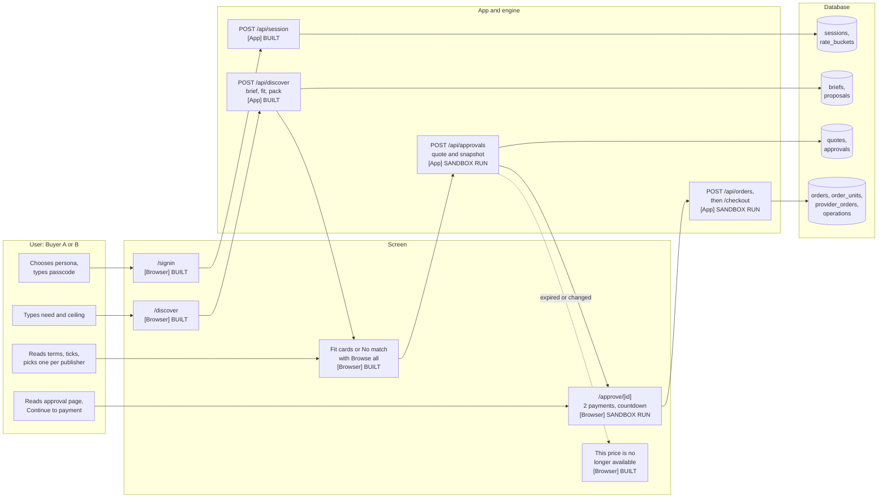

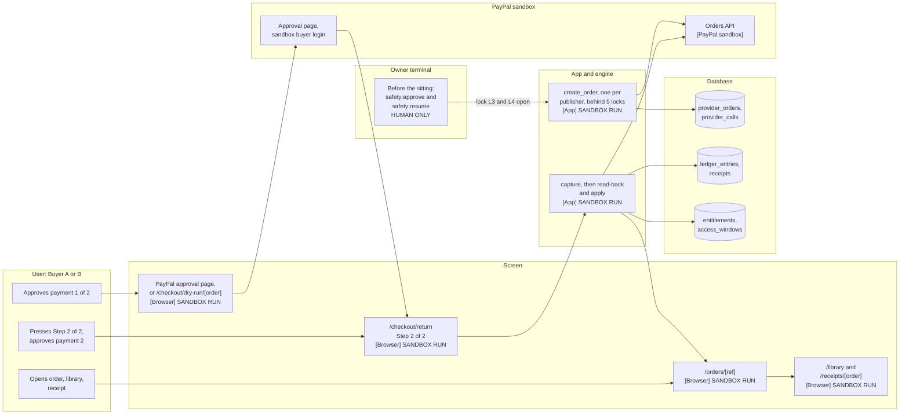

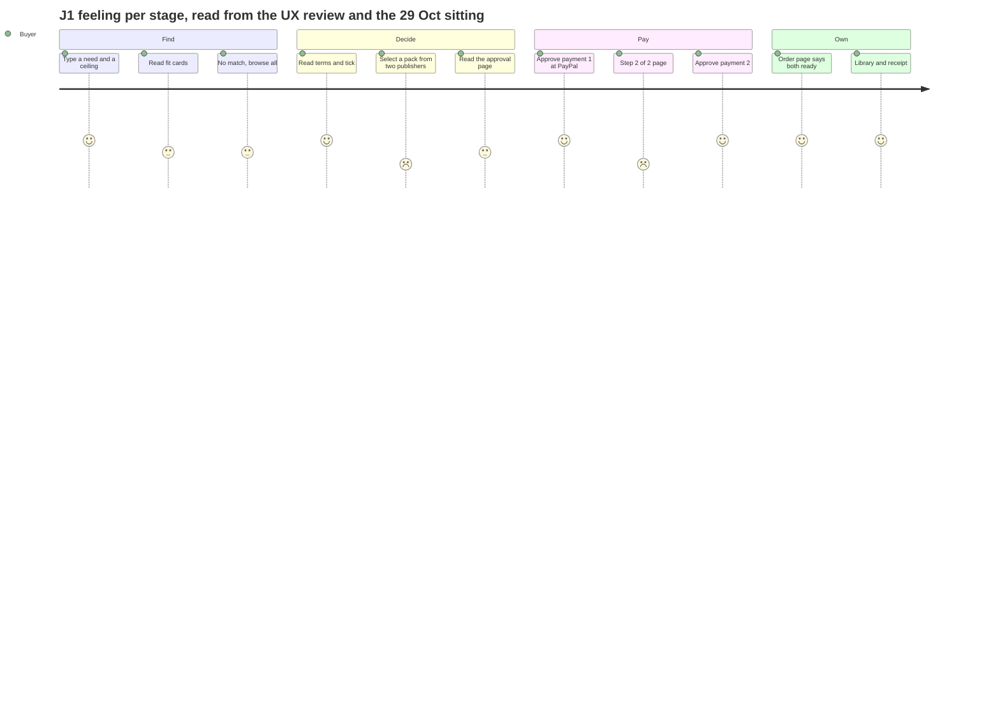

The scores (1 low, 5 high) are this document's reading of the sources named in the table, not a measurement with users.

| Step  | What the user sees and does                                                                                       | What the system does                                                                                                         | BP ids                    | Requirement              | Where                                    | State                     | Feeling and friction                                                                                                                                                         | Evidence or spec                                                    |
| ----- | ----------------------------------------------------------------------------------------------------------------- | ---------------------------------------------------------------------------------------------------------------------------- | ------------------------- | ------------------------ | ---------------------------------------- | ------------------------- | ---------------------------------------------------------------------------------------------------------------------------------------------------------------------------- | ------------------------------------------------------------------- |
| J1.1  | `/signin`: chooses Buyer A or B, types the demo or judge passcode; sees the privacy notice                        | Verifies the passcode hash, opens a session, sets the CSRF token, counts the attempt in a rate bucket                       | BP-8.5                    | R-LEG-2, R-JUD-1         | [Browser] [App] [DB]                     | [BUILT] [DEPLOYED]        | Calm. A judge passcode opens buyers only (R-JUD-1, not on the host yet)                                                                                                     | `docs/evidence/mvp-c-hosted-2026-10-28.md`; `judge-a-passcode.md`  |
| J1.2  | Home `/`: "Buy just the article you need"; chooses Find articles (or an offer from the list, which starts J2)       | Renders the home page with the skin from the `um_skin` cookie                                                               | BP-10.1                   | R-SKN-1                  | [Browser] [App]                          | [BUILT]                   | Clear start, one obvious button                                                                                                                                              | `skin-a-system.md`                                                  |
| J1.3  | `/discover`: types a need and a ceiling, presses Find articles                                                    | `POST /api/discover`: parses the need into a brief with the scripted model, stores brief and proposals, ranks fit           | BP-1.1, BP-1.1.1, BP-9.1 | R-AI-5, R-AI-6           | [Browser] [App] [DB]                     | [BUILT]                   | Fast and offline by default. No real AI call is made (R-AI-8)                                                                                                                 | `ai-a-model-adapter.md`                                             |
| J1.4  | Sees fit cards: "Why this fit", "$1.20 · Read online", "5 days to read"                                           | Builds fit cards from `domain/fit`; composes a pack inside the ceiling                                                      | BP-1.2, BP-1.2.1, BP-1.2.2 | UX-1A U4, DP-1         | [Browser] [App]                          | [BUILT]                   | UX problem 2 (cards break at mid widths) fixed by UX-1A U4. "Good fit" on every card and the title not being a link were open in the review                                | `web-ux-phase1a.md`                                                 |
| J1.5  | No match: banner with the reason and "Browse all N articles"; or "You have an unpaid order for this article" | Returns a no-match reason (`already_owned`, `unpaid_order`, others) and the catalogue list                                   | BP-1.3, BP-1.3.1, BP-1.3.2 | R-BUY-3, R-BUY-11       | [Browser] [App]                          | [BUILT]                   | UX problem 8 (dead end) fixed by R-BUY-3. The catalogue holds about ten demo articles, so a no match is common (hosted findings)                                           | `fix-gatefinal.md` item 3                                           |
| J1.6  | Opens "What the terms say", ticks the terms                                                                       | Shows the platform terms and the offer's AI-use line before the tick                                                        | BP-1.4                    | R-BUY-4                  | [Browser]                                | [BUILT]                   | UX problem 3 (consent to unseen terms) fixed by UX-1A U3 and R-BUY-4                                                                                                         | `web-ux-phase1a.md`                                                 |
| J1.7  | Selects one article from each publisher, presses Buy selected together                                            | `POST /api/approvals`: quotes each unit, writes one approval snapshot with price, payee and terms                           | BP-1.2.2, BP-2.1, BP-2.2  | DP-1, DP-5               | [Browser] [App] [DB]                     | [BUILT] [SANDBOX RUN]     | UX problem 6: pack selection split across the page, no running total. Not traced to a fix. The hardest action on the page                                                  | `mvp-d-dp5-web-composite.md`                                        |
| J1.8  | `/approve/[id]`: one block per publisher, "2 payments", the frozen price and its countdown; Continue to payment    | `POST /api/orders` places the order (one PayPal order per publisher), then `POST /api/orders/[ref]/checkout`               | BP-2.2.1, BP-2.3          | DP-2a, DP-5              | [Browser] [App] [DB]                     | [BUILT] [SANDBOX RUN]     | UX problem 9: weak hierarchy, raw ISO time, blocks not labelled "Payment 1 of 2". Not traced to a fix. The approval step stays still in both skins (DV-47)              | `docs/evidence/mvp-d-real-sitting-2026-10-29.md`                    |
| J1.9  | If the quote expired or the offer changed: "This price is no longer available" with a way to ask again            | Refuses the approval; hides the price card                                                                                  | BP-2.2.2                  | R-BUY-11                 | [Browser] [App]                          | [BUILT]                   | Fixed by GATEFIX2 item 5 (no "Could not get a price" above a live button)                                                                                                    | `fix-gatefinal.md` item 5                                           |
| J1.10 | PayPal approval page for payment 1 of 2, logs in with the sandbox buyer; in offline mode the in-app "Dry run: no PayPal" page | `create_order` for each publisher through the sealed transport, only with all five locks open; one `provider_calls` row each | BP-2.4, BP-2.4.1, BP-8.1, BP-8.6 | DP-2a, BU-6     | [Browser] [App] [PayPal sandbox] [Laptop] | [BUILT] [SANDBOX RUN]     | Familiar PayPal page. Real only inside an approval window; outside it the hosted checkout is paused and nothing is charged (D-056)                                         | `mvp-d-real-sitting-2026-10-29.md`                                  |
| J1.11 | Back on `/checkout/return`: "Step 2 of 2: approve your payment to" and the publisher name "at PayPal"; presses it and approves payment 2 | Reads each awaiting PayPal order by its stored id; captures nothing until every one is approved                    | BP-2.4.2                  | DP-5                     | [Browser] [App] [PayPal sandbox] [Laptop] | [BUILT] [SANDBOX RUN]     | UX problem 12: the page did not say payment 1 was approved or how much payment 2 is. The line now names the publisher (`composite-copy.ts`); amount not traced. Owner-reported, no screenshot (sitting row 4.3) | `mvp-d-real-sitting-2026-10-29.md` row 4.3                          |
| J1.12 | Waits on the return page                                                                                          | Captures each PayPal order, reads it back, applies: unit verified, ledger sale and fee, entitlement, access window, receipt | BP-2.5, BP-2.6, BP-8.2, BP-8.3 | DP-2b, DP-4          | [App] [PayPal sandbox] [DB] [Laptop]     | [BUILT] [SANDBOX RUN]     | Invisible to the buyer. Two separate payments landed in one Business account (D-041)                                                                                        | `mvp-d-real-sitting-2026-10-29.md`                                  |
| J1.13 | `/orders/[ref]`: "X and Y are ready", or one ready and one on hold                                                | Reads the order and unit states; partial outcome message from DP-3; D-051 wording                                           | BP-2.6                    | DP-3, DP-5b              | [Browser] [App] [DB]                     | [BUILT] [SANDBOX RUN]     | UX problem 10: no amounts, date or "what happens next"; a partial order showed a green banner. DP-5b changed the tone; the rest was not traced. Item order differs (F6) | `mvp-d-dp5b-order-page-fixes.md`                                    |
| J1.14 | `/library`: two entries, each "Ready" with one time-left statement                                                | Lists entitlements with window and state                                                                                    | BP-3.2                    | R-BUY-1                  | [Browser] [App] [DB]                     | [BUILT] [SANDBOX RUN]     | Sitting finding F3 and UX problem 1 (two contradicting times) fixed by R-BUY-1 after the sitting                                                                          | `web-ux-phase1a.md` U1                                              |
| J1.15 | `/receipts/[order]`: total, titles and publisher, version, fingerprint                                            | Reads the newest receipt version                                                                                            | BP-3.5, BP-8.3            | R-BUY-2                  | [Browser] [App] [DB]                     | [BUILT] [SANDBOX RUN]     | Sitting finding F2 and UX problem 5 (article ids, no publisher) fixed by R-BUY-2 after the sitting                                                                        | `mvp-d-real-sitting-2026-10-29.md` F1, F2                           |

### J2 Buyer, offer page path (one article)

Single article purchase from an offer page. One real hosted purchase reached "Paid" on 27 to 28 Oct (buyer sign in, price, PayPal
approval, capture, read-back, library access; `mvp-c-hosted-2026-10-28.md`, "Also observed"). The evidence does not name the entry
screen, so J2.1 and J2.3 are [BUILT] only. MVP-B ran the same single order on the laptop (`mvp-b-sandbox-2026-10-26.md` B-01, B-05).

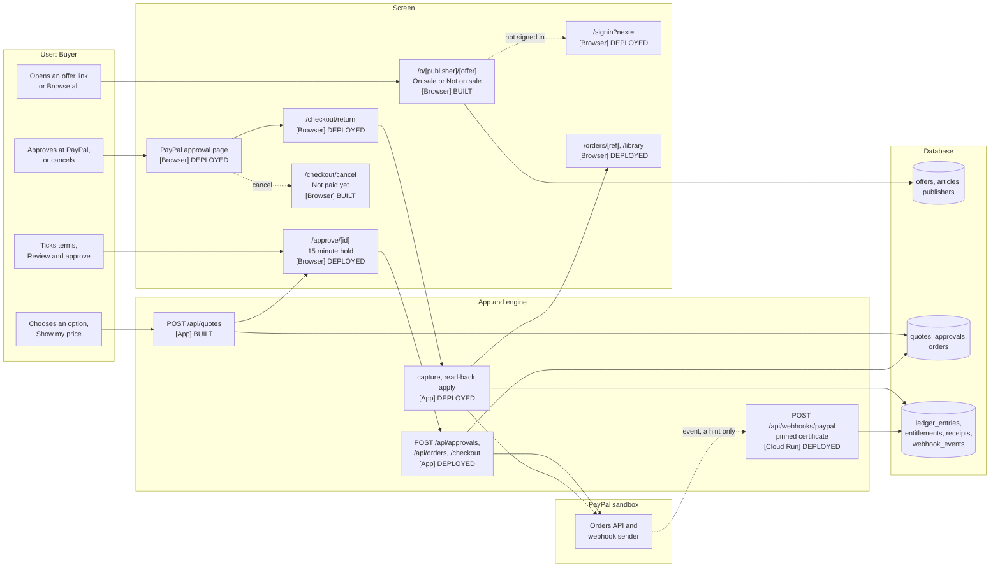

| Step | What the user sees and does                                                                                          | What the system does                                                                                                 | BP ids                   | Requirement          | Where                                       | State                         | Feeling and friction                                                                                                         | Evidence or spec                                |
| ---- | -------------------------------------------------------------------------------------------------------------------- | -------------------------------------------------------------------------------------------------------------------- | ------------------------ | -------------------- | ------------------------------------------- | ----------------------------- | ---------------------------------------------------------------------------------------------------------------------------- | ----------------------------------------------- |
| J2.1 | `/o/[publisher]/[offer]`: title, abstract, article facts, options and prices, or "Not on sale" with no prices        | Reads the offer; `on_sale` from stored data (authorised, not superseded, publisher active, inside validity)          | BP-10.2, BP-5.4.4        | R-BUY-11, PUB-E5     | [Browser] [App] [DB]                        | [BUILT]                       | Clear. A withdrawn offer says "Not on sale" (GATEFIX2 item 7; Vikram reconfirms, assumption 36)                             | `pub-e5-article-facts.md`                       |
| J2.2 | Not signed in: `/signin?next=` returns to the offer after sign in                                                    | Opens a session                                                                                                      | BP-8.5                   | MVP-A                | [Browser] [App] [DB]                        | [BUILT] [DEPLOYED]            | One extra screen                                                                                                             | `fix-flow-gate12.md`                            |
| J2.3 | Chooses Keep a copy or Read online, presses "Show my price"; or sees "You have an unpaid order" with a link          | `POST /api/quotes`: a quote row, or a no-match reason with `order_ref`                                               | BP-2.1, BP-1.3.1         | R-BUY-11             | [Browser] [App] [DB]                        | [BUILT]                       | UX "also found": a button for a price already shown. The rename to "Get my price and terms" is not done (`OfferFlow.tsx` line 178) | `fix-gatefinal.md` item 3                       |
| J2.4 | Reads the terms, ticks, Review and approve; `/approve/[id]` shows the price held for 15 minutes                      | `POST /api/approvals` writes the approval snapshot                                                                   | BP-1.4, BP-2.2           | R-BUY-4              | [Browser] [App] [DB]                        | [BUILT] [DEPLOYED]            | Trust point. UX problem 9 (hierarchy, raw ISO time) open                                                                    | `mvp-c-hosted-2026-10-28.md`                    |
| J2.5 | Continue to payment: goes to the PayPal approval page                                                                | Places the order, `create_order` behind the five locks                                                               | BP-2.3, BP-2.4, BP-8.1   | BU-6, MVPC-HOSTED    | [Browser] [App] [PayPal sandbox] [Cloud Run] | [BUILT] [SANDBOX RUN] [DEPLOYED] | Familiar. Outside an approval window the hosted checkout is paused, nothing charged (D-056)                                 | `mvp-b-sandbox-2026-10-26.md` B-01              |
| J2.6 | Approves at PayPal and returns to `/checkout/return`                                                                 | Captures, reads back, applies ledger, entitlement, window and receipt                                                | BP-2.5, BP-2.6, BP-8.2   | MVPC-HOSTED          | [App] [PayPal sandbox] [Cloud Run] [Cloud SQL] | [BUILT] [SANDBOX RUN] [DEPLOYED] | Invisible to the buyer; a short wait                                                                                         | `mvp-c-hosted-2026-10-28.md`                    |
| J2.7 | Cancels at PayPal: `/checkout/cancel`, the order says "Not paid yet"                                                 | Keeps the order open and unpaid until cancelled or expired; nothing is charged                                       | BP-4.2                   | R-BUY-9, R-BUY-13    | [Browser] [App] [DB]                        | [BUILT] [SANDBOX RUN]         | Honest wording after GATEFIX2 item 4. Cancel then abandon ran for real in MVP-B (B-05)                                      | `mvp-b-sandbox-2026-10-26.md` B-05              |
| J2.8 | `/orders/[ref]` says paid, then `/library` shows the article ready                                                   | Reads order and entitlement                                                                                          | BP-2.6, BP-3.2           | MVPC-HOSTED          | [Browser] [App] [Cloud Run]                 | [BUILT] [DEPLOYED]            | Relief. UX problem 10 (order page lacks amounts and next steps) open                                                        | `mvp-c-hosted-2026-10-28.md`                    |
| J2.9 | Nothing visible                                                                                                      | PayPal posts a webhook to `/api/webhooks/paypal`; signature checked against the pinned certificate; stored as a hint | BP-2.7                   | CO-3, CO-1d          | [PayPal sandbox] [Cloud Run] [Cloud SQL]    | [BUILT] [DEPLOYED]            | None for the buyer. Unsigned simulator events are refused with 400                                                          | `mvp-c-hosted-2026-10-28.md` C-01               |

### J3 Buyer after payment (library, reader, download, receipt, cancel, help, refund)

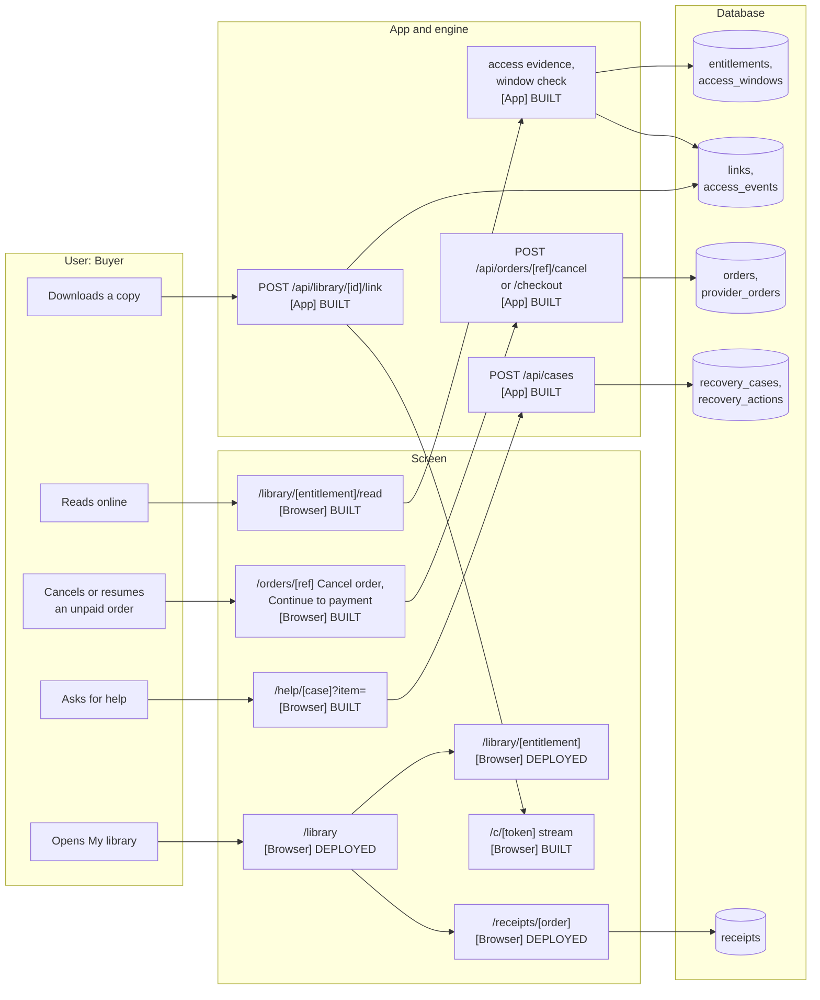

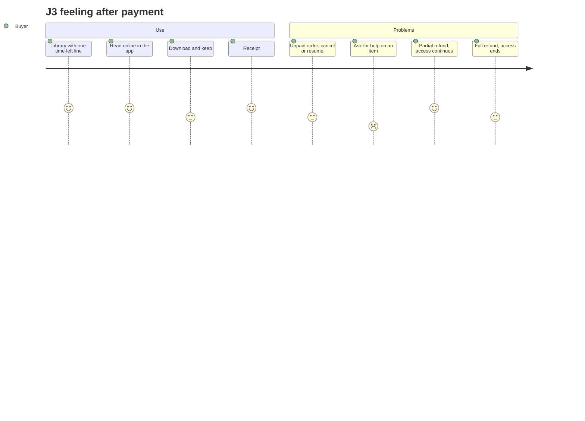

| Step  | What the user sees and does                                                                                                  | What the system does                                                                                                     | BP ids             | Requirement        | Where                              | State                           | Feeling and friction                                                                                                                       | Evidence or spec                               |
| ----- | ---------------------------------------------------------------------------------------------------------------------------- | ------------------------------------------------------------------------------------------------------------------------ | ------------------ | ------------------ | ---------------------------------- | ------------------------------- | ------------------------------------------------------------------------------------------------------------------------------------------ | ---------------------------------------------- |
| J3.1  | `/library`: each card says Ready with one time-left statement, "Not paid yet", "Partially refunded" or "Refunded"            | Lists the buyer's entitlements, windows and order states                                                                 | BP-3.2             | R-BUY-1, R-BUY-9   | [Browser] [App] [DB]               | [BUILT] [DEPLOYED]              | The hosted app shows the older card with two times (gcp-mvpc-2); the one statement (R-BUY-1) is on `main` only                              | `mvp-c-hosted-2026-10-28.md` C-07              |
| J3.2  | `/library/[entitlement]`: item page with details and Open or Download; a refunded item has no open control                   | Reads entitlement state and the window                                                                                   | BP-3.1             | CO-5, CO-8         | [Browser] [App] [DB]               | [BUILT] [DEPLOYED]              | UX "also found": "Evidence" and "Payment state: refunded" are internal words; not traced to a fix                                         | `mvp-c-hosted-2026-10-28.md` C-07              |
| J3.3  | `/library/[entitlement]/read`: the article as text with the time-left meter                                                  | Same access evidence, rate limits and window rules as the content route; writes an access event                         | BP-3.3             | R-RDR-1            | [Browser] [App] [DB]               | [BUILT]                         | Pleasant. Not on the hosted app                                                                                                           | `reader-a-view.md`                             |
| J3.4  | Download and keep: a link opens `/c/[token]` and the file streams                                                            | `POST /api/library/[id]/link` writes a link row; `/c/[token]` checks it, counts the use, writes an access event          | BP-3.4             | MVP-A              | [Browser] [App] [DB]               | [BUILT]                         | Works; after a full refund "links have stopped. The copy you downloaded cannot be recalled" (C-07 wording)                                 | `mvp-c-hosted-2026-10-28.md` C-07              |
| J3.5  | `/receipts/[order]`: receipt with version number and refund lines                                                            | Reads the newest immutable receipt version                                                                               | BP-3.5, BP-8.3     | R-BUY-2            | [Browser] [App] [DB]               | [BUILT] [DEPLOYED]              | Hosted receipt is the older layout with article ids; titles and publisher (R-BUY-2) are on `main` only                                    | `mvp-c-hosted-2026-10-28.md` C-06, C-07        |
| J3.6  | Unpaid order on `/orders/[ref]`: Cancel order, or Continue to payment back to PayPal                                             | Cancel closes the order; resume calls checkout again for the same order                                                  | BP-4.2             | R-BUY-13           | [Browser] [App] [DB]               | [BUILT]                         | Gives control back. Not on the hosted app                                                                                                 | `order-a-cancel-resume.md`                     |
| J3.7  | `/help/[case]?item=`: "Ask us to look at this"; without an item only guidance and a link to My library                       | `POST /api/cases` opens a recovery case                                                                                  | BP-4.3             | R-BUY-11           | [Browser] [App] [DB]               | [BUILT]                         | Weak: the buyer is not told the outcome anywhere except the order page (UX "also found"); no email exists                                 | `fix-gatefinal.md` item 2                      |
| J3.8  | After an operator refund: banner "Partially refunded: your access continues" or "Refunded: access has ended"                 | The operator's refund (J5.3) changes unit, entitlement, ledger and receipt                                               | BP-4.1.1, BP-4.1.2 | CO-8, DP-3         | [Browser] [App] [Cloud Run]        | [BUILT] [SANDBOX RUN] [DEPLOYED] | Honest wording, seen on the host. The buyer cannot ask for a refund in the app; an operator decides                                       | `mvp-c-hosted-2026-10-28.md` C-06, C-07        |
| J3.9  | Reads `/legal/privacy`; asks the team for an export or a deletion (no screen)                                                | An operator runs `pnpm privacy:export` or `pnpm privacy:delete` at a terminal (J5.9)                                     | BP-4.4             | R-PRV-1, R-LEG-1   | [Browser] [Owner terminal]         | [BUILT] [HUMAN ONLY]            | Slow by design (within 30 days, PRIV-4). The legal pages are drafts, not legal advice                                                     | `ops-privacy-export-delete.md`                 |
| J3.10 | After five days: the card says access has ended                                                                              | The access clock closes the window; delivery refuses                                                                     | BP-3.1             | CO-5, CO-5b        | [App] [DB]                         | [BUILT]                         | Expected and stated in the terms                                                                                                          | `access-clock-refund-interplay.md`             |

### J4 Publisher, from applying to the first sale and the statement

A publisher signs in only after the owners give it a persona; there is no self sign up (P-A3 deferred). The publisher area is not on
the hosted app: it needs a deploy and the publisher secret (R-DEP-5, testing instructions "TO FINALISE"). Every publisher
query is bound to the session's publisher id.

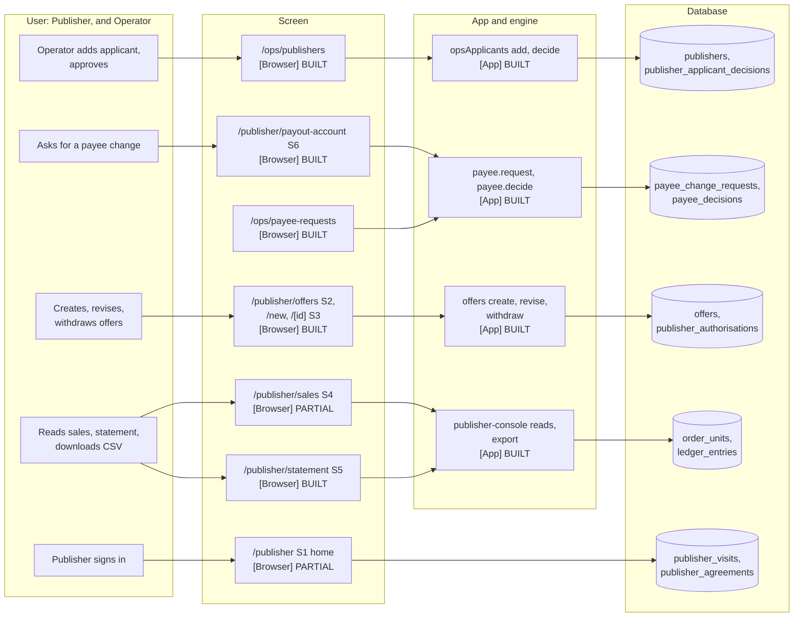

| Step  | What the user sees and does                                                                                                  | What the system does                                                                                                      | BP ids                    | Requirement             | Where                    | State                    | Evidence or spec                                   |
| ----- | ---------------------------------------------------------------------------------------------------------------------------- | ------------------------------------------------------------------------------------------------------------------------- | ------------------------- | ----------------------- | ------------------------ | ------------------------ | -------------------------------------------------- |
| J4.1  | An operator adds the publisher as an applicant on `/ops/publishers`, then approves or rejects it                            | Writes a `publishers` row with status `applied`; one applicant decision row; approval sets status `active`               | BP-5.1, BP-6.6            | PUB-E2, P-I4            | [Browser] [App] [DB]     | [BUILT]                  | `pub-e2-applicants.md`                             |
| J4.2  | The owners give the publisher a persona; it signs in on `/signin` with the publisher passcode                                | Verifies against `UMS_PUBLISHER_PASSCODE_HASH` only; the demo or judge passcode never signs a publisher in               | BP-5.2, BP-8.5            | PUB-A1, DV-34, R-PUB-7  | [Browser] [App] [DB]     | [BUILT] [HUMAN ONLY]     | `pub-a1-personas-shell.md`                         |
| J4.3  | `/publisher` S1: name, status, offers live, settlement sentence, since your last visit, agreement line                      | Reads home, visits cursor and agreement; moves the visit cursor                                                           | BP-5.7, BP-5.8, BP-5.3.3  | P-S1, P-H1, R-PUB-1     | [Browser] [App] [DB]     | [PARTIAL]                | `pub-e1-publisher-should.md`; S1 period figures missing |
| J4.4  | `/publisher/payout-account` S6: last 4, verified or not, settlement sentence; asks for a new payee                           | Writes an append-only payee change request; nothing changes until an operator verifies                                    | BP-5.3, BP-5.3.1          | PUB-A2, P-B1            | [Browser] [App] [DB]     | [BUILT]                  | `pub-a2-payee.md`                                  |
| J4.5  | An operator on `/ops/payee-requests` retypes the id and enters an authenticator code                                        | Writes a payee decision and updates the publisher's payee; refused outside a dry run (assumption 3)                       | BP-5.3.2, BP-6.7          | PUB-A2, P-I2            | [Browser] [App] [DB] [Offline demo] | [BUILT]   | `pub-a2-payee.md`                                  |
| J4.6  | `/publisher/offers` S2, then `/publisher/offers/new`: creates an offer for an own article                                    | Writes an offer version and an authorisation row; price above 0 and at most the cap of 2000 minor units                  | BP-5.4, BP-5.4.1          | PUB-E1, P-C4, DV-35     | [Browser] [App] [DB]     | [PARTIAL]                | `pub-e1-publisher-should.md`; rights and floor edit missing |
| J4.7  | `/publisher/offers/[id]` S3: sees article facts and history; revises the price                                               | Writes a new offer version with `superseded_by` and an authorisation row; open approvals keep their frozen price         | BP-5.4.2, BP-5.4.4        | PUB-B, PUB-E5           | [Browser] [App] [DB]     | [BUILT]                  | `pub-b-offer-revise-withdraw.md`                   |
| J4.8  | Withdraws the offer; buyers see "Not on sale"                                                                                | New version marked withdrawn; `on_sale` false on the buyer offer page                                                    | BP-5.4.3                  | PUB-B, R-BUY-12         | [Browser] [App] [DB]     | [BUILT]                  | e2e `ze-publisher-offers.spec.ts`                  |
| J4.9  | A buyer buys one of its offers (J1 or J2)                                                                                    | The sale writes order units with the payee stored per unit, and ledger rows                                               | BP-2.6, BP-8.4            | DP-4, R-SET-1           | [App] [DB]               | [BUILT] [SANDBOX RUN]    | `mvp-d-real-sitting-2026-10-29.md`                 |
| J4.10 | `/publisher/sales` S4: rows with date, order last 6, article, option, amount, status words, totals row, refunds view, mismatch note | Reads units and refunds bound to the actor; no buyer identity                                                        | BP-5.5                    | PUB-C, PUB-F1, P-S4     | [Browser] [App] [DB]     | [PARTIAL]                | `pub-f1-sales-statement-agree.md`; filters missing (P-E2) |
| J4.11 | `/publisher/statement` S5: blocks per currency and environment, settlement mode per block; downloads CSV                     | Reads ledger rows; `/api/publisher/export` builds the CSV                                                                 | BP-5.6, BP-5.3.3, BP-8.4  | PUB-C, P-F1, P-F2, MT-4 | [Browser] [App] [DB]     | [BUILT]                  | `pub-c-sales-statement.md`                         |
| J4.12 | An operator suspends the publisher; its offers go off sale                                                                   | Sets status `suspended`, ends its open quotes, writes an audit row; paid orders untouched                                | BP-5.9, BP-6.6            | PUB-D, R-PUB-5          | [Browser] [App] [DB]     | [BUILT]                  | `pub-d-ops-publishers.md`; known gap: an earlier approval can still be placed |
| J4.13 | Wants to add a new article                                                                                                   | Nothing: no upload exists                                                                                                 | BP-5.10                   | P-D3                    | none                     | [NOT BUILT]              | traceability P-D3                                  |
| J4.14 | Wants to be paid directly into its own PayPal account (Quayside)                                                             | Nothing: every sandbox sale reads `owner_account`; the set-payee command is not merged                                    | BP-5.3, BP-8.4            | R-PUB-3, R-PUB-4, DV-28 | [External]               | [NOT BUILT] [HUMAN ONLY] | branch `feat/hard-set-payee`                       |

### J5 Operator (daily check, refund, kill switch, suspend)

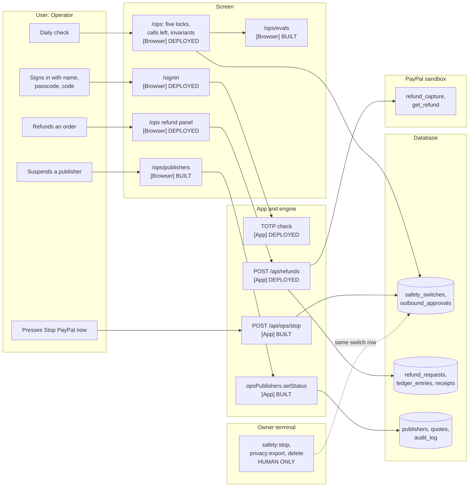

| Step  | What the user sees and does                                                                                         | What the system does                                                                                                | BP ids                 | Requirement            | Where                                      | State                            | Evidence or spec                                    |
| ----- | ------------------------------------------------------------------------------------------------------------------- | ------------------------------------------------------------------------------------------------------------------- | ---------------------- | ---------------------- | ------------------------------------------ | -------------------------------- | --------------------------------------------------- |
| J5.1  | `/signin` as Operator: name, passcode and authenticator code; a wrong code is refused                               | Verifies passcode and TOTP; with no keys set an operator signs in with the passcode alone and cannot refund or resume | BP-6.1, BP-8.5         | CO-6, CO-6b            | [Browser] [App] [DB] [Cloud Run]           | [BUILT] [DEPLOYED]               | `mvp-c-hosted-2026-10-28.md` C-06                   |
| J5.2  | `/ops`: the five locks, Stop PayPal now, calls left today, orders, invariants INV1 to INV7, alerts, full order refs | Reads switches, approval rows, budget, orders and invariant sums; the job loop reconciles in the background         | BP-6.3, BP-6.4         | R-BUY-6, BU-2          | [Browser] [App] [DB] [Cloud Run]           | [BUILT] [DEPLOYED]               | `mvp-c-hosted-2026-10-28.md` C-06                   |
| J5.3  | Refund panel: chooses an amount, enters a code, presses refund once                                                 | Writes a refund request, sends `refund_capture` and `get_refund` behind the five locks, books ledger refund rows and a new receipt version | BP-4.1, BP-4.1.1, BP-4.1.2, BP-8.1 | CO-8, CO-8c, DP-3 | [Browser] [App] [PayPal sandbox] [Cloud Run] | [BUILT] [SANDBOX RUN] [DEPLOYED] | `mvp-c-hosted-2026-10-28.md` C-06, C-07; the current basis D-062 has no refund operation |
| J5.4  | Cancels a refund request that has not been sent                                                                     | `POST /api/refunds/[id]/cancel` frees the reservation                                                               | BP-4.1.3               | CO-8                   | [Browser] [App] [DB]                       | [BUILT]                          | `web-refund-states.md`                              |
| J5.5  | Presses Stop PayPal now                                                                                             | `POST /api/ops/stop` turns `paypal_outbound` off with a reason and an audit row; it can only turn it off            | BP-6.2                 | BU-2                   | [Browser] [App] [DB]                       | [BUILT]                          | `testing-instructions.md`; the hosted evidence shows `safety:stop` at a terminal, not the button |
| J5.6  | `/ops/publishers`: exposure per publisher, applicants, agreement flag; suspends or reactivates                      | Reads exposure; writes status and an audit row                                                                      | BP-6.6, BP-5.9         | PUB-D, R-PUB-1         | [Browser] [App] [DB]                       | [BUILT]                          | e2e `zd-ops-publishers.spec.ts`                     |
| J5.7  | `/ops/payee-requests`: verifies or rejects a payee request with a code                                              | Writes the decision                                                                                                 | BP-6.7, BP-5.3.2       | PUB-A2                 | [Browser] [App] [DB]                       | [BUILT]                          | `pub-a2-payee.md`                                   |
| J5.8  | `/ops/evals`: case count and keyword baseline, labelled honestly                                                    | Runs the scripted model over the committed cases; no network, no key, no spend                                      | BP-6.5, BP-9.1         | R-AI-7                 | [Browser] [App] [Repo]                     | [BUILT]                          | `ai-b-evals-page.md`                                |
| J5.9  | At a terminal: `pnpm privacy:export <buyer_id>` or `pnpm privacy:delete <buyer_id> --operator <id> --reason <text>` | Export prints one JSON document; delete pseudonymises after the id is typed back, keeps money evidence, one audit row | BP-4.4                | R-PRV-1                | [Owner terminal] [DB]                      | [BUILT] [HUMAN ONLY]             | `ops-privacy-export-delete.md`                      |

### J6 Owner (approval and sitting, deploy, release)

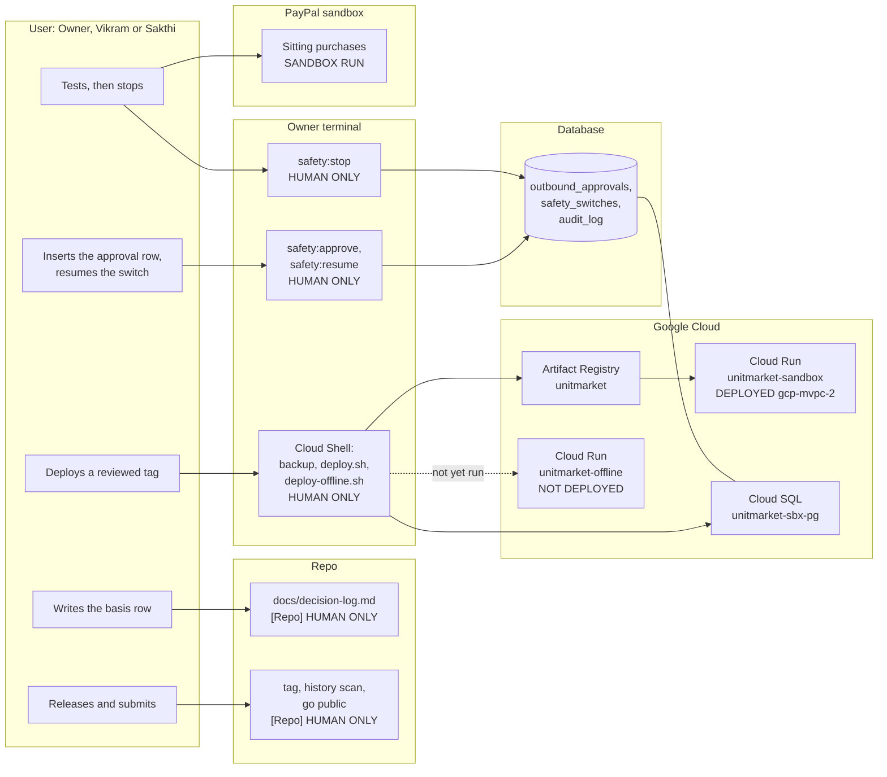

| Step  | What the user sees and does                                                                                                         | What the system does                                                                                     | BP ids          | Requirement                  | Where                                               | State                       | Evidence or spec                                      |
| ----- | ----------------------------------------------------------------------------------------------------------------------------------- | -------------------------------------------------------------------------------------------------------- | --------------- | ---------------------------- | --------------------------------------------------- | --------------------------- | ----------------------------------------------------- |
| J6.1  | Writes the approval basis as a row in `docs/decision-log.md`: scope, operations, cap, calls a day, valid until, operator, payee     | Nothing runs; it is the written approval (D-011)                                                         | BP-7.2          | D-052, D-057, D-062          | [Repo]                                              | [HUMAN ONLY]                | `docs/decision-log.md`                                |
| J6.2  | At their own terminal, with `env -u DATABASE_URL -u UMS_DB -u UMS_PAYPAL_CONNECT` and the right database: `pnpm safety:approve`     | Inserts an append-only `outbound_approvals` row and an audit row; refuses without a terminal or in CI   | BP-7.2, BP-8.1  | D-029, D-059                 | [Owner terminal] [DB] [Cloud SQL] [Laptop]          | [HUMAN ONLY] [SANDBOX RUN]  | `mvp-d-real-sitting-2026-10-29.md` timeline           |
| J6.3  | Sets `UMS_PAYPAL_CONNECT=on` and runs `pnpm safety:resume`                                                                          | Turns `paypal_outbound` on with an audit row; `/ops` shows all five locks open                           | BP-7.2, BP-6.3  | D-029                        | [Owner terminal] [DB]                               | [HUMAN ONLY] [SANDBOX RUN]  | `mvp-d-real-sitting-2026-10-29.md` 18:14, 18:17 UTC   |
| J6.4  | Runs the sitting: buyer purchases with the sandbox Personal account; operator refunds if the basis allows                           | Real PayPal sandbox calls inside the cap and the daily budget                                            | BP-7.2          | MVPC-HOSTED, MVPD-REAL       | [Browser] [App] [PayPal sandbox] [Cloud Run] [Laptop] | [SANDBOX RUN]             | `mvp-c-hosted-2026-10-28.md`; `mvp-d-real-sitting-2026-10-29.md` |
| J6.5  | Ends the sitting: `pnpm safety:stop`                                                                                                | Turns `paypal_outbound` off with an audit row                                                            | BP-7.2, BP-6.2  | BU-2                         | [Owner terminal] [DB]                               | [HUMAN ONLY] [SANDBOX RUN]  | `mvp-d-real-sitting-2026-10-29.md` 18:10, 19:14 UTC   |
| J6.6  | Makes secrets: `pnpm owner:secrets`, `pnpm totp:enrol`, then `infra/gcp/set-secret.sh` in Cloud Shell                               | Prints values once to the terminal; they go into `.env.local` or Secret Manager, never the database     | BP-7.1          | R-DEP-1, D-061, D-063        | [Owner terminal] [Secret Manager]                   | [HUMAN ONLY]                | `docs/owner/DEPLOY-PREP-2026-11.md`                   |
| J6.7  | Deploys: lists backups, tags the reviewed commit, runs the offline check list, runs `deploy.sh PROJECT_ID REGION TAG`               | Builds and pushes the image to Artifact Registry, makes a Cloud Run revision, maps secrets, leaves the PayPal connection off | BP-7.3, BP-7.4 | GCP-1, GCP-2, R-DEP-3, R-DEP-5 | [Owner terminal] [Artifact Registry] [Cloud Run] [Cloud SQL] | [BUILT] [HUMAN ONLY] | `SAKTHI-DEPLOY-COPYPASTE.md`; last deploy `gcp-mvpc-2`; overnight work not deployed |
| J6.8  | Deploys the offline judge service with `deploy-offline.sh` and stores its five own secrets                                         | Makes `unitmarket-offline`: offline mode, in memory data, no PayPal, label Dry run                       | BP-7.3.1        | R-OFF-1, R-OFF-2, R-OFF-3    | [Owner terminal] [Offline service]                  | [BUILT] [HUMAN ONLY]        | `infra-a-optional-secrets-offline-service.md`; not done |
| J6.9  | Releases: rotates secrets, scans the full history, makes the repository public with the licence shown, tags `submission-1`, submits on Devpost before 12 Nov 12:00 PT | Nothing in the app; repository and Devpost actions                                  | BP-7.5          | R-HRD-8, DV-9, DV-12, DV-64  | [Repo] [External]                                   | [HUMAN ONLY]                | `docs/decision-log.md` D-058, D-065                   |
| J6.10 | Records the demo video under 3 minutes under its own approval row                                                                   | A short sitting, as J6.1 to J6.5                                                                         | BP-7.6          | DV-66                        | [Browser] [PayPal sandbox]                          | [HUMAN ONLY]                | `DECISIONS-FOR-VIKRAM.md` item 66                     |
| J6.11 | Opens the judging windows from 30 Nov, 7 Dec and 14 Dec, each with a new basis and approval row; keeps the app running until 15 Dec | As J6.1 to J6.5 per window                                                                               | BP-7.7          | DV-21, D-065                 | [Owner terminal] [Cloud Run]                        | [HUMAN ONLY]                | `testing-instructions.md`                             |

### J7 Judge (testing instructions, offline service, judge passcode)

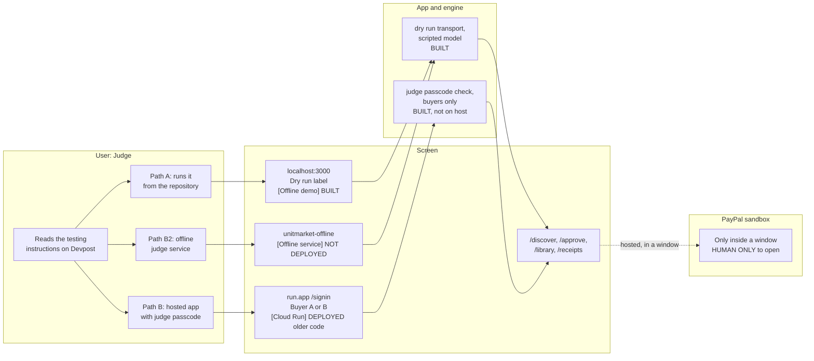

| Step | What the user sees and does                                                                                                   | What the system does                                                                                         | BP ids                  | Requirement             | Where                               | State                         | Evidence or spec                               |
| ---- | ----------------------------------------------------------------------------------------------------------------------------- | ------------------------------------------------------------------------------------------------------------ | ----------------------- | ----------------------- | ----------------------------------- | ----------------------------- | ---------------------------------------------- |
| J7.1 | Reads the testing instructions on Devpost                                                                                     | Nothing; a draft with TO FINALISE markers                                                                    | BP-7.7                  | R-HRD-7, DV-69          | [Repo] [External]                   | [PARTIAL]                     | `docs/submission/testing-instructions.md`      |
| J7.2 | Path A: `corepack pnpm install --frozen-lockfile`, `owner:secrets` in a real terminal, `.env.local`, build, start; `/healthz` answers `"environment":"dryrun"` | Runs the whole app offline with a pretend PayPal and the scripted model                      | BP-7.7, BP-2.4.1, BP-9.1 | DV-20                  | [Browser] [Offline demo]            | [BUILT]                       | testing instructions Path A; a fresh clone run is not done yet |
| J7.3 | Path B: opens the hosted URL, signs in as Buyer A or B with the judge passcode                                                | The judge passcode signs in buyers only, never the operator or a publisher; boot refuses equal hashes        | BP-8.5, BP-7.7          | R-JUD-1, R-JUD-2        | [Browser] [Cloud Run]               | [BUILT] [HUMAN ONLY]          | `judge-a-passcode.md`; not deployed, value not chosen |
| J7.4 | Path B2: opens the offline judge service and completes a purchase at any time                                                | Offline mode, in memory data, no PayPal, Dry run label from stored data                                      | BP-7.3.1, BP-2.4.1      | R-OFF-1, R-OFF-2, DV-23 | [Browser] [Offline service]         | [BUILT] [HUMAN ONLY]          | `infra-hard-offline.md`; not deployed          |
| J7.5 | Does the buyer journey J1 on the hosted app inside a judging window; outside a window, browses only                           | Real sandbox calls only while the owners have the connection on and an approval row active                    | BP-2.4, BP-8.1          | DV-21, D-056            | [Browser] [Cloud Run] [PayPal sandbox] | [HUMAN ONLY]               | testing instructions Path B                    |
| J7.6 | On Path A: looks at `/ops` (does not press Stop on the hosted app), the Appearance control, the reader and the legal pages   | Same screens as J5.2, J3.3                                                                                   | BP-6.3, BP-3.3, BP-10.1 | R-SKN-1, R-RDR-1, R-LEG-1 | [Browser] [Offline demo]          | [BUILT]                       | testing instructions "What to try"             |

## 4. Data flow maps (business process flows behind the screens)

Each map shows what data moves from which actor, screen or route to which module, table, PayPal call, terminal command, file or
log. Arrow labels name the data. Subgraphs named "Zone" are trust boundaries:

- Zone Browser to Zone App: HTTPS; every write route needs a session, a CSRF token and an idempotency key where money moves
  (`withRoute`, `packages/security`).
- Zone App to Zone Database: the app's own database connection; Postgres URL only from `packages/config`.
- Zone App to Zone PayPal sandbox: only `packages/transport`, one sandbox host constant, behind the five locks.
- Zone Owner terminal to Zone Database: human-only commands, at a TTY, with the `env -u` prefix; on Google Cloud through the Cloud
  SQL Auth Proxy.

Never crosses any boundary, in any flow: secret values (PayPal client secret, session, approval and link secrets, TOTP keys, the
Anthropic key) stay in the secret store and the process environment; passcodes are never stored, only their hashes, and the hashes
stay in the secret store, never in the database or a page; card data is never held at all (card entry happens only on PayPal's
pages, nfr 2.6); full PayPal ids are never shown on a buyer page (R-BUY-5) and evidence files hold sanitised ids only.

### 4.1 Data stores (D1 to D13, real table names)

| Store | Name                    | Tables or files                                                                                                                                                       | Append only (trigger in the migration)                                                                                                                   |
| ----- | ----------------------- | --------------------------------------------------------------------------------------------------------------------------------------------------------------------- | -------------------------------------------------------------------------------------------------------------------------------------------------------- |
| D1    | Sessions and limits     | `sessions`, `rate_buckets`, `api_idempotency`                                                                                                                         | none                                                                                                                                                     |
| D2    | Buyers and briefs       | `buyers`, `consents`, `identity_links`, `briefs`, `proposals`                                                                                                         | none                                                                                                                                                     |
| D3    | Catalogue               | `publishers`, `articles`, `content_blobs`, `offers`, `publisher_authorisations`, `access_policies`, `corridors`                                                      | `publisher_authorisations` (0001); `articles` content frozen once used (`articles_content_frozen`, 0012)                                                 |
| D4    | Quotes and approvals    | `quotes`, `approvals`                                                                                                                                                 | `approvals`: no delete, guarded update (`approvals_guard`, 0004)                                                                                         |
| D5    | Orders and payment state | `orders`, `order_units`, `provider_orders`, `operations`, `refund_requests`, `webhook_events`                                                                       | none (state machines, compare and set)                                                                                                                   |
| D6    | Access                  | `entitlements`, `access_windows`, `access_events`, `links`                                                                                                            | `access_events` (0005)                                                                                                                                   |
| D7    | Money records           | `ledger_entries`, `receipts`                                                                                                                                          | `ledger_entries` (0004); `receipts` immutable (0004)                                                                                                     |
| D8    | Recovery                | `recovery_cases`, `recovery_actions`, `alerts`                                                                                                                        | `recovery_actions` (0006)                                                                                                                                |
| D9    | Safety                  | `safety_switches`, `outbound_approvals`, `provider_calls`                                                                                                             | `outbound_approvals` (0006); `provider_calls` (0004); `safety_switches` no delete (0006)                                                                 |
| D10   | Audit log               | `audit_log` (also the AI spend rows, action `model.spend`)                                                                                                            | `audit_log` (0006)                                                                                                                                       |
| D11   | Publisher side records  | `payee_change_requests`, `payee_decisions`, `publisher_applicant_decisions`, `publisher_visits`, `publisher_agreements`                                              | all except `publisher_visits` (0012, 0013, 0015); `publisher_visits` is a cursor and may be updated (0014)                                               |
| D12   | Secret store            | `apps/web/.env.local` on a laptop (git ignores it); Secret Manager on Google Cloud                                                                                    | not a database; values never enter D1 to D11                                                                                                             |
| D13   | Files, logs and backups | host logs (Cloud Logging), Cloud SQL backups, `calls.json` of an owner run (owner's machine), committed eval cases, the CSV in the publisher's browser, the evidence files | backups and logs are kept by the host; the rest are files                                                                                                |

### 4.2 Level 0 and level 1 overview

Level 0: UnitMarket as one process with its outside parties.

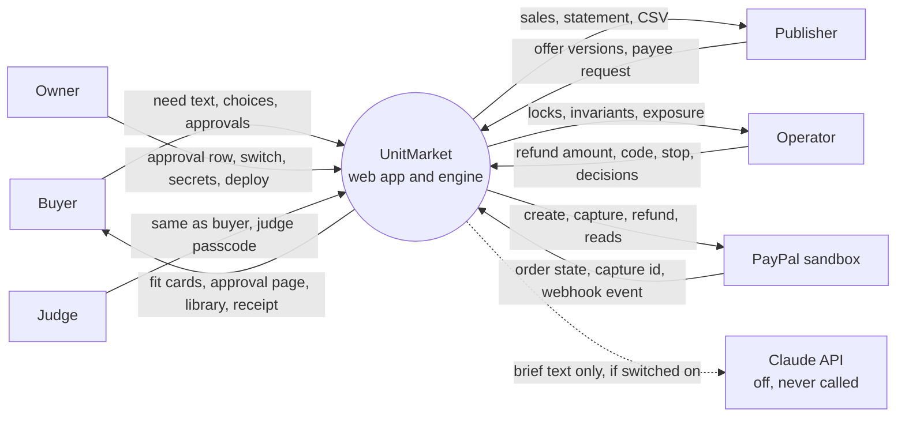

Level 1, buyer side.

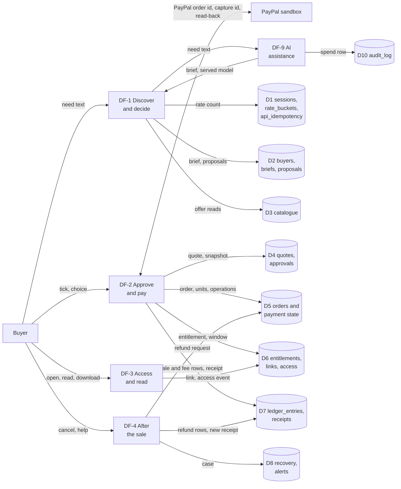

Level 1, publisher, operator and owner side.

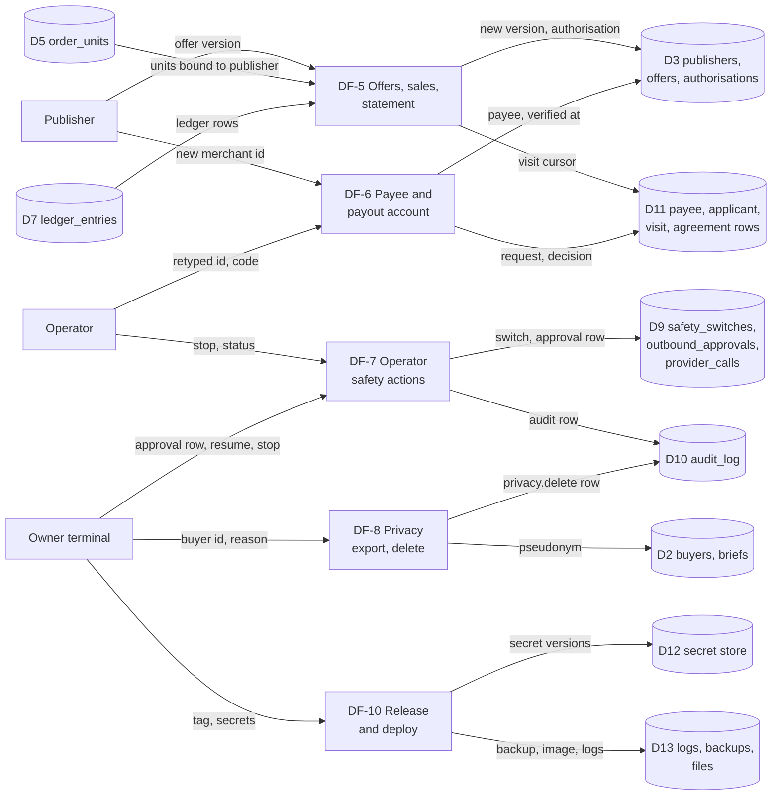

### 4.3 CRUD matrix: business process by data store

C create, R read, U update, D delete. Verified by a grep of `INSERT INTO`, `UPDATE`, `DELETE FROM` and `FROM` or `JOIN` in non-test
code (`domain/*/src`, `packages/*/src`, `apps/web`, `scripts`), leaving out files that say they are test helpers (`*support.ts`,
`world.ts`). A mark means at least one table of the store has that operation from a module of that process. "A" after a mark
means the touched table is append only, so the process can only add rows there.

| BP    | D1   | D2  | D3  | D4  | D5  | D6  | D7  | D8  | D9  | D10 | D11 | D12 | D13 |
| ----- | ---- | --- | --- | --- | --- | --- | --- | --- | --- | --- | --- | --- | --- |
| BP-1  | CRU  | CR  | R   |     | R   | R   |     |     |     |     |     |     |     |
| BP-2  | CRU  | R   | R   | CRU | CRU | CRU | CRA | C   | RCA | CA  |     | R   | C   |
| BP-3  | CRU  |     | R   |     | R   | CRU | R   |     |     |     |     |     | C   |
| BP-4  | CRU  | RU  | R   | R   | CRU | RU  | CRA | CRU | RCA | CRA |     |     |     |
| BP-5  | CRU  |     | CRU | U   | R   | R   | R   |     |     | CRA | CRU |     | C   |
| BP-6  | CRU  |     | RU  | U   | R   | R   | R   | R   | RU  | CRA | CRA |     | R   |
| BP-7  |      |     |     |     |     |     |     |     | CRU | CA  |     | CRU | CR  |
| BP-8  | CRUD |     | R   | R   | RU  |     | CRA |     | RCA | CRA |     | R   |     |
| BP-9  |      | C   | R   |     |     |     |     |     |     | CRA |     | R   |     |
| BP-10 | R    |     | R   |     | R   | R   |     |     |     |     |     |     |     |

What the marks rest on (module that holds the statement):

- D1: `packages/security/src/session.ts` (sessions C U), `rate.ts` (rate_buckets C U), `idempotency.ts` (api_idempotency C U D:
  `abandonIdempotent` is the only DELETE in product code). Privacy delete updates `sessions` (`scripts/lib/privacy.mjs`).
- D2: `buyers` C at boot seed in `apps/web/composition.server.ts` line 1272; `briefs` C in `domain/discovery/src/brief.ts`;
  `proposals` C in `domain/discovery/src/discover.ts`; privacy delete U `buyers` and `briefs`. `consents` and `identity_links` have
  no writer in product code; only the privacy export reads them.
- D3: `domain/catalogue/src/seed.ts` (C at boot), `write.ts` (offers C U, publisher_authorisations C A), `applicants.ts`
  (publishers C U), `payee.ts` and `status.ts` (publishers U); `composition.server.ts` lines 1019 to 1261 (publishers U at boot).
- D4: `domain/offer-entry/src/start.ts` (quotes C), `domain/approval/src/approval.ts` (approvals C U, guarded),
  `domain/catalogue/src/status.ts` (quotes U on suspend).
- D5: `domain/payments/src/place.ts` (orders, order_units, provider_orders, operations C), `checkout.ts`, `return.ts`,
  `capture.ts`, `apply.ts`, `reconcile.ts`, `due.ts`, `composite.ts` (U), `refunds.ts` (refund_requests C U), `webhooks.ts`
  (webhook_events C U).
- D6: `domain/entitlements/src/entitlements.ts` (entitlements C U, access_windows C), `domain/access-clock/src/events.ts`
  (access_events C A, access_windows C, entitlements U), `domain/delivery/src/links.ts` and `serve.ts` (links C U).
- D7: `domain/ledger/src/ledger.ts` (ledger_entries C A), `domain/receipts/src/receipts.ts` (receipts C A).
- D8: `domain/recovery/src/cases.ts` (recovery_cases C U, recovery_actions C A, alerts C), `domain/payments/src/alerts.ts`
  (alerts C).
- D9: `packages/safety/src/cli-approve.ts` (outbound_approvals C A), `switches.ts` and `apps/web/composition.server.ts` (stop
  button, dry run seed) (safety_switches U), `composition.server.ts` line 1386 (provider_calls C A).
- D10: `packages/obs/src/audit.ts` (the audit sink used by refunds, switches, approvals, payee, status), `packages/safety/src/budget.ts`,
  `composition.server.ts` line 1090 (`model.spend`); reads in `domain/publisher-console`, `packages/safety`, `packages/security`.
- D11: `domain/catalogue/src/payee.ts`, `applicants.ts`, `visits.ts`, `agreements.ts`; reads in `domain/publisher-console`.
- D12 and D13: from the deploy kit, the owner documents and the evidence files; not from SQL.

### DF-1 Discover and decide

BP-1, BP-9.1, BP-10.1. Built, offline tested. Not shown on the hosted app by evidence.

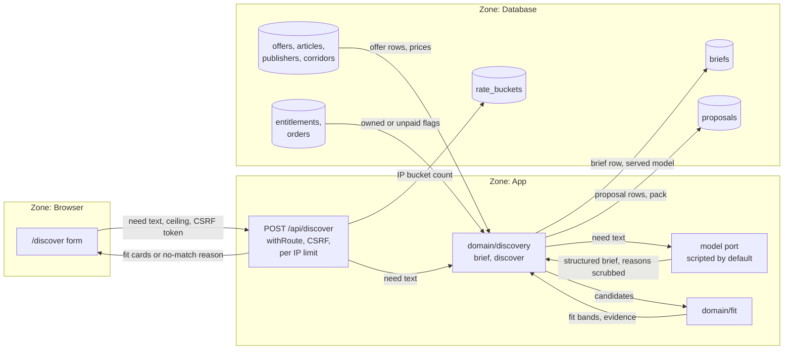

| Data item           | Created by                      | Stored where                         | Read by                                | Retention or delete rule                                                        | Sensitivity      | Where                | State   |
| ------------------- | ------------------------------- | ------------------------------------ | -------------------------------------- | ------------------------------------------------------------------------------- | ---------------- | -------------------- | ------- |
| Need text           | Buyer                           | `briefs.raw_text`                    | `domain/discovery`, privacy export     | Design: briefs 30 days (nfr PRIV-3), not automated; privacy delete blanks it   | buyer personal   | [Browser] [App] [DB] | [BUILT] |
| Brief (structured)  | Model port, scripted by default | `briefs.structured`                  | `domain/discovery`, `domain/approval`  | As need text                                                                    | buyer personal   | [App] [DB]           | [BUILT] |
| Proposal and pack   | `domain/discovery`              | `proposals`                          | `domain/approval` (DF-2)               | Kept; privacy export lists it                                                   | buyer personal   | [App] [DB]           | [BUILT] |
| Fit card            | `domain/fit`                    | not stored; response only            | Browser                                | Not stored                                                                      | public           | [Browser] [App]      | [BUILT] |
| No-match reason     | `domain/discovery`, `offer-entry` | not stored; response only          | Browser                                | Not stored                                                                      | buyer personal   | [Browser] [App]      | [BUILT] |
| IP rate count       | `packages/security/src/rate.ts` | `rate_buckets`                       | the same module                        | Bucket window only; no rule stated for old rows                                 | buyer personal   | [App] [DB]           | [BUILT] |

### DF-2 Approve and pay

BP-2, BP-8.1, BP-8.2, BP-8.3, BP-8.5, BP-8.6. A sequence diagram, because order matters here. Run for real on the laptop (MVP-B single, MVP-D pack) and on the hosted app (MVP-C single).

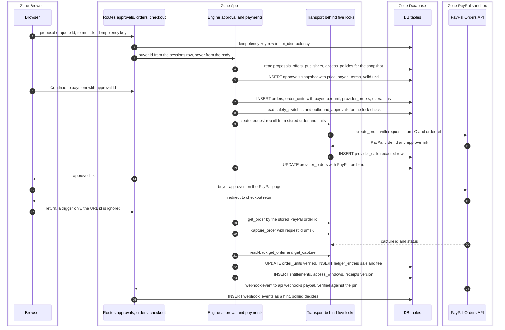

| Data item                | Created by                       | Stored where                                          | Read by                                    | Retention or delete rule                                                       | Sensitivity          | Where                              | State                            |
| ------------------------ | -------------------------------- | ----------------------------------------------------- | ------------------------------------------ | ------------------------------------------------------------------------------ | -------------------- | ---------------------------------- | -------------------------------- |
| Quote                    | `domain/offer-entry/src/start.ts` | `quotes`                                             | `domain/approval`                          | Ended on publisher suspend; kept otherwise                                     | buyer personal       | [App] [DB]                         | [BUILT] [DEPLOYED]               |
| Approval snapshot        | `domain/approval`                | `approvals` (no delete, guarded update)               | `domain/payments`, `domain/receipts`       | Never deleted; valid 15 minutes single, 60 minutes pack constant               | audit                | [App] [DB]                         | [BUILT] [SANDBOX RUN] [DEPLOYED] |
| Order ref and units      | `domain/payments/src/place.ts`   | `orders`, `order_units` (`payee_merchant_id` per unit) | payments, ledger, library, publisher-console | Design: to 15 Jan 2027 (PRIV-3), not automated                               | buyer personal       | [App] [DB]                         | [BUILT] [SANDBOX RUN] [DEPLOYED] |
| PayPal order id          | PayPal                           | `provider_orders`                                     | payments, reconcile                        | As orders; shown sanitised in evidence, never on buyer pages                   | audit                | [PayPal sandbox] [DB]              | [BUILT] [SANDBOX RUN] [DEPLOYED] |
| Operation and request id | `domain/payments`                | `operations` (keys `umsC-`, `umsK-`, D-014)           | payments, `packages/jobs`                  | As orders                                                                      | audit                | [App] [DB]                         | [BUILT] [SANDBOX RUN] [DEPLOYED] |
| Capture id and read-back | PayPal                           | `order_units`, `operations`                           | payments, receipts                         | As orders                                                                      | audit                | [PayPal sandbox] [App] [DB]        | [BUILT] [SANDBOX RUN] [DEPLOYED] |
| Provider call record     | `composition.server.ts`          | `provider_calls` (append only, redacted)              | receipts, `/ops`                           | Design: 90 days (legal privacy text), not automated                            | audit                | [App] [DB]                         | [BUILT] [SANDBOX RUN]            |
| Ledger rows              | `domain/ledger`                  | `ledger_entries` (append only)                        | publisher-console, `/ops` invariants       | Kept; never deleted, only pseudonymised around it                              | audit                | [DB]                               | [BUILT] [SANDBOX RUN] [DEPLOYED] |
| Receipt and fingerprint  | `domain/receipts`                | `receipts` (immutable versions)                       | buyer receipt page, library                | Kept as a financial record (legal privacy text)                                | audit                | [DB] [Browser]                     | [BUILT] [SANDBOX RUN] [DEPLOYED] |
| Webhook event            | PayPal                           | `webhook_events`                                      | `domain/payments/src/webhooks.ts`          | No rule stated                                                                 | audit                | [PayPal sandbox] [Cloud Run] [DB]  | [BUILT] [DEPLOYED]               |
| PayPal client secret     | Owner                            | D12 only                                              | `packages/config`, transport               | Rotated at the end of the credentialed phase (MVP-C closure)                   | secret never stored  | [Secret Manager]                   | [HUMAN ONLY]                     |
| Card data                | never                            | never held                                            | none                                       | Entered only on PayPal's pages                                                 | secret never stored  | [PayPal sandbox]                   | n/a                              |

### DF-3 Access and read

BP-3. Built. The library and item page are on the host (C-07); the reader is not.

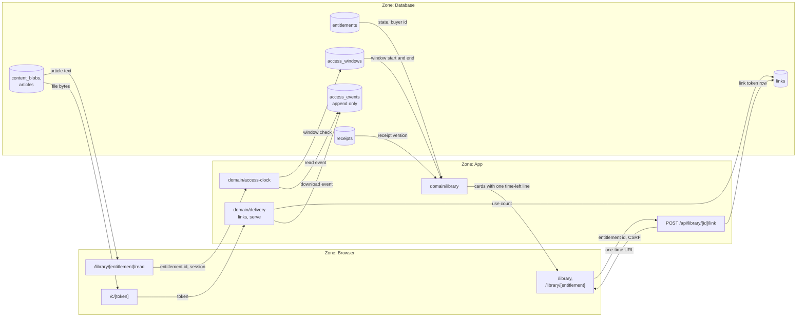

| Data item          | Created by                     | Stored where             | Read by                         | Retention or delete rule                                              | Sensitivity       | Where                | State                    |
| ------------------ | ------------------------------ | ------------------------ | ------------------------------- | --------------------------------------------------------------------- | ----------------- | -------------------- | ------------------------ |
| Entitlement        | `domain/entitlements`          | `entitlements`           | library, delivery, receipts     | State changes only (refunded, ended); kept                            | buyer personal    | [App] [DB]           | [BUILT] [DEPLOYED]       |
| Access window      | entitlements, access-clock     | `access_windows`         | library, reader, delivery       | Five days from verified payment and delivery possible (D-006)         | buyer personal    | [DB]                 | [BUILT] [DEPLOYED]       |
| Link token         | `domain/delivery/src/links.ts` | `links`                  | `/c/[token]`                    | Stops at a full refund or window end; no purge rule stated            | buyer personal    | [App] [DB] [Browser] | [BUILT]                  |
| Access event       | `domain/access-clock`          | `access_events` (append only) | access clock, receipts, recovery | Kept; design says IP in access logs (PRIV-1)                     | buyer personal    | [DB]                 | [BUILT]                  |
| Article text, file | Seed                           | `content_blobs`, `articles` | reader, delivery             | Frozen once an authorised offer uses it                               | publisher business | [DB] [Browser]      | [BUILT]                  |

### DF-4 Refunds and after the sale

BP-4.1, BP-4.2, BP-4.3. Refunds ran for real on the hosted app (C-06, C-07). The current hosted basis D-062 has no refund
operation, so a new basis row is needed before the next real refund.

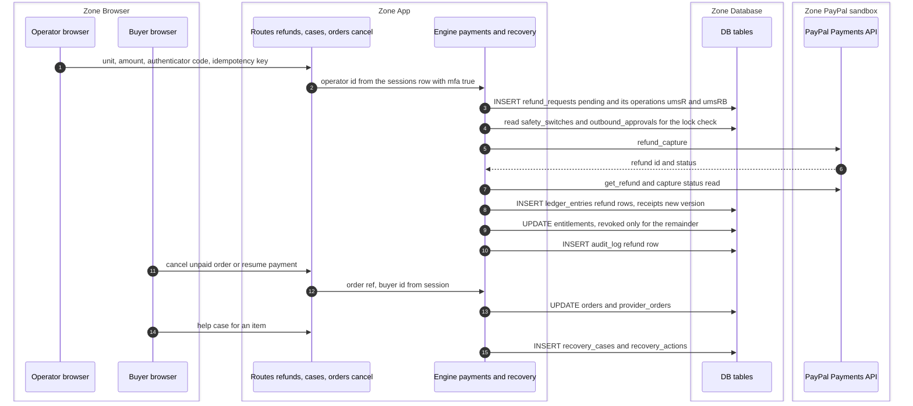

| Data item               | Created by                       | Stored where                                  | Read by                               | Retention or delete rule                                  | Sensitivity    | Where                              | State                            |
| ----------------------- | -------------------------------- | --------------------------------------------- | ------------------------------------- | --------------------------------------------------------- | -------------- | ---------------------------------- | -------------------------------- |
| Refund request          | `domain/payments/src/refunds.ts` | `refund_requests`, `operations`               | payments, publisher-console, recovery | Kept; `unresolved` keeps its reservation (D-019)          | audit          | [App] [DB]                         | [BUILT] [SANDBOX RUN] [DEPLOYED] |
| Refund id and status    | PayPal                           | `refund_requests`, `operations`               | payments                              | As orders                                                 | audit          | [PayPal sandbox] [DB]              | [BUILT] [SANDBOX RUN] [DEPLOYED] |
| Refund ledger rows      | `domain/ledger`                  | `ledger_entries` (append only)                | statement, invariants                 | Kept                                                      | audit          | [DB]                               | [BUILT] [SANDBOX RUN] [DEPLOYED] |
| Receipt new version     | `domain/receipts`                | `receipts`                                    | buyer receipt page                    | Kept                                                      | audit          | [DB]                               | [BUILT] [SANDBOX RUN] [DEPLOYED] |
| Authenticator code      | Operator's app                   | not stored; checked once                      | `packages/security/src/totp.ts`       | Not stored                                                | secret never stored | [Browser] [App]               | [BUILT] [DEPLOYED]               |
| Order cancel or resume  | `domain/payments`                | `orders`, `provider_orders`                   | order page, library                   | Kept                                                      | buyer personal | [App] [DB]                         | [BUILT]                          |
| Help case               | `domain/recovery/src/cases.ts`   | `recovery_cases`, `recovery_actions` (append only) | recovery, library, privacy export | No rule stated                                         | buyer personal | [App] [DB]                         | [BUILT]                          |
| Audit row               | `packages/obs` audit sink        | `audit_log` (append only)                     | `/ops`, privacy export                | Kept                                                      | audit          | [DB]                               | [BUILT] [DEPLOYED]               |

### DF-5 Publisher offers, sales and statement

BP-5.1, BP-5.2, BP-5.4, BP-5.5, BP-5.6, BP-5.7, BP-5.8, BP-5.9. Built, offline tested. Not on the hosted app.

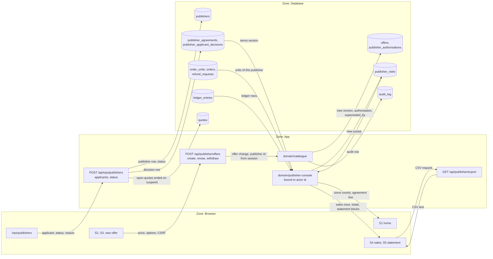

| Data item             | Created by                         | Stored where                                       | Read by                            | Retention or delete rule                                        | Sensitivity        | Where                | State       |
| --------------------- | ---------------------------------- | -------------------------------------------------- | ---------------------------------- | --------------------------------------------------------------- | ------------------ | -------------------- | ----------- |
| Offer version         | `domain/catalogue/src/write.ts`    | `offers`                                           | buyer offer page, approval         | Never edited in place; a change is a new version                | publisher business | [App] [DB]           | [BUILT]     |
| Authorisation row     | `write.ts`                         | `publisher_authorisations` (append only)           | approval, publisher-console        | Kept                                                            | audit              | [DB]                 | [BUILT]     |
| Publisher status      | `applicants.ts`, `status.ts`       | `publishers.status`                                | catalogue, approval                | Kept                                                            | publisher business | [DB]                 | [BUILT]     |
| Applicant decision    | `applicants.ts`                    | `publisher_applicant_decisions` (append only)      | catalogue                          | Kept; at most one per publisher                                 | audit              | [DB]                 | [BUILT]     |
| Visit cursor          | `visits.ts`                        | `publisher_visits` (one row per publisher)         | publisher-console                  | Overwritten on each visit                                       | publisher business | [DB]                 | [BUILT]     |
| Agreement record      | boot seed `agreements.ts`          | `publisher_agreements` (append only)               | S1, S7                             | Kept; method `seeded_demo`, no personal data                    | audit              | [DB]                 | [BUILT]     |
| Sales and statement   | `domain/publisher-console`         | not stored; read model                             | publisher browser                  | Not stored                                                      | publisher business | [App] [Browser]      | [BUILT]     |
| CSV download          | `/api/publisher/export`            | the publisher's browser only (D13)                 | publisher                          | Not kept by the app                                             | publisher business | [Browser]            | [BUILT]     |
| Publisher passcode hash | Owner                            | D12 only                                           | `packages/config`                  | Never in the database                                           | secret never stored | [Secret Manager]    | [HUMAN ONLY] |

### DF-6 Payee and payout account

BP-5.3, BP-8.4. Built for dry run only (verification is refused outside a dry run, assumption 3). Every sandbox sale reads
`owner_account` (D-041).

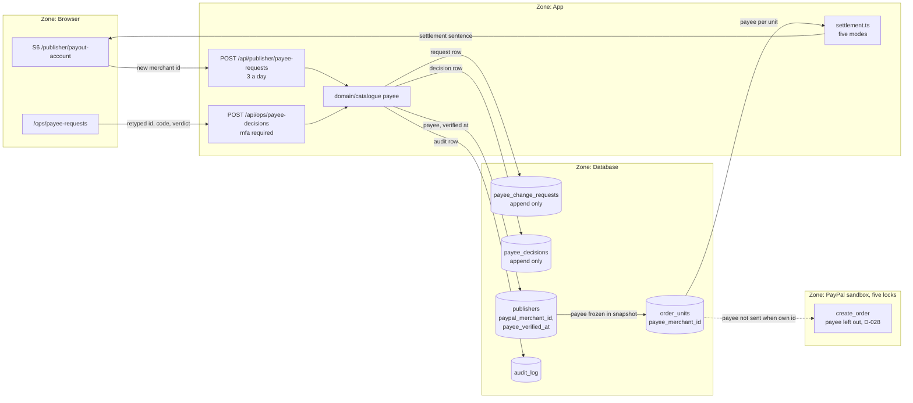

| Data item             | Created by                    | Stored where                                  | Read by                           | Retention or delete rule                    | Sensitivity        | Where                | State   |
| --------------------- | ----------------------------- | --------------------------------------------- | --------------------------------- | ------------------------------------------- | ------------------ | -------------------- | ------- |
| Payee change request  | `domain/catalogue/src/payee.ts` | `payee_change_requests` (append only)       | `/ops/payee-requests`, S6         | Kept                                        | publisher business | [App] [DB]           | [BUILT] |
| Payee decision        | `payee.ts`                    | `payee_decisions` (append only, one per request) | S6, S7                         | Kept                                        | audit              | [DB]                 | [BUILT] |
| Merchant id (last 4 shown) | publisher or seed        | `publishers.paypal_merchant_id`               | approval snapshot, S6, S7         | Kept; full id never on a buyer page (R-BUY-5) | publisher business | [DB]               | [BUILT] |
| Payee per unit        | `place.ts` from the snapshot  | `order_units.payee_merchant_id`               | settlement mode, statement        | As orders                                   | audit              | [DB]                 | [BUILT] [SANDBOX RUN] |
| Settlement sentence   | `settlement.ts`               | not stored                                    | S1, S5, S6, S7                    | Not stored                                  | public             | [App] [Browser]      | [BUILT] |

### DF-7 Operator safety actions

BP-6, BP-7.2, BP-8.1, BP-8.6. The terminal commands ran for real (MVP-B, MVP-C, MVP-D); the `/ops` view is on the host.

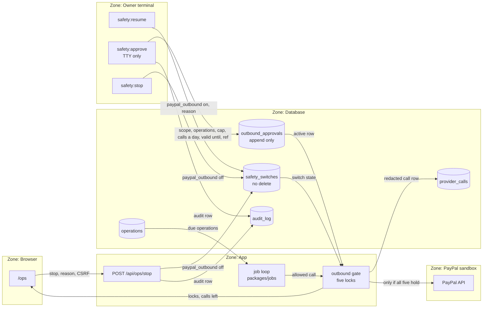

| Data item        | Created by                         | Stored where                            | Read by                       | Retention or delete rule                                        | Sensitivity        | Where                       | State                     |
| ---------------- | ---------------------------------- | --------------------------------------- | ----------------------------- | --------------------------------------------------------------- | ------------------ | --------------------------- | ------------------------- |
| Approval row     | `packages/safety/src/cli-approve.ts` | `outbound_approvals` (append only)    | the outbound gate, `/ops`     | Never deleted; expires at `valid_until`; rehearsal rows stay (DV-62) | audit           | [Owner terminal] [DB]       | [HUMAN ONLY] [SANDBOX RUN] |
| Switch state     | `switches.ts`, stop route          | `safety_switches`                       | gate, `/ops`                  | No delete; each change has an audit row                         | audit              | [DB]                        | [BUILT] [SANDBOX RUN]     |
| Call budget used | gate, `budget.ts`                  | `provider_calls`, `audit_log`           | `/ops` calls left             | As provider calls                                               | audit              | [DB]                        | [BUILT] [SANDBOX RUN]     |
| TOTP keys        | `totp:enrol`                       | D12 only (D-040)                        | `packages/security`           | Never in the cloud session or the database                      | secret never stored | [Secret Manager] [Laptop]  | [HUMAN ONLY]              |

### DF-8 Privacy export and delete

BP-4.4. Built (`scripts/privacy.mjs`, `scripts/lib/privacy.mjs`). Run only by a person at a terminal; refuses without a TTY, in
CI and in an AI session.

```mermaid
flowchart LR
  subgraph ZT["Zone: Owner terminal"]
    C1["pnpm privacy:export buyer_id"]
    C2["pnpm privacy:delete buyer_id<br/>--operator --reason"]
    F1["JSON document<br/>on the terminal"]
  end
  subgraph ZD["Zone: Database"]
    T1[("buyers, consents,<br/>identity_links")]
    T2[("briefs, proposals,<br/>quotes, approvals")]
    T3[("orders, units, refunds,<br/>entitlements, links,<br/>receipts, cases")]
    T4[("sessions,<br/>api_idempotency")]
    T5[("audit_log")]
    T6[("ledger_entries<br/>untouched")]
  end
  T1 -->|"buyer rows"| C1
  T2 -->|"buyer rows"| C1
  T3 -->|"rows by owned orders"| C1
  T4 -->|"buyer sessions"| C1
  T5 -->|"rows naming the buyer"| C1
  C1 -->|"one JSON document"| F1
  C2 -->|"pseudonym, deleted auth subject"| T1
  C2 -->|"raw_text removed, structured emptied"| T2
  C2 -->|"sessions revoked"| T4
  C2 -->|"privacy.delete row with counts"| T5
  T6 -.->|"kept: money evidence"| C2
```

| Data item          | Created by               | Stored where                         | Read by        | Retention or delete rule                                                    | Sensitivity    | Where                 | State                |
| ------------------ | ------------------------ | ------------------------------------ | -------------- | --------------------------------------------------------------------------- | -------------- | --------------------- | -------------------- |
| Export document    | `privacy:export`         | the terminal only (D13)              | the requester  | Not kept by the app                                                         | buyer personal | [Owner terminal]      | [BUILT] [HUMAN ONLY] |
| Pseudonym          | `privacy:delete`         | `buyers.display_name`, `auth_subject` | everyone after | Replaces the name; ledger, receipts and approvals keep their ids           | buyer personal | [Owner terminal] [DB] | [BUILT] [HUMAN ONLY] |
| Delete audit row   | `privacy:delete`         | `audit_log` (append only)            | `/ops`, export | Kept                                                                        | audit          | [DB]                  | [BUILT] [HUMAN ONLY] |

### DF-9 AI assistance

BP-9. The scripted model is built and is the default. The Claude adapter is built and off; no key is stored and no real AI call
has been made (R-AI-8).

```mermaid
flowchart LR
  subgraph ZA["Zone: App"]
    M1["model port"]
    M2["scripted model<br/>default"]
    M3["Claude adapter<br/>off"]
    M4["spend guard<br/>caps.ts"]
    M5["sanitiseModelOutput"]
    T1["model-https.ts<br/>one host, POST only"]
  end
  subgraph ZD["Zone: Database"]
    D1[("briefs<br/>served model")]
    D2[("audit_log<br/>model.spend")]
  end
  subgraph ZS["Zone: Secret store"]
    S1["UMS_ANTHROPIC_API_KEY<br/>not stored today"]
  end
  subgraph ZX["Zone: External, not called"]
    X1["Claude API"]
  end
  M1 -->|"need text"| M2
  M1 -.->|"need text, if claude and key"| M3
  M3 -.->|"day and total spend"| M4
  D2 -.->|"spent micro USD"| M4
  M4 -.->|"worst case charge"| D2
  S1 -.->|"key"| M3
  M3 -.->|"prompt without email, name or payer id"| T1
  T1 -.->|"64 KB cap, 20 s deadline"| X1
  M2 -->|"brief, reasons"| M5
  M5 -->|"clean brief"| D1
```

| Data item      | Created by          | Stored where                                     | Read by            | Retention or delete rule         | Sensitivity        | Where              | State                |
| -------------- | ------------------- | ------------------------------------------------ | ------------------ | -------------------------------- | ------------------ | ------------------ | -------------------- |
| Served model   | model port          | `briefs`                                         | evals, support     | As briefs                        | audit              | [DB]               | [BUILT]              |
| Spend row      | spend guard         | `audit_log` action `model.spend` (append only)   | spend guard        | Kept; no reader text in it (AI-H) | audit             | [DB]               | [BUILT]              |
| Anthropic key  | Owner               | D12 only; the deploy skips the adapter without it | adapter            | Not created                      | secret never stored | [Secret Manager]  | [HUMAN ONLY]         |
| Prompt         | Claude adapter      | not stored                                       | Claude API         | Not sent today                   | buyer personal     | [External]         | [BUILT] [HUMAN ONLY] |

### DF-10 Release and deploy

BP-7.1, BP-7.3, BP-7.4, BP-7.5. The kit is built; every run is human only. The last deploy is `gcp-mvpc-2`.

```mermaid
flowchart LR
  subgraph ZR["Zone: Repo"]
    G1["reviewed commit"]
    G2["tag, for example gcp-pub-1"]
  end
  subgraph ZT["Zone: Owner terminal, Cloud Shell"]
    C1["offline check list"]
    C2["gcloud sql backups list"]
    C3["set-secret.sh"]
    C4["deploy.sh"]
    C5["deploy-offline.sh<br/>not run"]
  end
  subgraph ZG["Zone: Google Cloud"]
    A1["Artifact Registry<br/>unitmarket"]
    S1["Secret Manager"]
    R1["Cloud Run<br/>unitmarket-sandbox"]
    R2["Cloud Run<br/>unitmarket-offline"]
    Q1[("Cloud SQL<br/>unitmarket-sbx-pg")]
    L1[("Cloud Logging")]
  end
  G1 -->|"source"| C1
  G1 --> G2
  G2 -->|"tag name"| C4
  C2 -->|"backup list"| Q1
  C3 -->|"secret versions"| S1
  C4 -->|"image tag and commit"| A1
  A1 -->|"image"| R1
  S1 -->|"mapped secrets, optional five only if enabled"| R1
  R1 -->|"connect off after deploy"| Q1
  R1 -->|"JSON log lines"| L1
  C5 -.->|"image, five offline secrets"| R2
```

| Data item         | Created by          | Stored where                  | Read by                   | Retention or delete rule                                              | Sensitivity         | Where                   | State                  |
| ----------------- | ------------------- | ----------------------------- | ------------------------- | --------------------------------------------------------------------- | ------------------- | ----------------------- | ---------------------- |
| Image             | `deploy.sh`         | Artifact Registry `unitmarket` | Cloud Run                | No rule stated                                                        | public              | [Artifact Registry]     | [DEPLOYED] [HUMAN ONLY] |
| Secret versions   | `set-secret.sh`     | Secret Manager                | Cloud Run at start        | Old versions disabled after rotation (D-061, D-063)                   | secret never stored | [Secret Manager]        | [HUMAN ONLY]           |
| Backups           | Cloud SQL           | Cloud SQL backups             | owner, restore drill      | Daily backups and point in time recovery (D-049); a clone was deleted after the drill (C-10) | buyer personal | [Cloud SQL]   | [DEPLOYED]             |
| App logs          | the app             | Cloud Logging                 | owner                     | Design: 30 days at the host (legal privacy text)                      | audit               | [Cloud Run]             | [DEPLOYED]             |
| Tags and evidence | owner, coordinator  | the repository                | everyone                  | Kept; ids sanitised                                                   | public              | [Repo]                  | [HUMAN ONLY]           |

## 5. Cross reference tables

Generated from the journey tables, the data flow headings and the CRUD matrix above by a throwaway script, then checked by a
second pass (section 5.4). A level 2 row of table A counts every step that names it or one of its level 3 children.

### 5.1 Table A: business process to journey steps

| BP id | Process | Journey steps that touch it |
| ----- | ------- | --------------------------- |
| BP-1 | Discover and decide (buyer) (category) | J1.3, J1.4, J1.5, J1.6, J1.7, J2.3, J2.4 |
| BP-1.1 | State a need: need text and price ceiling on `/discover` | J1.3 |
| BP-1.2 | Find and rank: fit cards with fit evidence | J1.4, J1.7 |
| BP-1.3 | No match | J1.5, J2.3 |
| BP-1.4 | Read the terms before the tick | J1.6, J2.4 |
| BP-2 | Approve and pay (buyer, system) (category) | J1.7, J1.8, J1.9, J1.10, J1.11, J1.12, J1.13, J2.3, J2.4, J2.5, J2.6, J2.8, J2.9, J4.9, J7.2, J7.4, J7.5 |
| BP-2.1 | Quote: price and terms for one offer option | J1.7, J2.3 |
| BP-2.2 | Approval snapshot: freeze price, payee and terms for the window | J1.7, J1.8, J1.9, J2.4 |
| BP-2.3 | Place the order: orders, units, one PayPal order per publisher, operations | J1.8, J2.5 |
| BP-2.4 | PayPal checkout: create the PayPal order and send the buyer to approve | J1.10, J1.11, J2.5, J7.2, J7.4, J7.5 |
| BP-2.5 | Capture after the buyer returns | J1.12, J2.6 |
| BP-2.6 | Read-back and apply: unit verified, ledger rows, entitlement, access window, receipt | J1.12, J1.13, J2.6, J2.8, J4.9 |
| BP-2.7 | Webhook intake: a verified PayPal event is a hint; polling reconciles | J2.9 |
| BP-3 | Access and read (buyer) (category) | J1.14, J1.15, J2.8, J3.1, J3.2, J3.3, J3.4, J3.5, J3.10, J7.6 |
| BP-3.1 | Entitlement and the five day window; refunded or ended states | J3.2, J3.10 |
| BP-3.2 | Library `/library`: one statement of time left, "Not paid yet", refunded states | J1.14, J2.8, J3.1 |
| BP-3.3 | Reader view `/library/[entitlement]/read` with the time-left meter | J3.3, J7.6 |
| BP-3.4 | Delivery link for download and keep: `/api/library/[id]/link`, then `/c/[token]` | J3.4 |
| BP-3.5 | Receipt `/receipts/[order]`: versions, titles and publisher, fingerprint | J1.15, J3.5 |
| BP-4 | After the sale (buyer, operator, owner) (category) | J2.7, J3.6, J3.7, J3.8, J3.9, J5.3, J5.4, J5.9 |
| BP-4.1 | Refunds, decided by an operator with an authenticator code | J3.8, J5.3, J5.4 |
| BP-4.2 | Cancel an unpaid order, or resume its payment | J2.7, J3.6 |
| BP-4.3 | Help cases `/help/[case]`: open a case for an item | J3.7 |
| BP-4.4 | Privacy requests: export and delete by an operator script | J3.9, J5.9 |
| BP-5 | Publisher lifecycle (publisher, operator) (category) | J2.1, J4.1, J4.2, J4.3, J4.4, J4.5, J4.6, J4.7, J4.8, J4.10, J4.11, J4.12, J4.13, J4.14, J5.6, J5.7 |
| BP-5.1 | Apply: an operator adds an applicant, then approves or rejects; no self sign up | J4.1 |
| BP-5.2 | Personas and sign in with the publisher passcode | J4.2 |
| BP-5.3 | Payout account and payee verification | J4.3, J4.4, J4.5, J4.11, J4.14, J5.7 |
| BP-5.4 | Offers | J2.1, J4.6, J4.7, J4.8 |
| BP-5.5 | Sales S4 `/publisher/sales`: rows, states, refunds view, totals, mismatch note (no filters) | J4.10 |
| BP-5.6 | Statement S5 `/publisher/statement` and CSV download | J4.11 |
| BP-5.7 | Since your last visit on S1 | J4.3 |
| BP-5.8 | Agreement record: seeded acceptance of the publisher terms, shown on S1 and S7 | J4.3 |
| BP-5.9 | Suspend and reactivate a publisher | J4.12, J5.6 |
| BP-5.10 | Add a new article (text or Markdown upload) | J4.13 |
| BP-6 | Operator and safety (operator) (category) | J4.1, J4.5, J4.12, J5.1, J5.2, J5.5, J5.6, J5.7, J5.8, J6.3, J6.5, J7.6 |
| BP-6.1 | Sign in with name, passcode and authenticator code | J5.1 |
| BP-6.2 | Kill switch: "Stop PayPal now" on `/ops`, or `pnpm safety:stop` | J5.5, J6.5 |
| BP-6.3 | Approvals and locks view on `/ops`: five locks, calls left today | J5.2, J6.3, J7.6 |
| BP-6.4 | Reconcile and invariants: job loop, INV1 to INV7, alerts | J5.2 |
| BP-6.5 | Evals page `/ops/evals`: case count and keyword baseline | J5.8 |
| BP-6.6 | Publishers page `/ops/publishers`: exposure, applicants, status, agreement flag | J4.1, J4.12, J5.6 |
| BP-6.7 | Payee requests page `/ops/payee-requests` | J4.5, J5.7 |
| BP-7 | Owner and release (owner) (category) | J6.1, J6.2, J6.3, J6.4, J6.5, J6.6, J6.7, J6.8, J6.9, J6.10, J6.11, J7.1, J7.2, J7.3, J7.4 |
| BP-7.1 | Secrets: `owner:secrets`, `totp:enrol`, `infra/gcp/set-secret.sh` into Secret Manager | J6.6 |
| BP-7.2 | Approval rows and sittings: basis row, `safety:approve`, `safety:resume`, test, `safety:stop` | J6.1, J6.2, J6.3, J6.4, J6.5 |
| BP-7.3 | Deploy: backup, tag, offline checks, `deploy.sh`, first checks | J6.7, J6.8, J7.4 |
| BP-7.4 | Backup and restore drill | J6.7 |
| BP-7.5 | Release: history scan, rotate secrets, go public, licence in About, tag `submission-1`, Devpost by 12 Nov 21:00 CET | J6.9 |
| BP-7.6 | Demo video under 3 minutes, under its own approval row | J6.10 |
| BP-7.7 | Judging: windows from 30 Nov, 7 Dec and 14 Dec, judge passcode, testing instructions, runnable until 15 Dec | J6.11, J7.1, J7.2, J7.3 |
| BP-8 | Platform and money controls (system) (category) | J1.1, J1.10, J1.12, J1.15, J2.2, J2.5, J2.6, J3.5, J4.2, J4.9, J4.11, J4.14, J5.1, J5.3, J6.2, J7.3, J7.5 |
| BP-8.1 | The five locks on every PayPal call, plus host constant and no-live-host checks | J1.10, J2.5, J5.3, J6.2, J7.5 |
| BP-8.2 | Ledger: append only rows, per publisher sums, INV7 | J1.12, J2.6 |
| BP-8.3 | Receipts: immutable versions with a fingerprint | J1.12, J1.15, J3.5 |
| BP-8.4 | Settlement modes `dryrun`, `owner_account`, `direct`, `not_set`, `mixed` from the payee stored on each unit | J4.9, J4.11, J4.14 |
| BP-8.5 | Sessions, sign in, CSRF, idempotency keys and rate limits | J1.1, J2.2, J4.2, J5.1, J7.3 |
| BP-8.6 | Redacted audit of every PayPal call (`provider_calls`) and the audit log | J1.10 |
| BP-9 | AI assistance (system) (category) | J1.3, J5.8, J7.2 |
| BP-9.1 | Scripted model, the default (`UMS_AI_ADAPTER=scripted`) | J1.3, J5.8, J7.2 |
| BP-9.2 | Claude adapter for brief parse and pack compose only; off; scripted fallback on any error | none: background, owner only or not built |
| BP-9.3 | Spend caps: USD 2 a day, USD 20 in total, worst case charged before each call | none: background, owner only or not built |
| BP-9.4 | Output scrub and served model recorded per brief; per IP discovery limit | none: background, owner only or not built |
| BP-10 | Entry paths (buyer) (category) | J1.2, J2.1, J7.6 |
| BP-10.1 | Agent-led: home page, then `/discover` | J1.2, J7.6 |
| BP-10.2 | Offer page `/o/[publisher]/[offer]`, from a link or from "Browse all" | J2.1 |
| BP-10.3 | WordPress plugin, feed import and signed offer links (branches `feat/wordpress-plugin`, `feat/feed-import`, `feat/offer-entry-signed-link`) | none: background, owner only or not built |
| BP-10.4 | Alternatives from the entry paths memo: demo publisher page signed per render, share panel, Open Graph tags | none: background, owner only or not built |

### 5.2 Table B: journey step to business processes

| Step | Journey | BP ids |
| ---- | ------- | ------ |
| J1.1 | J1 Buyer, agent-led path (discover, pack, two payments) | BP-8.5 |
| J1.2 | J1 Buyer, agent-led path (discover, pack, two payments) | BP-10.1 |
| J1.3 | J1 Buyer, agent-led path (discover, pack, two payments) | BP-1.1, BP-1.1.1, BP-9.1 |
| J1.4 | J1 Buyer, agent-led path (discover, pack, two payments) | BP-1.2, BP-1.2.1, BP-1.2.2 |
| J1.5 | J1 Buyer, agent-led path (discover, pack, two payments) | BP-1.3, BP-1.3.1, BP-1.3.2 |
| J1.6 | J1 Buyer, agent-led path (discover, pack, two payments) | BP-1.4 |
| J1.7 | J1 Buyer, agent-led path (discover, pack, two payments) | BP-1.2.2, BP-2.1, BP-2.2 |
| J1.8 | J1 Buyer, agent-led path (discover, pack, two payments) | BP-2.2.1, BP-2.3 |
| J1.9 | J1 Buyer, agent-led path (discover, pack, two payments) | BP-2.2.2 |
| J1.10 | J1 Buyer, agent-led path (discover, pack, two payments) | BP-2.4, BP-2.4.1, BP-8.1, BP-8.6 |
| J1.11 | J1 Buyer, agent-led path (discover, pack, two payments) | BP-2.4.2 |
| J1.12 | J1 Buyer, agent-led path (discover, pack, two payments) | BP-2.5, BP-2.6, BP-8.2, BP-8.3 |
| J1.13 | J1 Buyer, agent-led path (discover, pack, two payments) | BP-2.6 |
| J1.14 | J1 Buyer, agent-led path (discover, pack, two payments) | BP-3.2 |
| J1.15 | J1 Buyer, agent-led path (discover, pack, two payments) | BP-3.5, BP-8.3 |
| J2.1 | J2 Buyer, offer page path (one article) | BP-10.2, BP-5.4.4 |
| J2.2 | J2 Buyer, offer page path (one article) | BP-8.5 |
| J2.3 | J2 Buyer, offer page path (one article) | BP-2.1, BP-1.3.1 |
| J2.4 | J2 Buyer, offer page path (one article) | BP-1.4, BP-2.2 |
| J2.5 | J2 Buyer, offer page path (one article) | BP-2.3, BP-2.4, BP-8.1 |
| J2.6 | J2 Buyer, offer page path (one article) | BP-2.5, BP-2.6, BP-8.2 |
| J2.7 | J2 Buyer, offer page path (one article) | BP-4.2 |
| J2.8 | J2 Buyer, offer page path (one article) | BP-2.6, BP-3.2 |
| J2.9 | J2 Buyer, offer page path (one article) | BP-2.7 |
| J3.1 | J3 Buyer after payment (library, reader, download, receipt, cancel, help, refund) | BP-3.2 |
| J3.2 | J3 Buyer after payment (library, reader, download, receipt, cancel, help, refund) | BP-3.1 |
| J3.3 | J3 Buyer after payment (library, reader, download, receipt, cancel, help, refund) | BP-3.3 |
| J3.4 | J3 Buyer after payment (library, reader, download, receipt, cancel, help, refund) | BP-3.4 |
| J3.5 | J3 Buyer after payment (library, reader, download, receipt, cancel, help, refund) | BP-3.5, BP-8.3 |
| J3.6 | J3 Buyer after payment (library, reader, download, receipt, cancel, help, refund) | BP-4.2 |
| J3.7 | J3 Buyer after payment (library, reader, download, receipt, cancel, help, refund) | BP-4.3 |
| J3.8 | J3 Buyer after payment (library, reader, download, receipt, cancel, help, refund) | BP-4.1.1, BP-4.1.2 |
| J3.9 | J3 Buyer after payment (library, reader, download, receipt, cancel, help, refund) | BP-4.4 |
| J3.10 | J3 Buyer after payment (library, reader, download, receipt, cancel, help, refund) | BP-3.1 |
| J4.1 | J4 Publisher, from applying to the first sale and the statement | BP-5.1, BP-6.6 |
| J4.2 | J4 Publisher, from applying to the first sale and the statement | BP-5.2, BP-8.5 |
| J4.3 | J4 Publisher, from applying to the first sale and the statement | BP-5.7, BP-5.8, BP-5.3.3 |
| J4.4 | J4 Publisher, from applying to the first sale and the statement | BP-5.3, BP-5.3.1 |
| J4.5 | J4 Publisher, from applying to the first sale and the statement | BP-5.3.2, BP-6.7 |
| J4.6 | J4 Publisher, from applying to the first sale and the statement | BP-5.4, BP-5.4.1 |
| J4.7 | J4 Publisher, from applying to the first sale and the statement | BP-5.4.2, BP-5.4.4 |
| J4.8 | J4 Publisher, from applying to the first sale and the statement | BP-5.4.3 |
| J4.9 | J4 Publisher, from applying to the first sale and the statement | BP-2.6, BP-8.4 |
| J4.10 | J4 Publisher, from applying to the first sale and the statement | BP-5.5 |
| J4.11 | J4 Publisher, from applying to the first sale and the statement | BP-5.6, BP-5.3.3, BP-8.4 |
| J4.12 | J4 Publisher, from applying to the first sale and the statement | BP-5.9, BP-6.6 |
| J4.13 | J4 Publisher, from applying to the first sale and the statement | BP-5.10 |
| J4.14 | J4 Publisher, from applying to the first sale and the statement | BP-5.3, BP-8.4 |
| J5.1 | J5 Operator (daily check, refund, kill switch, suspend) | BP-6.1, BP-8.5 |
| J5.2 | J5 Operator (daily check, refund, kill switch, suspend) | BP-6.3, BP-6.4 |
| J5.3 | J5 Operator (daily check, refund, kill switch, suspend) | BP-4.1, BP-4.1.1, BP-4.1.2, BP-8.1 |
| J5.4 | J5 Operator (daily check, refund, kill switch, suspend) | BP-4.1.3 |
| J5.5 | J5 Operator (daily check, refund, kill switch, suspend) | BP-6.2 |
| J5.6 | J5 Operator (daily check, refund, kill switch, suspend) | BP-6.6, BP-5.9 |
| J5.7 | J5 Operator (daily check, refund, kill switch, suspend) | BP-6.7, BP-5.3.2 |
| J5.8 | J5 Operator (daily check, refund, kill switch, suspend) | BP-6.5, BP-9.1 |
| J5.9 | J5 Operator (daily check, refund, kill switch, suspend) | BP-4.4 |
| J6.1 | J6 Owner (approval and sitting, deploy, release) | BP-7.2 |
| J6.2 | J6 Owner (approval and sitting, deploy, release) | BP-7.2, BP-8.1 |
| J6.3 | J6 Owner (approval and sitting, deploy, release) | BP-7.2, BP-6.3 |
| J6.4 | J6 Owner (approval and sitting, deploy, release) | BP-7.2 |
| J6.5 | J6 Owner (approval and sitting, deploy, release) | BP-7.2, BP-6.2 |
| J6.6 | J6 Owner (approval and sitting, deploy, release) | BP-7.1 |
| J6.7 | J6 Owner (approval and sitting, deploy, release) | BP-7.3, BP-7.4 |
| J6.8 | J6 Owner (approval and sitting, deploy, release) | BP-7.3.1 |
| J6.9 | J6 Owner (approval and sitting, deploy, release) | BP-7.5 |
| J6.10 | J6 Owner (approval and sitting, deploy, release) | BP-7.6 |
| J6.11 | J6 Owner (approval and sitting, deploy, release) | BP-7.7 |
| J7.1 | J7 Judge (testing instructions, offline service, judge passcode) | BP-7.7 |
| J7.2 | J7 Judge (testing instructions, offline service, judge passcode) | BP-7.7, BP-2.4.1, BP-9.1 |
| J7.3 | J7 Judge (testing instructions, offline service, judge passcode) | BP-8.5, BP-7.7 |
| J7.4 | J7 Judge (testing instructions, offline service, judge passcode) | BP-7.3.1, BP-2.4.1 |
| J7.5 | J7 Judge (testing instructions, offline service, judge passcode) | BP-2.4, BP-8.1 |
| J7.6 | J7 Judge (testing instructions, offline service, judge passcode) | BP-6.3, BP-3.3, BP-10.1 |

### 5.3 Table C: data flows and data stores to business processes and journey steps

| Id | Name | BP ids (for a store: from the CRUD matrix) | Data stores (for a flow) or data flows (for a store) | Journey steps (for a store: through its data flows) |
| -- | ---- | ------ | -------------------- | ------------- |
| DF-1 | Discover and decide | BP-1, BP-9.1, BP-10.1 | D1, D2, D3, D5, D6 | J1.2, J1.3, J1.4, J1.5, J1.6, J1.7, J2.3, J2.4, J5.8, J7.2, J7.6 |
| DF-2 | Approve and pay | BP-2, BP-8.1, BP-8.2, BP-8.3, BP-8.5, BP-8.6 | D1, D2, D3, D4, D5, D6, D7, D9 | J1.1, J1.7, J1.8, J1.9, J1.10, J1.11, J1.12, J1.13, J1.15, J2.2, J2.3, J2.4, J2.5, J2.6, J2.8, J2.9, J3.5, J4.2, J4.9, J5.1, J5.3, J6.2, J7.2, J7.3, J7.4, J7.5 |
| DF-3 | Access and read | BP-3 | D3, D6, D7 | J1.14, J1.15, J2.8, J3.1, J3.2, J3.3, J3.4, J3.5, J3.10, J7.6 |
| DF-4 | Refunds and after the sale | BP-4.1, BP-4.2, BP-4.3 | D1, D5, D6, D7, D8, D9, D10 | J2.7, J3.6, J3.7, J3.8, J5.3, J5.4 |
| DF-5 | Publisher offers, sales and statement | BP-5.1, BP-5.2, BP-5.4, BP-5.5, BP-5.6, BP-5.7, BP-5.8, BP-5.9 | D3, D4, D5, D7, D10, D11 | J2.1, J4.1, J4.2, J4.3, J4.6, J4.7, J4.8, J4.10, J4.11, J4.12, J5.6 |
| DF-6 | Payee and payout account | BP-5.3, BP-8.4 | D3, D5, D10, D11 | J4.3, J4.4, J4.5, J4.9, J4.11, J4.14, J5.7 |
| DF-7 | Operator safety actions | BP-6, BP-7.2, BP-8.1, BP-8.6 | D5, D9, D10 | J1.10, J2.5, J4.1, J4.5, J4.12, J5.1, J5.2, J5.3, J5.5, J5.6, J5.7, J5.8, J6.1, J6.2, J6.3, J6.4, J6.5, J7.5, J7.6 |
| DF-8 | Privacy export and delete | BP-4.4 | D1, D2, D4, D5, D6, D7, D10, D13 | J3.9, J5.9 |
| DF-9 | AI assistance | BP-9 | D2, D10, D12 | J1.3, J5.8, J7.2 |
| DF-10 | Release and deploy | BP-7.1, BP-7.3, BP-7.4, BP-7.5 | D12, D13 | J6.6, J6.7, J6.8, J6.9, J7.4 |
| D1 | Sessions and limits | BP-1, BP-2, BP-3, BP-4, BP-5, BP-6, BP-8, BP-10 | DF-1, DF-2, DF-4, DF-8 | J1.1, J1.2, J1.3, J1.4, J1.5, J1.6, J1.7, J1.8, J1.9, J1.10, J1.11, J1.12, J1.13, J1.15, J2.2, J2.3, J2.4, J2.5, J2.6, J2.7, J2.8, J2.9, J3.5, J3.6, J3.7, J3.8, J3.9, J4.2, J4.9, J5.1, J5.3, J5.4, J5.8, J5.9, J6.2, J7.2, J7.3, J7.4, J7.5, J7.6 |
| D2 | Buyers and briefs | BP-1, BP-2, BP-4, BP-9 | DF-1, DF-2, DF-8, DF-9 | J1.1, J1.2, J1.3, J1.4, J1.5, J1.6, J1.7, J1.8, J1.9, J1.10, J1.11, J1.12, J1.13, J1.15, J2.2, J2.3, J2.4, J2.5, J2.6, J2.8, J2.9, J3.5, J3.9, J4.2, J4.9, J5.1, J5.3, J5.8, J5.9, J6.2, J7.2, J7.3, J7.4, J7.5, J7.6 |
| D3 | Catalogue | BP-1, BP-2, BP-3, BP-4, BP-5, BP-6, BP-8, BP-9, BP-10 | DF-1, DF-2, DF-3, DF-5, DF-6 | J1.1, J1.2, J1.3, J1.4, J1.5, J1.6, J1.7, J1.8, J1.9, J1.10, J1.11, J1.12, J1.13, J1.14, J1.15, J2.1, J2.2, J2.3, J2.4, J2.5, J2.6, J2.8, J2.9, J3.1, J3.2, J3.3, J3.4, J3.5, J3.10, J4.1, J4.2, J4.3, J4.4, J4.5, J4.6, J4.7, J4.8, J4.9, J4.10, J4.11, J4.12, J4.14, J5.1, J5.3, J5.6, J5.7, J5.8, J6.2, J7.2, J7.3, J7.4, J7.5, J7.6 |
| D4 | Quotes and approvals | BP-2, BP-4, BP-5, BP-6, BP-8 | DF-2, DF-5, DF-8 | J1.1, J1.7, J1.8, J1.9, J1.10, J1.11, J1.12, J1.13, J1.15, J2.1, J2.2, J2.3, J2.4, J2.5, J2.6, J2.8, J2.9, J3.5, J3.9, J4.1, J4.2, J4.3, J4.6, J4.7, J4.8, J4.9, J4.10, J4.11, J4.12, J5.1, J5.3, J5.6, J5.9, J6.2, J7.2, J7.3, J7.4, J7.5 |
| D5 | Orders and payment state | BP-1, BP-2, BP-3, BP-4, BP-5, BP-6, BP-8, BP-10 | DF-1, DF-2, DF-4, DF-5, DF-6, DF-7, DF-8 | J1.1, J1.2, J1.3, J1.4, J1.5, J1.6, J1.7, J1.8, J1.9, J1.10, J1.11, J1.12, J1.13, J1.15, J2.1, J2.2, J2.3, J2.4, J2.5, J2.6, J2.7, J2.8, J2.9, J3.5, J3.6, J3.7, J3.8, J3.9, J4.1, J4.2, J4.3, J4.4, J4.5, J4.6, J4.7, J4.8, J4.9, J4.10, J4.11, J4.12, J4.14, J5.1, J5.2, J5.3, J5.4, J5.5, J5.6, J5.7, J5.8, J5.9, J6.1, J6.2, J6.3, J6.4, J6.5, J7.2, J7.3, J7.4, J7.5, J7.6 |
| D6 | Access | BP-1, BP-2, BP-3, BP-4, BP-5, BP-6, BP-10 | DF-1, DF-2, DF-3, DF-4, DF-8 | J1.1, J1.2, J1.3, J1.4, J1.5, J1.6, J1.7, J1.8, J1.9, J1.10, J1.11, J1.12, J1.13, J1.14, J1.15, J2.2, J2.3, J2.4, J2.5, J2.6, J2.7, J2.8, J2.9, J3.1, J3.2, J3.3, J3.4, J3.5, J3.6, J3.7, J3.8, J3.9, J3.10, J4.2, J4.9, J5.1, J5.3, J5.4, J5.8, J5.9, J6.2, J7.2, J7.3, J7.4, J7.5, J7.6 |
| D7 | Money records | BP-2, BP-3, BP-4, BP-5, BP-6, BP-8 | DF-2, DF-3, DF-4, DF-5, DF-8 | J1.1, J1.7, J1.8, J1.9, J1.10, J1.11, J1.12, J1.13, J1.14, J1.15, J2.1, J2.2, J2.3, J2.4, J2.5, J2.6, J2.7, J2.8, J2.9, J3.1, J3.2, J3.3, J3.4, J3.5, J3.6, J3.7, J3.8, J3.9, J3.10, J4.1, J4.2, J4.3, J4.6, J4.7, J4.8, J4.9, J4.10, J4.11, J4.12, J5.1, J5.3, J5.4, J5.6, J5.9, J6.2, J7.2, J7.3, J7.4, J7.5, J7.6 |
| D8 | Recovery | BP-2, BP-4, BP-6 | DF-4 | J2.7, J3.6, J3.7, J3.8, J5.3, J5.4 |
| D9 | Safety | BP-2, BP-4, BP-6, BP-7, BP-8 | DF-2, DF-4, DF-7 | J1.1, J1.7, J1.8, J1.9, J1.10, J1.11, J1.12, J1.13, J1.15, J2.2, J2.3, J2.4, J2.5, J2.6, J2.7, J2.8, J2.9, J3.5, J3.6, J3.7, J3.8, J4.1, J4.2, J4.5, J4.9, J4.12, J5.1, J5.2, J5.3, J5.4, J5.5, J5.6, J5.7, J5.8, J6.1, J6.2, J6.3, J6.4, J6.5, J7.2, J7.3, J7.4, J7.5, J7.6 |
| D10 | Audit log | BP-2, BP-4, BP-5, BP-6, BP-7, BP-8, BP-9 | DF-4, DF-5, DF-6, DF-7, DF-8, DF-9 | J1.3, J1.10, J2.1, J2.5, J2.7, J3.6, J3.7, J3.8, J3.9, J4.1, J4.2, J4.3, J4.4, J4.5, J4.6, J4.7, J4.8, J4.9, J4.10, J4.11, J4.12, J4.14, J5.1, J5.2, J5.3, J5.4, J5.5, J5.6, J5.7, J5.8, J5.9, J6.1, J6.2, J6.3, J6.4, J6.5, J7.2, J7.5, J7.6 |
| D11 | Publisher side records | BP-5, BP-6 | DF-5, DF-6 | J2.1, J4.1, J4.2, J4.3, J4.4, J4.5, J4.6, J4.7, J4.8, J4.9, J4.10, J4.11, J4.12, J4.14, J5.6, J5.7 |
| D12 | Secret store | BP-2, BP-7, BP-8, BP-9 | DF-9, DF-10 | J1.3, J5.8, J6.6, J6.7, J6.8, J6.9, J7.2, J7.4 |
| D13 | Files, logs and backups | BP-2, BP-3, BP-5, BP-6, BP-7 | DF-8, DF-10 | J3.9, J5.9, J6.6, J6.7, J6.8, J6.9, J7.4 |

### 5.4 Agreement check

A throwaway Python script (not committed, run on 31 Oct 2026) parsed this file and checked:

1. Every BP id named in a journey table exists in section 2 (74 steps, 10 categories, 58 level 2, 21 level 3 processes).
2. Table B equals the BP ids of each journey table row.
3. For each step and each of its BP ids, the level 1 and level 2 rows of table A list that step; and every step a table A row
   lists names an id under that row in table B. 492 pairs checked.
4. Every level 2 process has a table A row; processes with no step are marked "none" (BP-9.2 to BP-9.4, BP-10.3, BP-10.4).
5. Table C: each data flow lists the steps of its BP ids; each data store lists the BP categories of its CRUD matrix row, the data
   flows whose diagrams name one of its tables, and the steps of those flows; a flow and a store name each other both ways.
6. Mermaid lint: subgraph and box blocks closed, every subgraph title and node label quoted, no parenthesis outside quotes, every
   edge label quoted, no `;` or `#` in sequence messages, journey tasks in `task: score: actor` form, at most 25 nodes per
   flowchart (the largest has 21).

Result: no mismatch. The diagrams were not rendered by a mermaid engine (none is installed here); the lint is a syntax check only.

## 6. Systems view

### 6.1 The three runtime modes and what is where

Allowed traffic only. The five locks are drawn on the one path to PayPal. The model API path is dashed because it is off.

```mermaid
flowchart TB
  BR["Browser<br/>buyer, publisher,<br/>operator, judge"]
  subgraph M1["Mode 1: Offline demo, any laptop"]
    A1["App, UMS_MODE offline"]
    DB1[("PGlite in memory")]
    DR["Dry run transport<br/>no network"]
  end
  subgraph M2["Mode 2: Owner laptop"]
    A2["App, UMS_MODE sandbox"]
    DB2[("PGlite on disk")]
  end
  subgraph M3["Mode 3: Google Cloud, unitmarket-sbx-vr1, europe-west3"]
    CR["Cloud Run<br/>unitmarket-sandbox"]
    SQL[("Cloud SQL<br/>unitmarket-sbx-pg")]
    SM["Secret Manager"]
    AR["Artifact Registry"]
    OFF["Cloud Run<br/>unitmarket-offline<br/>planned"]
  end
  subgraph LK["Five locks, all at call time"]
    L1["L1 UMS_MODE sandbox"]
    L2["L2 UMS_PAYPAL_CONNECT on"]
    L3["L3 active approval row"]
    L4["L4 paypal_outbound on"]
    L5["L5 credentials, no override"]
  end
  PP["PayPal sandbox<br/>test money"]
  OT["Owner terminal<br/>safety, secrets, privacy,<br/>deploy scripts"]
  AI["Claude API<br/>adapter off"]
  BR -->|"HTTPS"| A1
  BR -->|"localhost"| A2
  BR -->|"HTTPS run.app"| CR
  BR -.->|"HTTPS, if deployed"| OFF
  A1 --> DB1
  A1 --> DR
  A2 --> DB2
  CR --> SQL
  SM -->|"secrets at start"| CR
  AR -->|"image"| CR
  A2 --> L1
  CR --> L1
  L1 --> L2 --> L3 --> L4 --> L5 --> PP
  OT -->|"approval row, switch"| DB2
  OT -->|"Auth Proxy: approval row, switch"| SQL
  OT -->|"deploy, set-secret"| M3
  CR -.->|"off"| AI
```

Mode 1 never reaches PayPal: offline mode fails L1 and the dry run transport has no network. The offline judge service is Mode 1
on Google Cloud. A deploy to Mode 3 leaves L2 off (R-DEP-3). The owner terminal is the only place L3 and L4 can be opened.

### 6.2 Capability by place

"Today" is what is running or proven now. "After the human deploy" is what the next deploy of a reviewed `main` commit would add
(`docs/owner/DEPLOY-PREP-2026-11.md`). "Who" names the person for the step that is not automatic.

| Capability                                    | Where it runs today                                                     | Where it can run after the human deploy                        | Who does the step                                      |
| --------------------------------------------- | ----------------------------------------------------------------------- | --------------------------------------------------------------- | ------------------------------------------------------ |
| Single article purchase                       | Offline demo; laptop (MVP-B); Cloud Run at `gcp-mvpc-2` (MVP-C)         | Cloud Run, newer screens                                        | Owner opens an approval window for real payments       |
| Two publisher pack, two payments              | Offline demo; laptop (MVP-D, 29 Oct)                                    | Cloud Run                                                       | Owner deploys and opens a window                       |
| Refunds with an authenticator code            | Offline demo; Cloud Run (C-06, C-07)                                    | Cloud Run                                                       | Owner adds refund operations to a new basis row        |
| Webhook intake with the pinned certificate    | Cloud Run (C-01)                                                        | Cloud Run; pin expires 26 Jan 2027 (D-053)                      | None until the certificate rotates                     |
| Library one time-left line, receipt titles    | Offline demo only (`main`)                                              | Cloud Run                                                       | Owner deploys                                          |
| Reader view, cancel and resume, help without a dead button | Offline demo only                                          | Cloud Run                                                       | Owner deploys                                          |
| Publisher area S1 to S7                       | Offline demo only                                                       | Cloud Run, with migrations 0012 to 0015 (forward only)          | Owner deploys and stores the publisher passcode hash   |
| Payee verification                            | Offline demo only (refused outside a dry run)                           | Still dry run only                                              | Not planned for sandbox; set-payee is not merged       |
| Skins and motion                              | Offline demo only                                                       | Cloud Run                                                       | Owner deploys                                          |
| Judge passcode                                | Offline demo only                                                       | Cloud Run and the offline service                               | Owner chooses the value and stores the hash            |
| Offline judge service                         | Not running                                                             | Cloud Run `unitmarket-offline`                                  | Owner runs `deploy-offline.sh` and stores five secrets |
| Claude adapter                                | Nowhere (off, no key)                                                   | Cloud Run, only if a key is stored                              | Owner stores the key and switches it on                |
| Privacy export and delete                     | Owner terminal against any database                                     | Owner terminal through the Auth Proxy                           | Operator at a terminal                                 |
| Kill switch and approval rows                 | Owner terminal and `/ops` on every mode                                 | Same                                                            | Owner or operator                                      |
| Backups and restore                           | Cloud SQL daily backups; restore drill timed only (C-10)                | Same                                                            | Owner lists backups before every deploy                |
| WordPress and signed offer links              | Branches only                                                           | Not planned before the deadline                                 | Owner decides (on hold)                                |

## 7. Gaps and open points

### 7.1 Per process

| BP       | What is not built, human only or open                                                                                                                                       | Source                                     |
| -------- | --------------------------------------------------------------------------------------------------------------------------------------------------------------------------- | ------------------------------------------ |
| BP-1     | Fit card title is not a link; "Good fit" on every card; no real AI call ever made                                                                                          | UX review "also found"; R-AI-8             |
| BP-2.2   | An approval made before a suspend or withdraw can still be placed inside its window (KNOWN GAP test). Not checked here: whether the 60 minute pack window behaves the same | addendum section 10; R-PUB-5               |
| BP-2.2.1 | Approval page hierarchy and "Payment 1 of 2" labels (UX problem 9) not traced to a fix                                                                                     | UX review                                  |
| BP-2.4.2 | "Step 2 of 2" lacks context (UX problem 12); its real run is owner-reported, no screenshot                                                                                 | UX review; MVP-D sitting row 4.3           |
| BP-2.7   | `CHECKOUT.PAYMENT-APPROVAL.REVERSED` is not registered (7 of 8 events); the webhook lines of two refunds were not read                                                      | D-053; MVP-C open items                    |
| BP-3     | The newer library, receipt and reader screens are not on the hosted app                                                                                                    | R-DEP-5                                    |
| BP-4.1   | The current hosted basis D-062 has no refund operation. Refund of a direct Quayside sale is untested (P-4L4)                                                               | D-062; traceability P-4L4                  |
| BP-4.3   | The buyer is told a case outcome only on the order page; no email (P-H2 deferred)                                                                                         | UX review; traceability P-H2               |
| BP-4.4   | Retention periods (logs 30 days, briefs 30 days, provider calls 90 days) are design targets; deletion after them is not automated                                         | nfr PRIV-3; legal privacy text             |
| BP-5.3   | Direct payee for Quayside (R-PUB-3), approval scope naming one payee (R-PUB-4), second sandbox Business account (DV-29) are not built or human only                        | register 2.6                               |
| BP-5.4.1 | Rights edit with attestation and renegotiation floor missing                                                                                                               | traceability P-C4                          |
| BP-5.5   | Status and date filters missing on S4                                                                                                                                      | traceability P-E2                          |
| BP-5.2   | One publisher passcode hash serves all three publishers (accepted for the demo)                                                                                            | assumption 18                              |
| BP-5.10  | Add a new article: not built                                                                                                                                                | traceability P-D3                          |
| BP-6.4   | ASM-55 real-Postgres race tests are waived per sitting only; a decision is due before the app stays up for judging                                                         | D-045; register PG-2                       |
| BP-7.3   | No deploy since `gcp-mvpc-2`; `UMS_OWN_MERCHANT_ID` must be a stored secret before the next deploy; deploy prep names only migration 0012 of the new 0012 to 0015         | MVP-C open items; R-DEP-4                  |
| BP-7.4   | Restore drill compared no row counts or ledger sums and did not start the app on the copy; the uptime alert e-mail was not provoked                                       | MVP-C C-10, C-13                           |
| BP-7.5   | Rotation, full history scan before going public, licence in About, tag, submission: all human only and not done                                                            | DV-9, DV-12, DV-64                         |
| BP-7.7   | Path A fresh clone run not done; offline service not deployed; judge passcode value not chosen; the judge sandbox buyer not created                                       | testing instructions; R-JUD-2, R-OFF-3     |
| BP-8.1   | The locks do not check which payee a create body names; only data and process stop it                                                                                     | addendum section 11; MT-5                  |
| BP-9     | Model price constants come from a reference dated 6 Oct; the owner re-checks before switching on. Injection tests ran against a stand-in only                             | assumption 8; R-AI-9                       |
| BP-10.3  | WordPress, feed import and signed links on hold; the plugin's 60 minute link and iframe findings are open                                                                  | entry paths memo                           |

### 7.2 What a reader should not assume

- Do not assume the hosted app shows what `main` shows. It runs `gcp-mvpc-2` from 27 Oct: no publisher area, no skins, no reader,
  no cancel and resume, no judge passcode, the older library card and receipt.
- Do not assume a hosted purchase works at any time. Outside an approval window the hosted checkout is paused and nothing is
  charged (D-056). Only the offline demo completes a purchase at any time.
- Do not assume two publishers are paid separately. Both are paid into the owner's one sandbox Business account (D-041). "Two
  payments" means two PayPal orders, not two merchants.
- Do not assume any AI call is made. The scripted model answers every brief; the Claude adapter has never been called.
- Do not assume the legal pages are approved. All four are drafts for owner approval and are not legal advice (R-LEG-5).
- Do not assume a sandbox run proves PayPal compatibility. It proves the modelled and observed cases only.

### 7.3 Data flows this document could not verify in code

- `consents` and `identity_links` have no writer in product code; the grep found only the privacy export reading them. Whether a
  later lane is meant to write them is not known.
- `content_blobs`, `operations` and `provider_orders` have DELETE statements only in test helpers (`domain/library/src/world.ts`,
  `domain/recovery/src/world.ts`, `domain/payments/src/support.ts`). The only DELETE in product code is `abandonIdempotent` on
  `api_idempotency`. A purge of old rows is not built.
- The reader view writes an access event per its spec (`reader-a-view.md`, "same access evidence"); this document did not trace
  the exact call from `/library/[entitlement]/read` to `domain/access-clock`.
- The CRUD marks for D12 and D13 come from the deploy kit and owner documents, not from code, and the hosted state of Secret
  Manager, Cloud Logging and Artifact Registry was not looked at.
- The order in DF-2 is the order of the code comments in `domain/payments/src/checkout.ts`, `return.ts` and `apply.ts`; the job
  loop may run the read-back on a later pass rather than right after the capture.
- Whether the hosted single purchase of 27 to 28 Oct started on `/discover` or on an offer page is not in the evidence file.
